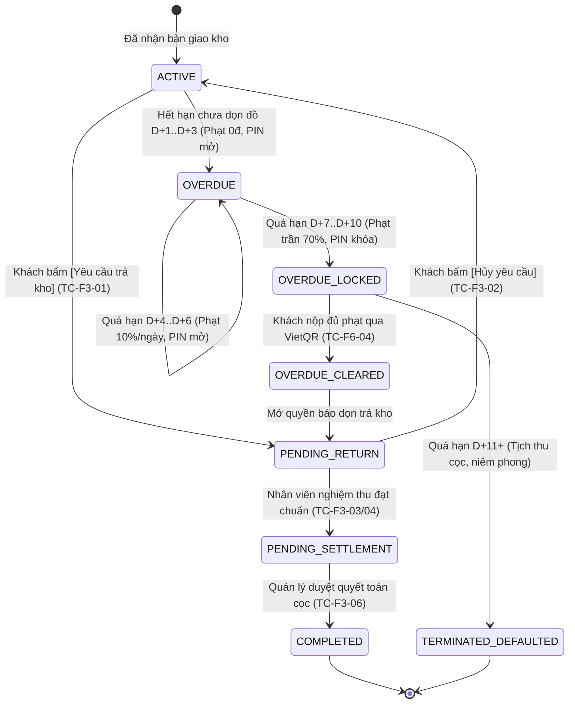

# 01. Ma trận Kiểm thử Tích hợp & E2E (E2E Test Matrix)

> **Người phụ trách (Assignee):** **Nguyễn Văn Gia Bình** (Technical Lead / WS2)  
> **Phân hệ chịu trách nhiệm:**  
> - **Flow 3:** Quản lý kho đang thuê, Trả sớm Win-Win & Quyết toán hoàn cọc (Rented Unit Management, Early Return & Settlement)  
> - **Sub-flow 6.2:** Hợp đồng Quá hạn & Vòng đời ô kho 3 Giai đoạn (Overdue Contract & Storage Unit Lifecycle D+1..D+10)  
> **Mục tiêu:** Đảm bảo 100% tính toàn vẹn của logic Dòng tiền (Financial Integrity) và Máy trạng thái (State Machine) trước khi bảo vệ đồ án.

---

## 1. 🗺️ Ma trận Truy vết Toàn diện (Traceability Matrix)

| Mã Kịch bản | Tên Nghiệp vụ Cốt lõi | Use Case liên quan | Business Rules đối soát | Endpoint REST API tương ứng | Trạng thái Hợp đồng & Ô kho | Mức ưu tiên |
| :---: | :--- | :---: | :---: | :--- | :--- | :---: |
| **`TC-F3-01`** | Khách chủ động đăng ký trả kho sớm (Win-Win Early Return) | `UC-F3-05` | `BR-RET-05` | `POST /api/v1/customer/contracts/{id}/return-request` | Contract: `ACTIVE` ➔ `PENDING_RETURN`<br>Unit: `OCCUPIED` | **P0 (Critical)** |
| **`TC-F3-02`** | Khách đổi ý hủy yêu cầu trả kho trước khi nghiệm thu | `UC-F3-05` | `BR-CAN-06` | `POST /api/v1/customer/contracts/{id}/cancel-return` | Contract: `PENDING_RETURN` ➔ `ACTIVE`<br>Unit: Giữ nguyên `OCCUPIED` | **P1 (High)** |
| **`TC-F3-03`** | Nhân viên cơ sở nghiệm thu hiện trường đạt chuẩn 4 tiêu chí | `UC-F3-06` | `BR-CHK-02`, `BR-RET-01` | `POST /api/v1/staff/inspections/return` | Contract: `PENDING_RETURN` ➔ `PENDING_SETTLEMENT`<br>Unit: `INSPECTION` | **P0 (Critical)** |
| **`TC-F3-04`** | Nghiệm thu phát hiện hư hại vách/mất chìa: Khấu trừ tiền cọc | `UC-F3-06` | `BR-RET-02` | `POST /api/v1/staff/inspections/return` | Ghi nhận `damage_fee`<br>Tự động trừ vào `deposit_amount` | **P0 (Critical)** |
| **`TC-F3-05`** | Bồi thường hư hại vượt quá tiền cọc: Sinh hóa đơn thu bổ sung | `UC-F3-13` | `BR-RET-03` | `POST /api/v1/staff/inspections/return` | Sinh `invoice` thu thêm phụ phí phát sinh | **P1 (High)** |
| **`TC-F3-06`** | Quản lý phê duyệt quyết toán, thu hồi PIN & mở kho sang dọn dẹp | `UC-F3-07`, `UC-F3-08` | `BR-RET-04`, `BR-RET-01` | `POST /api/v1/manager/contracts/{id}/settlement` | Contract: `COMPLETED`<br>Unit: `CLEANING` ➔ `AVAILABLE`<br>PIN: `REVOKED` | **P0 (Critical)** |
| **`TC-F6-01`** | Hết hạn thuê chưa dọn kho: Kích hoạt Giai đoạn Ân hạn D+1..D+3 | `UC-F6-05`, `UC-F6-08` | `BR-OVD-01` | `OverdueCronJob` (00:00:00 UTC+7) | Contract: `OVERDUE`<br>Phạt: **0 VND** · PIN: **Vẫn mở** | **P0 (Critical)** |
| **`TC-F6-02`** | Quá hạn D+4..D+6: Tính phạt trễ hạn 10%/ngày (tối đa 30% cọc) | `UC-F6-06` | `BR-OVD-02` | `OverdueCronJob` | Phạt: `10% * days * deposit`<br>PIN: **Vẫn mở** | **P0 (Critical)** |
| **`TC-F6-03`** | Quá hạn D+7..D+10: Khóa an ninh, vô hiệu hóa PIN, trần phạt 70% | `UC-F6-06`, `UC-F6-07` | `BR-OVD-03` | `OverdueCronJob` | Contract: `OVERDUE_LOCKED`<br>Phạt trần 70% · PIN: **KHÓA** | **P0 (Critical)** |
| **`TC-F6-04`** | Khách nộp đủ tiền phạt quá hạn: Mở khóa quyền trả kho / dọn kho | `UC-F6-08` | `BR-OVD-04` | `POST /api/v1/customer/contracts/{id}/pay-overdue-penalty` | Contract: `OVERDUE_CLEARED`<br>Mở lại quyền báo trả kho hoặc PIN | **P0 (Critical)** |
| **`TC-F6-05`** | Quá hạn > 10 ngày (D+11): Chấm dứt đơn phương, niêm phong tài sản | `UC-F6-09`, `UC-F6-11` | `BR-OVD-05` | `POST /api/v1/manager/contracts/{id}/terminate-defaulted` | Contract: `TERMINATED_DEFAULTED`<br>Tịch thu cọc · Chờ thanh lý | **P1 (High)** |

---

## 2. 🔄 Bản đồ Chuyển dịch Trạng thái Thực thể (Entity State Machine Transition)

### A. Vòng đời Trạng thái Hợp đồng (Rental Contract):


### B. Vòng đời Trạng thái Ô kho (Storage Unit):
```
[OCCUPIED] ──(Khách báo trả kho)──> [OCCUPIED (Pending Return)]
     │
     └──(Nghiệm thu hiện trường)──> [INSPECTION]
                                         │
                                         └──(Hoàn tất tất toán)──> [CLEANING (Đệm 15 ngày)]
                                                                        │
                                                                        └──(Bảo dưỡng xong)──> [AVAILABLE]
```

---

## 3. 🎯 Checklist Tiêu chí Hoàn thành (Definition of Done - DoD cá nhân)

- [x] **1. Unit / Integration Test Backend:** Passed 100%.
  - [x] `ContractReturnServiceTest`: Đã pass 100% test case tính cấn trừ tiền cọc và không hoàn tiền thuê còn lại.
  - [x] `OverdueCronJobTest`: Đã pass test quét giả lập các mốc D+1, D+4, D+7, D+11.
  - [x] `ContractSettlementApprovalTest`: Đã pass test quản lý duyệt tất toán.
- [x] **2. Frontend UI Verification:** Đã kiểm chứng tự động qua Playwright E2E Test Suite (`flow3-return-settlement.spec.ts`).
  - [x] Modal `ScheduleReturnModal` hiển thị rõ điều khoản Win-Win không hoàn tiền thuê còn lại.
  - [x] Nút `[Hủy yêu cầu trả kho]` hoạt động mượt mà, reload đúng dữ liệu.
  - [x] `ReturnInspectionPage` có form checklist 4 điểm và ô nhập chi phí thiệt hại.
  - [x] `OverdueAlertBanner` hiển thị đúng màu cảnh báo theo từng giai đoạn (Vàng D+1..D+3, Cam D+4..D+6, Đỏ D+7+).
- [x] **3. Bằng chứng Kiểm thử (Artifacts):** Có đầy đủ Playwright HTML Report, Trace Viewer và Video recording.
  - [x] Log chạy `mvn test` và Vitest (`npm test`) xanh 100% không có failure.
  - [x] Video recording WebM và trace zip các kịch bản demo Multi-Actor phục vụ thuyết trình.
