# ĐẶC TẢ KIẾN TRÚC HỆ THỐNG & NGHIỆP VỤ BẢO VỆ ĐỒ ÁN
## (System Architecture, Data Model & Business Rules Specification)

> **Dự án:** Hệ thống Quản lý và Cho thuê Kho Tự Quản (Self-Storage Facility Rental and Management System)  
> **Mã học phần:** SWP391 · Giai đoạn: Bảo vệ Đồ án (Protective Phase)  
> **Ngăn xếp công nghệ:** Spring Boot 3 (Java 17 LTS) · React 18 (TypeScript + Vite) · SQL Server 2022 · Flyway · Spring Security & JWT  
> **Tài liệu tham chiếu chuẩn:**
> - Nghiệp vụ & Yêu cầu: [`docs/TOPIC.md`](TOPIC.md) · [`docs/USER-STORIES-AND-USE-CASES.md`](USER-STORIES-AND-USE-CASES.md) · [`docs/BUSINESS-RULES.md`](BUSINESS-RULES.md)
> - Kiến trúc Kỹ thuật & Luồng đi: [`docs/WORKFLOWS.md`](WORKFLOWS.md) · [`docs/API-SPEC.md`](API-SPEC.md)
> - Từ điển dữ liệu & Cơ sở dữ liệu: [`docs/DATA-DICTIONARY.md`](DATA-DICTIONARY.md) · [`database/Storage_Self.sql`](../database/Storage_Self.sql)

---

## MỤC LỤC TỔNG THỂ

1. [Phần 1: Feature (Tính năng & Quy trình Nghiệp vụ)](#1-feature-tính-năng--quy-trình-nghiệp-vụ)
   - 1.1. [Sơ đồ Phân làn Hoạt động (Swimlane Activity Diagrams)](#11-sơ-đồ-phân-làn-hoạt-động-swimlane-activity-diagrams)
     - 1.1.0. Master End-to-End System Swimlane (Toàn cảnh vòng đời hệ thống)
     - 1.1.1. Flow 1: Đặt chỗ & Thanh toán giữ ô kho (Reservation & Deposit)
     - 1.1.2. Flow 2: Nhận kho & Bàn giao (Check-in & Handover)
     - 1.1.3. Flow 3: Trả kho, Nghiệm thu & Quyết toán cọc (Return & Settlement)
     - 1.1.4. Flow 4: Thiết lập Chính sách, Biểu giá & Báo cáo KPI (BOM Policy & Pricing)
     - 1.1.5. Flow 5: Quản lý Cơ sở, Ô kho & Phân công ca trực (Facility & Staff Operations)
     - 1.1.6. Flow 6: Vòng đời Hợp đồng — Gia hạn & Xử lý Quá hạn (Renewal & Overdue D+1..D+10)
     - 1.1.7. Flow 7: Hỗ trợ Kỹ thuật & Xử lý Sự cố (Support & Incident SLA)
   - 1.2. [Sơ đồ Vòng đời Trạng thái (State Chart Diagrams)](#12-sơ-đồ-vòng-đời-trạng-thái-state-chart-diagrams)
     - 1.2.1. State Chart: Hợp đồng Thuê kho (`RentalContract`)
     - 1.2.2. State Chart: Yêu cầu Đặt chỗ (`Reservation`)
     - 1.2.3. State Chart: Ô kho Vật lý (`StorageUnit`)
     - 1.2.4. State Chart: Phương tiện Truy cập / Mã PIN (`AccessCredential`)
     - 1.2.5. State Chart: Yêu cầu Hỗ trợ & Báo lỗi (`SupportRequest`)
2. [Phần 2: Data Model (Mô hình Dữ liệu)](#2-data-model-mô-hình-dữ-liệu)
   - 2.1. [Mô hình Quan niệm (Conceptual Data Model - CDM)](#21-mô-hình-quan-niệm-conceptual-data-model---cdm)
   - 2.2. [Mô hình Thực thể Liên kết (Entity Relationship Diagram - ERD)](#22-mô-hình-thực-thể-liên-kết-entity-relationship-diagram---erd)
     - 2.2.1. Phân hệ Cốt lõi: Quản lý Thuê kho & Danh mục Cơ sở (Core Rental & Facility Catalog)
     - 2.2.2. Phân hệ Tài chính: Thanh toán & Sổ cái (Payment & Financial Ledger)
     - 2.2.3. Phân hệ Quản trị: Người dùng, Chính sách & Vận hành (User, Governance & Support)
3. [Phần 3: Business Rules (Bảng Quy tắc Nghiệp vụ)](#3-business-rules-bảng-quy-tắc-nghiệp-vụ)
   - 3.1. [Bảng Ma trận Nghiệp vụ | Fuc | Rules |](#31-bảng-ma-trận-nghiệp-vụ--fuc--rules-)
   - 3.2. [Bảng Tham số Cấu hình Hệ thống (Parameter Snapshot)](#32-bảng-tham-số-cấu-hình-hệ-thống-parameter-snapshot)
   - 3.3. [Ví dụ Tính toán Tài chính & Phạt Quá hạn Thực tế](#33-ví-dụ-tính-toán-tài-chính--phạt-quá-hạn-thực-tế)

---

# 1. Feature (Tính năng & Quy trình Nghiệp vụ)

Hệ thống phục vụ 5 nhóm tác nhân chính (`Storage Customer`, `Facility Staff`, `Facility Manager`, `Business Operations Manager`, `System Administrator`) với 7 luồng nghiệp vụ end-to-end chặt chẽ.

```
┌───────────────────────────────────────────────────────────────────────────────────┐
│              SELF-STORAGE FACILITY RENTAL & MANAGEMENT ARCHITECTURE               │
├────────────────────┬─────────────────────────────┬────────────────────────────────┤
│  STORAGE CUSTOMER  │   FACILITY STAFF / MANAGER  │   BUSINESS OPERATIONS / ADMIN  │
│  - Tìm kiếm & Thuê │   - Bàn giao & Kích hoạt    │   - Ban hành biểu giá & policy │
│  - Thanh toán cọc  │   - Nghiệm thu hoàn cọc     │   - Báo cáo KPI & Doanh thu    │
│  - Quản lý mã PIN  │   - Xử lý sự cố & Quá hạn   │   - Phân quyền & Giám sát audit│
└────────────────────┴─────────────────────────────┴────────────────────────────────┘
```

---

## 1.1. Sơ đồ Phân làn Hoạt động (Swimlane Activity Diagrams)

### 1.1.0. Master End-to-End System Swimlane (Toàn cảnh vòng đời hệ thống)

Sơ đồ thể hiện chu trình khép kín từ lúc khách hàng tìm kiếm ô kho đến khi tất toán và hoàn tiền cọc:

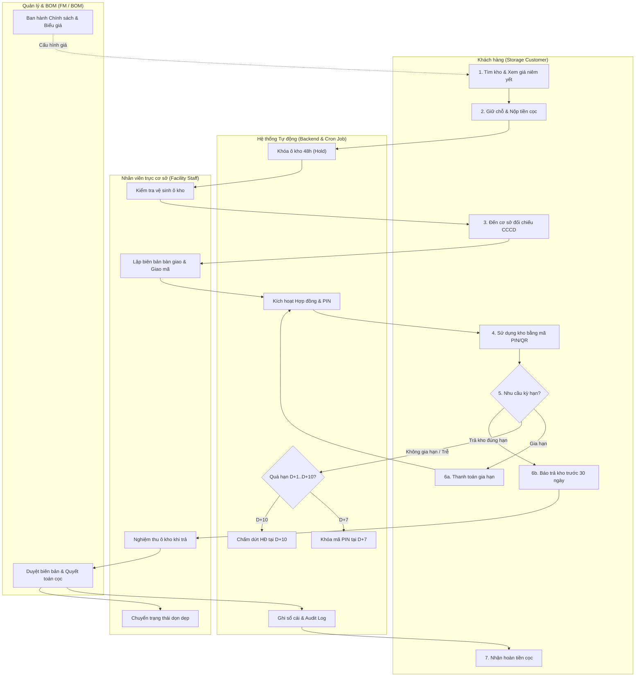

---

### 1.1.1. Flow 1: Đặt chỗ & Thanh toán giữ ô kho (Reservation & Deposit)

* **Tác nhân:** `Storage Customer` ↔ `Hệ thống Web/API` ↔ `Cổng thanh toán Sandbox/VNPAY` ↔ `Hệ thống Cron Job (Reservation Hold)`.
* **Phạm vi nghiệp vụ:** Tìm kiếm cơ sở, kiểm tra tình trạng trống theo thời gian thực (`BR-AVL-01`), tính tiền thuê theo đơn giá m² (`BR-PRI-01`), giữ chỗ tối đa 48 giờ (`BR-DEP-03`), nộp tiền cọc tương đương 1 tháng tiền thuê (`BR-DEP-01`), và xử lý hủy hoàn tiền trước 48 giờ (`BR-CAN-01`).

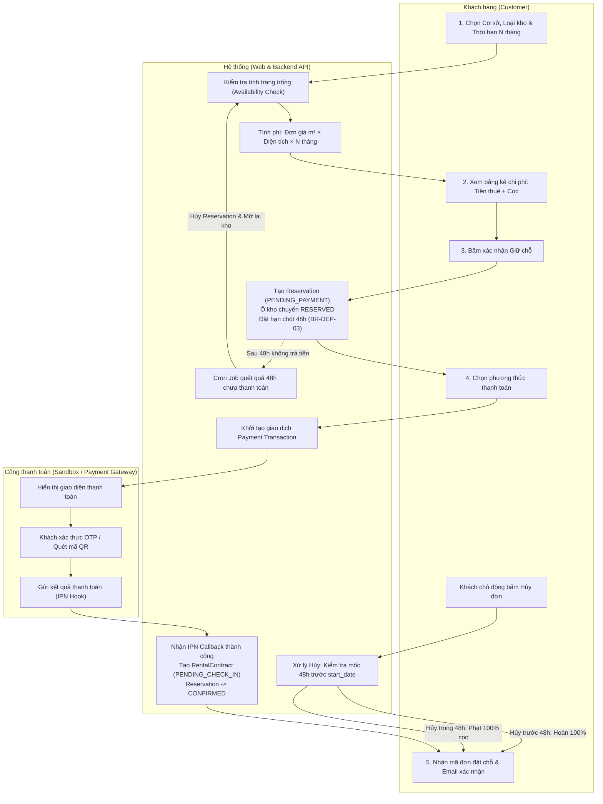

---

### 1.1.2. Flow 2: Nhận kho & Bàn giao (Check-in & Handover)

* **Tác nhân:** `Storage Customer` ↔ `Facility Staff` ↔ `Facility Manager`.
* **Phạm vi nghiệp vụ:** Khách hàng đến cơ sở trong khung thời hạn (cho phép trễ tối đa 10 ngày ân hạn `BR-CHK-05`), nhân viên đối chiếu giấy tờ tùy thân CCCD (`BR-CHK-01`), kiểm tra hiện trạng thiết bị ô kho (`BR-CHK-02`), ký biên bản bàn giao (`BR-CHK-03`), cấp mã PIN/QR điện tử (`BR-ACC-01`), và quy trình từ chối bàn giao hoàn tiền 100% nếu ô kho lỗi (`BR-CHK-06`).

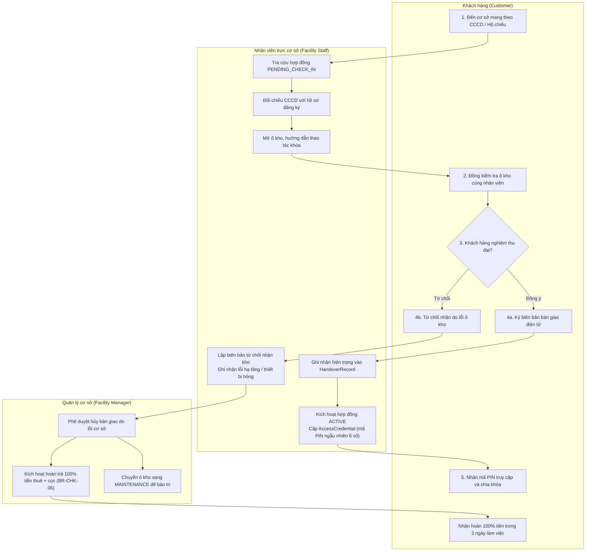

---

### 1.1.3. Flow 3: Trả kho, Nghiệm thu & Quyết toán cọc (Return & Settlement)

* **Tác nhân:** `Storage Customer` ↔ `Facility Staff` ↔ `Facility Manager`.
* **Phạm vi nghiệp vụ:** Khách hàng gửi thông báo trả kho trước tối thiểu 30 ngày (`BR-RET-01`), nếu trả trước hạn không được hoàn tiền thuê chưa sử dụng (`BR-RET-06`), nhân viên nghiệm thu hiện trạng sạch sẽ không hư hỏng (`BR-RET-03`), quản lý quyết toán cọc trừ nợ/thiệt hại (`BR-RET-04`), và hoàn tiền cọc trong vòng 7 ngày làm việc (`BR-RET-05`).

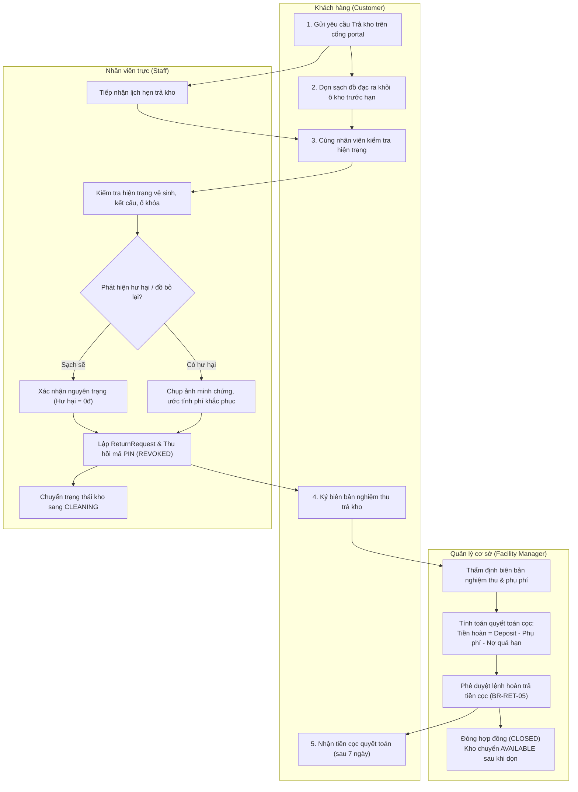

---

### 1.1.4. Flow 4: Thiết lập Chính sách, Biểu giá & Báo cáo KPI (BOM Policy & Pricing)

* **Tác nhân:** `Business Operations Manager (BOM)` ↔ `Hệ thống Core Backend`.
* **Phạm vi nghiệp vụ:** BOM là vai trò duy nhất có thẩm quyền thay đổi biểu giá và chính sách (`BR-GEN-01`), chính sách áp dụng theo cơ chế phiên bản snapshot không hồi tố (`BR-GEN-02`), thiết lập đơn giá m² theo từng cơ sở (`BR-GEN-05`), và trích xuất báo cáo doanh thu làm tròn đến 1.000 VNĐ (`BR-GEN-04`).

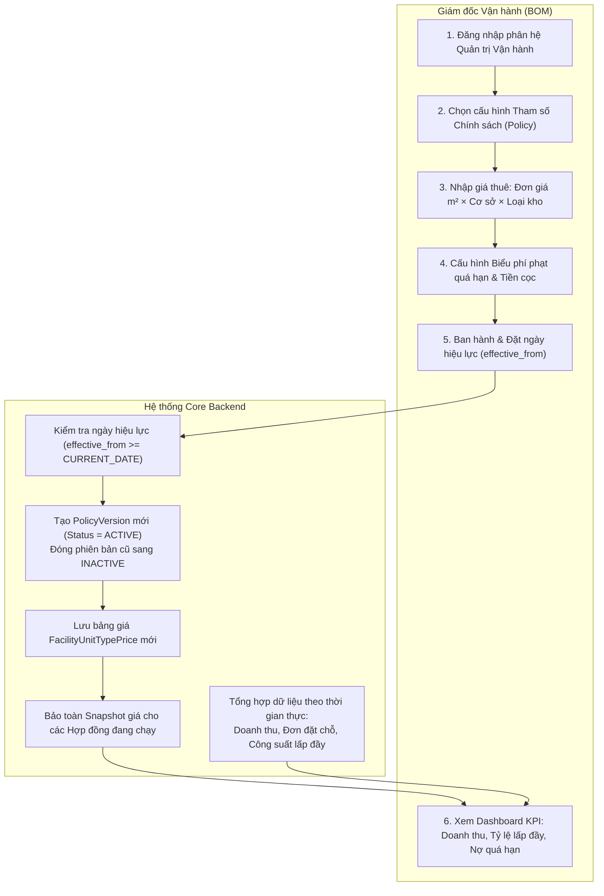

---

### 1.1.5. Flow 5: Quản lý Cơ sở, Ô kho & Phân công ca trực (Facility & Staff Operations)

* **Tác nhân:** `Business Operations Manager` ↔ `Facility Manager` ↔ `Facility Staff`.
* **Phạm vi nghiệp vụ:** BOM khởi tạo cơ sở với mã định danh chuẩn `FAC-XX` (`BR-GEN-07`), FM tạo sơ đồ ô kho và phân ca trực không chồng chéo, nhân viên nhận ca và thực hiện kiểm kê hiện trạng theo checklist.

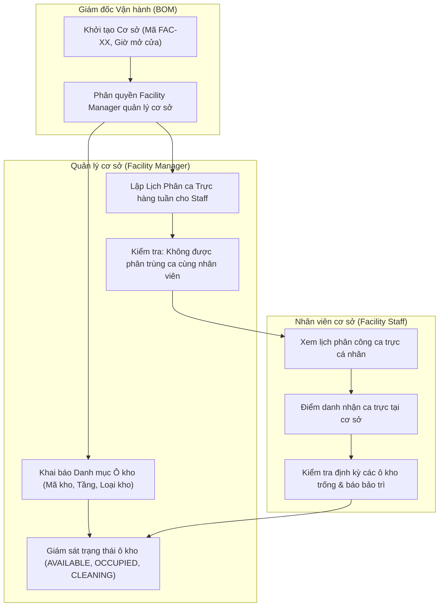

---

### 1.1.6. Flow 6: Vòng đời Hợp đồng — Gia hạn & Xử lý Quá hạn (Renewal & Overdue D+1..D+10)

* **Tác nhân:** `Storage Customer` ↔ `Tác vụ ngầm (Overdue Cron Job)` ↔ `Facility Staff`.
* **Phạm vi nghiệp vụ:** Hệ thống gửi thông báo nhắc gia hạn trước 60 ngày (`BR-REN-01`), khách hàng được gia hạn tối thiểu 1 tháng (`BR-REN-03`) và tối đa 12 tháng (`BR-REN-07`). Nếu không gia hạn và không trả kho:
  - **D+1 đến D+3:** Thời gian ân hạn, phí phạt 0 VNĐ (`BR-OVD-02`).
  - **D+4 đến D+10:** Tính phạt 10% tiền cọc mỗi ngày (`BR-OVD-03`), trần phạt tối đa 70% tiền cọc (`BR-OVD-04`).
  - **D+7:** Tự động khóa mã truy cập Access PIN (`BR-OVD-05`).
  - **D+10:** Đơn phương chấm dứt hợp đồng, tịch thu cọc, niêm phong đồ chuyển về kho thanh lý (`BR-OVD-07`).

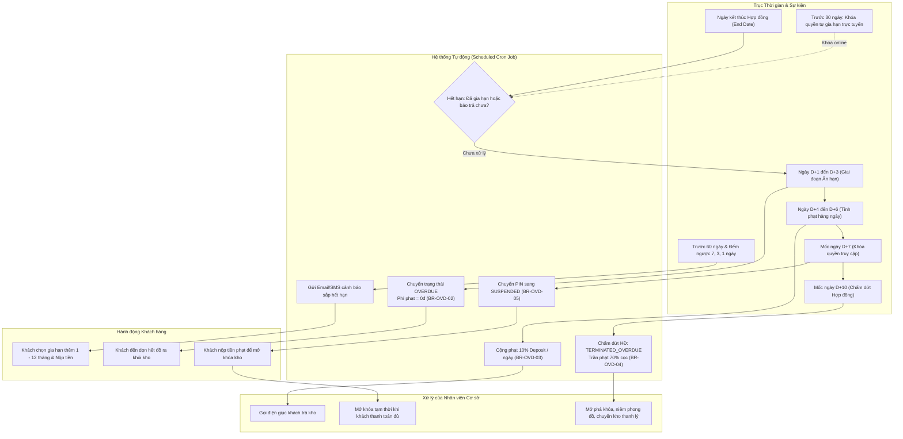

---

### 1.1.7. Flow 7: Hỗ trợ Kỹ thuật & Xử lý Sự cố (Support & Incident SLA)

* **Tác nhân:** `Storage Customer` ↔ `Facility Staff` ↔ `Facility Manager`.
* **Phạm vi nghiệp vụ:** Tiếp nhận khiếu nại/sự cố hạ tầng (`BR-SUP-01`), xử lý trong ca trực (`BR-SUP-02`), cấp lại mã PIN miễn phí nếu do lỗi phần cứng cơ sở (`BR-ACC-04`), quy trình đổi kho khẩn cấp nếu sự cố nghiêm trọng (ẩm mốc, cháy chập, dột nước) (`BR-SUP-05`).

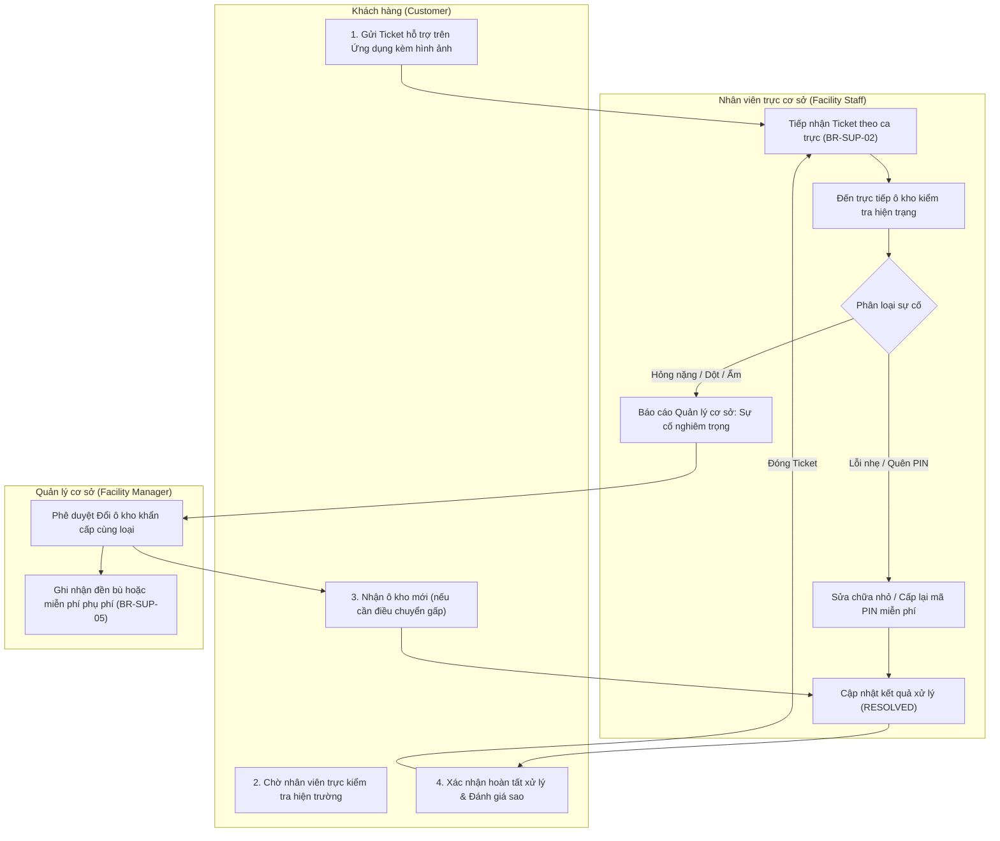

---

## 1.2. Sơ đồ Vòng đời Trạng thái (State Chart Diagrams)

### 1.2.1. State Chart: Hợp đồng Thuê kho (`RentalContract`)

Thực thể trung tâm điều khiển toàn bộ tiến trình pháp lý và tài chính giữa Khách thuê và Hệ thống:

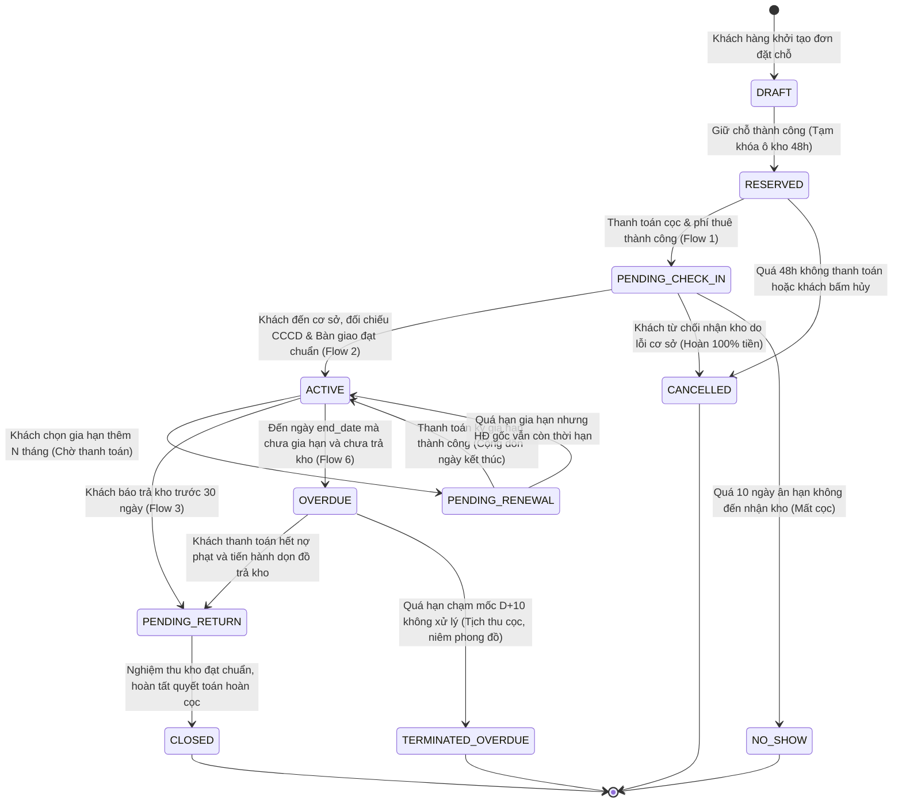

---

### 1.2.2. State Chart: Yêu cầu Đặt chỗ (`Reservation`)

Quản lý tiến trình đăng ký ban đầu trước khi chính thức chuyển giao thành Hợp đồng:

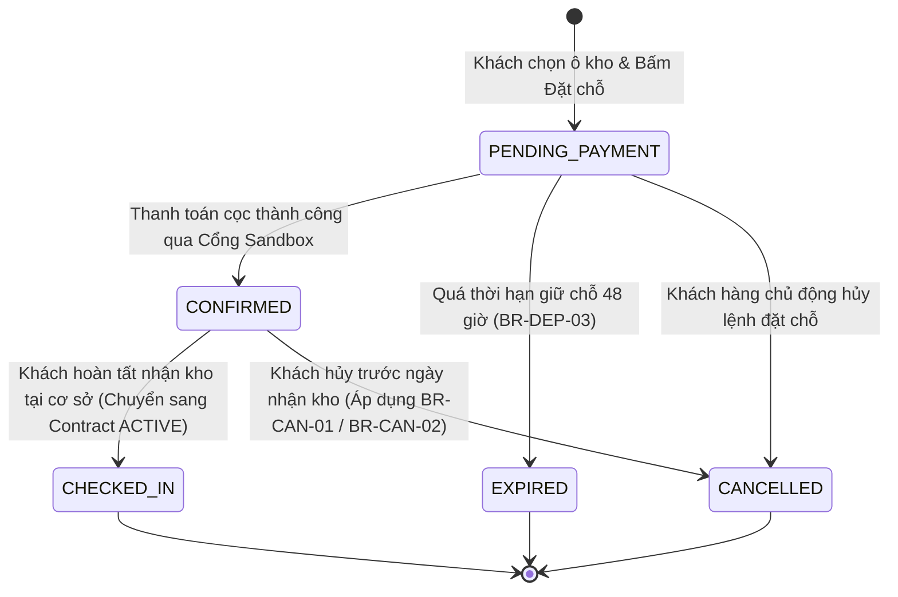

---

### 1.2.3. State Chart: Ô kho Vật lý (`StorageUnit`)

Kiểm soát chặt chẽ trạng thái vật lý để chống đặt trùng lặp (Double Booking):

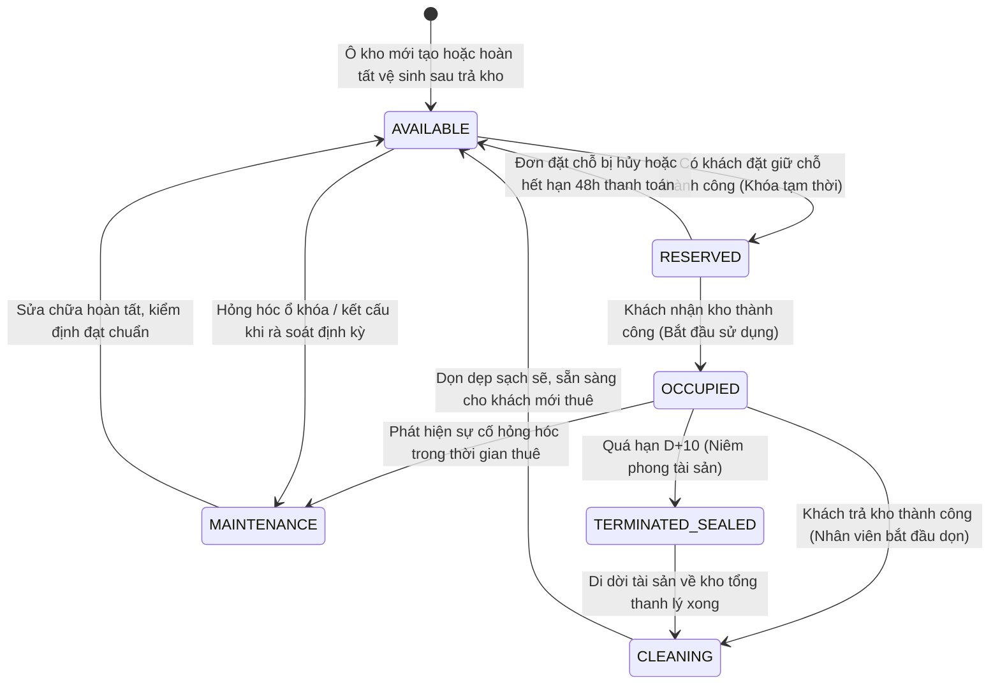

---

### 1.2.4. State Chart: Phương tiện Truy cập / Mã PIN (`AccessCredential`)

Quản lý chu kỳ hoạt động của mã PIN điện tử 6 số và thẻ từ mở cửa ô kho:

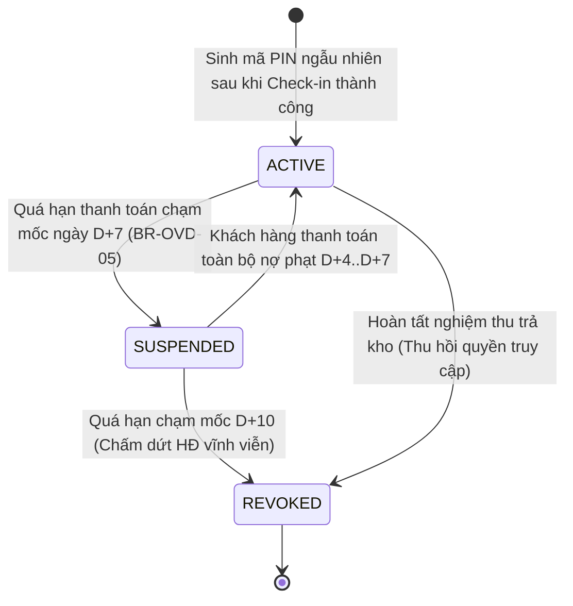

---

### 1.2.5. State Chart: Yêu cầu Hỗ trợ & Báo lỗi (`SupportRequest`)

Quản lý quy trình giải quyết sự cố kỹ thuật và khiếu nại của khách hàng:

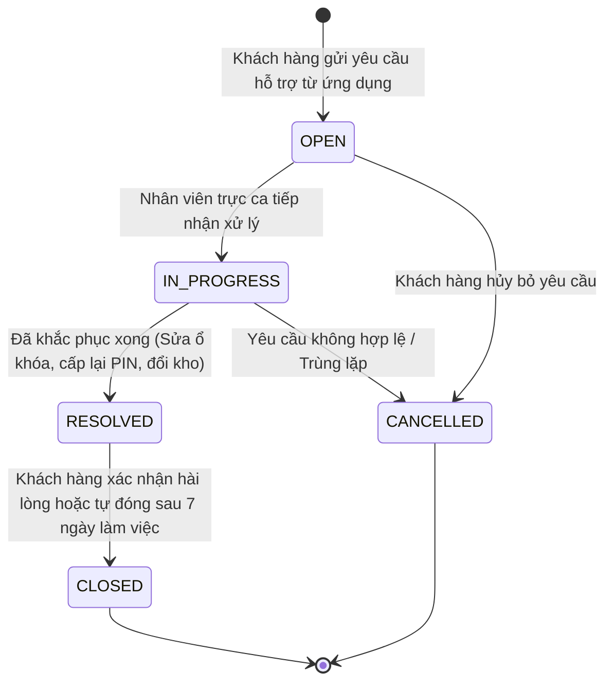

---

# 2. Data Model (Mô hình Dữ liệu)

## 2.1. Mô hình Quan niệm (Conceptual Data Model - CDM)

Mô hình dữ liệu quan niệm bao quát **24 thực thể nghiệp vụ** được phân bố đồng đều trên **6 phân hệ cốt lõi**, tuân thủ nguyên tắc chuẩn hóa dữ liệu 3NF và ký hiệu bản số Crow's Foot:

```mermaid
classDiagram
    direction TB

    %% 1. User & Security
    class app_user {
        <<User & Security>>
    }
    class user_facility_assignment {
        <<User & Security>>
    }
    class login_history {
        <<User & Security>>
    }
    class audit_log {
        <<User & Security>>
    }

    %% 2. Facility & Unit Catalog
    class facility {
        <<Facility & Catalog>>
    }
    class unit_type {
        <<Facility & Catalog>>
    }
    class facility_unit_type_price {
        <<Facility & Catalog>>
    }
    class storage_unit {
        <<Facility & Catalog>>
    }

    %% 3. Policy & Pricing
    class policy_version {
        <<Policy & Pricing>>
    }
    class extra_fee_type {
        <<Policy & Pricing>>
    }
    class discount_program {
        <<Policy & Pricing>>
    }

    %% 4. Reservation & Rental Contract
    class reservation {
        <<Core Rental>>
    }
    class rental_contract {
        <<Core Rental>>
    }
    class handover_record {
        <<Contract Execution>>
    }
    class access_credential {
        <<Contract Execution>>
    }
    class contract_renewal {
        <<Contract Execution>>
    }
    class return_request {
        <<Contract Execution>>
    }

    %% 5. Payment & Financial Ledger
    class payment_transaction {
        <<Financial Ledger>>
    }
    class ledger_entry {
        <<Financial Ledger>>
    }
    class contract_extra_charge {
        <<Financial Ledger>>
    }
    class overdue_fee_adjustment_request {
        <<Financial Ledger>>
    }

    %% 6. Operations & Support
    class support_request {
        <<Operations & Support>>
    }
    class staff_daily_assignment {
        <<Operations & Support>>
    }
    class attachment {
        <<Operations & Support>>
    }

    %% Quan hệ giữa các thực thể (Crow's Foot Cardinality)
    app_user "1" -- "0..*" login_history : ghi log
    app_user "1" -- "0..*" audit_log : thực hiện
    app_user "1" -- "0..*" user_facility_assignment : phân công
    facility "1" -- "0..*" user_facility_assignment : quản lý
    app_user "1" -- "0..*" attachment : tải lên

    facility "1" -- "1..*" storage_unit : bao gồm
    unit_type "1" -- "1..*" storage_unit : phân loại
    facility "1" -- "1..*" facility_unit_type_price : áp dụng
    unit_type "1" -- "1..*" facility_unit_type_price : định giá

    app_user "1" -- "0..*" reservation : đặt chỗ
    facility "1" -- "0..*" reservation : tại cơ sở
    unit_type "1" -- "0..*" reservation : loại kho
    storage_unit "0..1" -- "0..*" reservation : gán trước
    policy_version "1" -- "0..*" reservation : áp dụng

    reservation "1" -- "0..1" rental_contract : chuyển đổi thành
    app_user "1" -- "0..*" rental_contract : đứng tên
    storage_unit "1" -- "0..*" rental_contract : thuê cố định

    rental_contract "1" -- "0..1" handover_record : biên bản bàn giao
    rental_contract "1" -- "1..*" access_credential : cấp mã PIN
    rental_contract "1" -- "0..*" contract_renewal : lịch sử gia hạn
    rental_contract "1" -- "0..*" return_request : biên bản trả kho
    app_user "1" -- "0..*" handover_record : nhân viên bàn giao
    app_user "1" -- "0..*" return_request : nhân viên nghiệm thu

    reservation "0..1" -- "0..*" payment_transaction : thanh toán cọc
    rental_contract "0..1" -- "0..*" payment_transaction : thanh toán kỳ mới
    payment_transaction "1" -- "0..*" ledger_entry : ghi sổ cái
    rental_contract "1" -- "0..*" contract_extra_charge : tính phụ phí
    extra_fee_type "1" -- "0..*" contract_extra_charge : định loại phí
    rental_contract "1" -- "0..*" overdue_fee_adjustment_request : đề xuất giảm phạt

    app_user "1" -- "0..*" support_request : gửi yêu cầu
    rental_contract "0..1" -- "0..*" support_request : liên quan HĐ
    app_user "1" -- "0..*" staff_daily_assignment : trực ca
    facility "1" -- "0..*" staff_daily_assignment : tại cơ sở
```

---

## 2.2. Mô hình Thực thể Liên kết (Entity Relationship Diagram - ERD)

Để bảo đảm tính rõ ràng, tránh chồng chéo thuộc tính và tối ưu hóa cho công tác bảo vệ đồ án, phần ERD được chia thành 3 sơ đồ chi tiết theo các cụm phân hệ chức năng logic.

### 2.2.1. Phân hệ Cốt lõi: Quản lý Thuê kho & Danh mục Cơ sở (Core Rental & Facility Catalog)

Bao gồm các bảng lưu trữ thông tin cơ sở, ô kho, tiến trình đặt chỗ, hợp đồng và các biên bản thực thi:

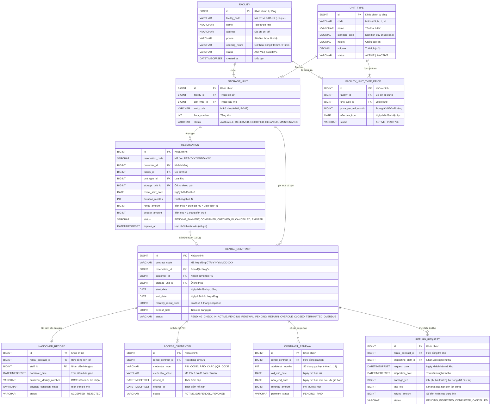

---

### 2.2.2. Phân hệ Tài chính: Thanh toán & Sổ cái (Payment & Financial Ledger)

Kiểm soát dòng tiền, tiền cọc, phụ phí và hạch toán kế toán không thất thoát:

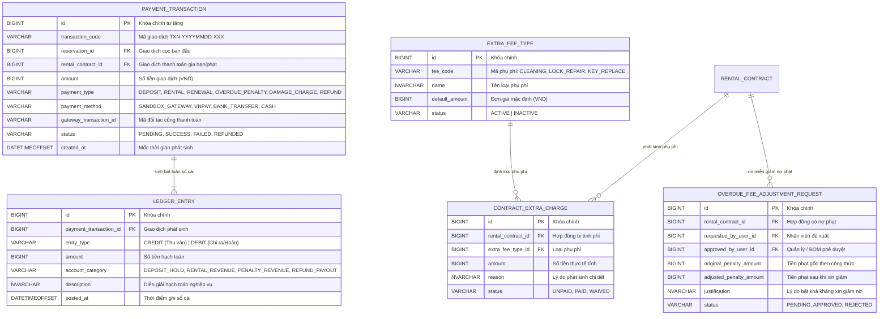

---

### 2.2.3. Phân hệ Quản trị: Người dùng, Chính sách & Vận hành (User, Governance & Support)

Bảo đảm an ninh, phân quyền đa cơ sở, kiểm toán vết hành vi và hỗ trợ khách hàng:

```mermaid
erDiagram
    APP_USER ||--o{ USER_FACILITY_ASSIGNMENT : "được phân công quản lý"
    APP_USER ||--o{ LOGIN_HISTORY : "lưu lịch sử đăng nhập"
    APP_USER ||--o{ AUDIT_LOG : "lưu vết thao tác"
    APP_USER ||--o{ SUPPORT_REQUEST : "gửi ticket hỗ trợ"
    APP_USER ||--o{ STAFF_DAILY_ASSIGNMENT : "được phân ca trực"

    APP_USER {
        BIGINT id PK "Khóa chính"
        VARCHAR email "Email đăng nhập (Unique)"
        VARCHAR password_hash "Mật khẩu BCrypt băm an toàn"
        NVARCHAR full_name "Họ và tên người dùng"
        VARCHAR phone "Số điện thoại di động"
        VARCHAR identity_number "Số CCCD / Hộ chiếu"
        VARCHAR role "STORAGE_CUSTOMER, FACILITY_STAFF, FACILITY_MANAGER, BUSINESS_OPERATIONS_MANAGER, SYSTEM_ADMINISTRATOR"
        VARCHAR status "ACTIVE | INACTIVE"
    }

    USER_FACILITY_ASSIGNMENT {
        BIGINT id PK "Khóa chính"
        BIGINT user_id FK "Nhân viên / Quản lý"
        BIGINT facility_id FK "Cơ sở được giao phụ trách"
        DATETIMEOFFSET created_at "Mốc phân công"
    }

    POLICY_VERSION {
        BIGINT id PK "Khóa chính"
        VARCHAR version_tag "Mã phiên bản (v1.0, v1.1)"
        NVARCHAR policy_data_json "Toàn văn JSON các tham số hệ thống"
        DATE effective_from "Ngày bắt đầu áp dụng"
        BIGINT created_by_user_id FK "BOM ban hành"
        VARCHAR status "ACTIVE | INACTIVE"
    }

    DISCOUNT_PROGRAM {
        BIGINT id PK "Khóa chính"
        VARCHAR code "Mã khuyến mại SALE10, SUMMER"
        DECIMAL discount_rate "Tỷ lệ giảm giá (%)"
        DATE valid_from "Ngày bắt đầu"
        DATE valid_to "Ngày kết thúc"
        VARCHAR status "ACTIVE | INACTIVE"
    }

    SUPPORT_REQUEST {
        BIGINT id PK "Khóa chính"
        BIGINT customer_id FK "Khách hàng gửi ticket"
        BIGINT rental_contract_id FK "Hợp đồng liên quan (nếu có)"
        BIGINT assigned_staff_id FK "Nhân viên tiếp nhận xử lý"
        VARCHAR category "ACCESS_ISSUE, DAMAGE_REPORT, BILLING, OTHER"
        NVARCHAR subject "Tiêu đề yêu cầu"
        NVARCHAR description "Mô tả chi tiết sự cố"
        VARCHAR status "OPEN, IN_PROGRESS, RESOLVED, CLOSED, CANCELLED"
        DATETIMEOFFSET created_at "Mốc tạo ticket"
    }

    STAFF_DAILY_ASSIGNMENT {
        BIGINT id PK "Khóa chính"
        BIGINT staff_id FK "Nhân viên trực"
        BIGINT facility_id FK "Tại cơ sở"
        DATE work_date "Ngày làm việc"
        VARCHAR shift_type "MORNING, AFTERNOON, NIGHT, FULL_DAY"
        VARCHAR status "SCHEDULED, ATTENDED, ABSENT"
    }

    ATTACHMENT {
        BIGINT id PK "Khóa chính"
        BIGINT uploader_user_id FK "Người tải lên"
        VARCHAR file_url "Đường dẫn lưu trữ ảnh/biên bản"
        VARCHAR file_type "IMAGE_PNG, PDF_CONTRACT"
        BIGINT file_size "Dung lượng tệp (bytes)"
    }
```

---

# 3. Business Rules (Bảng Quy tắc Nghiệp vụ)

## 3.1. Bảng Ma trận Nghiệp vụ | Fuc | Rules |

Bảng sau ánh xạ chi tiết từng **Function / Action** trong **7 Luồng nghiệp vụ** với các quy tắc nghiệp vụ (`BR-*`), công thức tính toán và ràng buộc kỹ thuật tương ứng:

| Fuc (Chức năng / Luồng / Use Case) | Rules (Quy tắc Nghiệp vụ & Ràng buộc Hệ thống) |
| :--- | :--- |
| **FLOW 1: ĐẶT CHỖ & THANH TOÁN (RESERVATION & DEPOSIT)** | |
| **Fuc 1.1: Tìm kiếm & Kiểm tra Khả dụng Ô kho**<br>· Actor: `Customer`<br>· Use Case: `UC-F1-01` .. `UC-F1-04`<br>· Code: `SC-01` | **`BR-AVL-01`**: Một ô kho chỉ khả dụng (`AVAILABLE`) khi không có bất kỳ đơn đặt chỗ nào đang giữ (`RESERVED`) hoặc hợp đồng nào đang hiệu lực (`ACTIVE`, `PENDING_CHECK_IN`, `OVERDUE`) trùng khung ngày thuê.<br>**`BR-AVL-02`**: Sau khi một hợp đồng hết hạn hoặc bị hủy, hệ thống kích hoạt tự động khoảng đệm an toàn `rental.buffer_days = 15 ngày` để làm vệ sinh, kiểm tra kỹ thuật trước khi mở cho lượt thuê kế tiếp.<br>**`BR-RES-01`**: Khách hàng chọn cơ sở, loại kho và thời hạn thuê tính theo tháng nguyên ($N \ge 1$).<br>**`BR-RES-02`**: Ngày bắt đầu thuê (`rental_start_date`) phải lớn hơn hoặc bằng ngày hiện tại (`CURRENT_DATE`) và không vượt quá 30 ngày trong tương lai. |
| **Fuc 1.2: Tính toán Giá thuê & Tiền cọc Deposit**<br>· Actor: `Customer`<br>· Use Case: `UC-F1-05`<br>· Code: `SC-01` | **`BR-GEN-03`**: Chu kỳ thuê tính theo tháng nguyên. Khách hàng bắt buộc **thanh toán trước toàn bộ** tiền thuê $N$ tháng cùng tiền cọc một lần duy nhất lúc đặt chỗ.<br>**`BR-GEN-04`**: Đơn vị tiền tệ chuẩn là **VND**. Mọi dòng chi phí (line item) được làm tròn lên đến **1.000 đ** sau khi áp dụng công thức; tổng thanh toán là tổng các line item đã làm tròn.<br>**`BR-GEN-05`**: Đơn giá thuê 1 tháng tính theo công thức snapshot:<br>$$\text{Giá thuê 1 tháng} = \text{Đơn giá m² (Facility } \times \text{ Unit Type)} \times \text{Diện tích quy chuẩn (m²)}$$<br>**`BR-PRI-01`**: Tổng phí thuê ban đầu: $\text{Rental Amount} = \text{Giá thuê 1 tháng} \times N$.<br>**`BR-DEP-01`**: Tiền cọc Deposit bắt buộc bằng đúng 1 tháng tiền thuê chuẩn: $\text{Deposit} = \text{Giá thuê 1 tháng} \times \text{deposit.multiplier (1.0)}$. |
| **Fuc 1.3: Khởi tạo Giữ chỗ & Khóa tạm thời 48h**<br>· Actor: `Customer`<br>· Use Case: `UC-F1-06`<br>· Code: `SC-01` | **`BR-DEP-03`**: Sau khi bấm giữ chỗ, hệ thống tạo Reservation ở trạng thái `PENDING_PAYMENT` và khóa ô kho sang `RESERVED` trong tối đa `reservation.hold_hours = 48 giờ`.<br>**`BR-RES-03`**: Nếu quá 48 giờ mà khách hàng chưa hoàn tất thanh toán, hệ thống tự động hủy đơn (`EXPIRED`), giải phóng ô kho về trạng thái `AVAILABLE`. |
| **Fuc 1.4: Xử lý Thanh toán qua Cổng Sandbox**<br>· Actor: `Customer`<br>· Use Case: `UC-F1-07`, `UC-F1-08`<br>· Code: `SC-01` | **`BR-PAY-01`**: Tổng tiền thanh toán ngay = $\text{Rental Amount} + \text{Deposit Amount}$.<br>**`BR-PAY-02`**: Giao dịch chỉ hợp lệ khi Cổng thanh toán phản hồi mã kết quả thành công qua IPN Webhook an toàn.<br>**`BR-PAY-03`**: Khi thanh toán thành công, hệ thống ghi nhận `PaymentTransaction`, sinh đồng thời bút toán `LedgerEntry`, chuyển `Reservation` sang `CONFIRMED` và tạo `RentalContract` ở trạng thái `PENDING_CHECK_IN`. |
| **Fuc 1.5: Hủy Đặt chỗ & Xử lý Hoàn tiền cọc**<br>· Actor: `Customer`<br>· Use Case: `UC-F1-10`, `UC-F1-12`<br>· Code: `SC-01` | **`BR-CAN-01`**: Khách hủy trước ngày nhận kho $\ge 48$ giờ (`cancel.full_refund_hours = 48h`): **Hoàn trả 100%** tiền thuê và **100%** tiền cọc Deposit.<br>**`BR-CAN-02`**: Khách hủy trong vòng 48 giờ trước ngày bắt đầu: **Phạt 100% tiền cọc Deposit** (`cancel.late_refund_rate = 0%`); hoàn lại 100% tiền thuê đã trả trước.<br>**`BR-CAN-04`**: Trường hợp khách không đến nhận kho (No-show) quá thời hạn ân hạn 10 ngày (`checkin.grace_days = 10 ngày`): Mất 100% tiền cọc, tiền thuê được hoàn lại sau khi trừ đi chi phí giữ kho 10 ngày tính theo ngày quy ước 30 ngày (`BR-PRI-03`):<br>$$\text{Tiền hoàn No-show} = \text{Tiền thuê đã trả} - \left(\frac{\text{Giá thuê 1 tháng}}{30} \times 10\right)$$ |
| **FLOW 2: NHẬN KHO & BÀN GIAO (CHECK-IN & HANDOVER)** | |
| **Fuc 2.1: Đối chiếu Danh tính & Nhận kho**<br>· Actor: `Staff`, `Customer`<br>· Use Case: `UC-F2-01` .. `UC-F2-03`<br>· Code: `FS-01`, `SC-02` | **`BR-CHK-01`**: Khách hàng bắt buộc xuất trình bản gốc CCCD / Hộ chiếu trùng khớp 100% với số giấy tờ đăng ký trên đơn đặt chỗ.<br>**`BR-CHK-02`**: Nhân viên trực dẫn khách đến tận ô kho, kiểm tra khóa điện tử, đèn chiếu sáng, độ sạch sẽ của ô kho trước sự chứng kiến của khách.<br>**`BR-CHK-05`**: Khách hàng được phép đến nhận kho trễ tối đa `checkin.grace_days = 10 ngày` kể từ ngày `rental_start_date`. Trong 10 ngày này, hợp đồng vẫn tính tiền bình thường theo mốc đã ký. |
| **Fuc 2.2: Ký Biên bản & Cấp Mã PIN Truy cập**<br>· Actor: `Staff`, `Customer`<br>· Use Case: `UC-F2-04`, `UC-F2-06`<br>· Code: `FS-01` | **`BR-CHK-03`**: Biên bản bàn giao (`HandoverRecord`) phải được cả nhân viên và khách xác nhận điện tử trên hệ thống.<br>**`BR-ACC-01`**: Ngay khi biên bản được ký duyệt, hợp đồng chuyển sang `ACTIVE`, hệ thống tự động sinh ngẫu nhiên mã PIN điện tử 6 chữ số an toàn (`AccessCredential`) gửi về email và ứng dụng của khách.<br>**`BR-ACC-03`**: Khách hàng có quyền đổi mã PIN cá nhân bất kỳ lúc nào trên ứng dụng di động / cổng web khách hàng. |
| **Fuc 2.3: Từ chối Bàn giao do Lỗi Cơ sở**<br>· Actor: `Staff`, `Manager`<br>· Use Case: `UC-F2-07`, `UC-F2-08`<br>· Code: `FS-01`, `FM-02` | **`BR-CHK-06`**: Nếu ô kho bị sự cố kỹ thuật (ẩm mốc, cửa kẹt, hư hỏng) mà cơ sở không có ô kho tương đương thay thế, khách có quyền từ chối nhận kho. Hệ thống **hoàn trả 100% tiền thuê và 100% tiền cọc** trong vòng `checkin.refund_working_days = 3 ngày làm việc`.<br>**`BR-CHK-07`**: Ô kho bị lỗi được chuyển ngay lập tức sang trạng thái `MAINTENANCE` để kỹ thuật xử lý. |
| **FLOW 3: TRẢ KHO & QUYẾT TOÁN CỌC (RETURN & SETTLEMENT)** | |
| **Fuc 3.1: Thông báo Trả kho Trực tuyến**<br>· Actor: `Customer`<br>· Use Case: `UC-F3-01` .. `UC-F3-03`<br>· Code: `SC-04` | **`BR-RET-01`**: Khách hàng phải gửi yêu cầu trả kho trước tối thiểu `return.notice_days = 30 ngày` so với ngày kết thúc hợp đồng.<br>**`BR-RET-06`**: Khách hàng có quyền trả kho sớm hơn hạn hợp đồng, nhưng **không được hoàn lại tiền thuê** cho khoảng thời gian chưa sử dụng (`return.early_refund_rate = 0%`). |
| **Fuc 3.2: Nghiệm thu Hiện trạng Ô kho**<br>· Actor: `Staff`<br>· Use Case: `UC-F3-05`, `UC-F3-06`<br>· Code: `FS-04` | **`BR-RET-03`**: Khách hàng phải dọn sạch toàn bộ tài sản và rác thải ra khỏi ô kho. Nhân viên cơ sở lập biên bản nghiệm thu (`ReturnRequest`), chụp ảnh đính kèm minh chứng hiện trạng.<br>**`BR-ACC-02`**: Mã PIN truy cập bị thu hồi vĩnh viễn (`REVOKED`) ngay khi biên bản nghiệm thu được lập.<br>**`BR-RET-10`**: Ô kho chuyển sang trạng thái `CLEANING` để nhân viên vệ sinh khử khuẩn trước khi đưa về `AVAILABLE`. |
| **Fuc 3.3: Quyết toán Khấu trừ & Hoàn trả Cọc**<br>· Actor: `Manager`<br>· Use Case: `UC-F3-08`, `UC-F3-09`<br>· Code: `FM-03` | **`BR-RET-04`**: Công thức quyết toán hoàn trả tiền cọc Deposit:<br>$$\text{Tiền hoàn thực lĩnh} = \text{Deposit} - \text{Phí hư hỏng} - \text{Phí vệ sinh} - \text{Nợ phạt quá hạn}$$<br>**`BR-RET-05`**: Quản lý cơ sở phê duyệt lệnh hoàn tiền trong vòng `return.refund_working_days = 7 ngày làm việc`.<br>**`BR-RET-08`**: Nếu chi phí khấu trừ vượt quá số tiền cọc hiện có ($\text{Tiền hoàn} < 0$), hợp đồng ghi nhận nợ đọng, khách hàng phải thanh toán phần chênh lệch trước khi hoàn tất thủ tục đóng hợp đồng (`CLOSED`). |
| **FLOW 4: THIẾT LẬP CHÍNH SÁCH & BIỂU GIÁ (BOM POLICY & PRICING)** | |
| **Fuc 4.1: Ban hành Phiên bản Chính sách**<br>· Actor: `BOM`<br>· Use Case: `UC-F4-01` .. `UC-F4-06`<br>· Code: `BM-02` | **`BR-GEN-01`**: Business Operations Manager (BOM) là vai trò **duy nhất** có thẩm quyền cấu hình tham số chính sách và định giá niêm yết. Quản lý cơ sở (FM) và nhân viên tuyệt đối không có quyền can thiệp giá niêm yết.<br>**`BR-GEN-02`**: Chính sách quản lý theo phiên bản (`PolicyVersion`). Mọi thay đổi không có hiệu lực hồi tố; ngày hiệu lực phải thỏa mãn `effective_from >= CURRENT_DATE`. |
| **Fuc 4.2: Thiết lập Đơn giá m² & Phụ phí**<br>· Actor: `BOM`<br>· Use Case: `UC-F4-07` .. `UC-F4-09`<br>· Code: `BM-03` | **`BR-GEN-05`**: Đơn giá thiết lập theo bảng giá `FacilityUnitTypePrice` (đơn vị VNĐ / m² / tháng).<br>**`BR-PRI-04`**: Hệ thống cho phép BOM thiết lập phụ phí cố định (Phí vệ sinh nếu để bẩn, phí thay khóa nếu làm mất chìa, phí hỗ trợ ngoài giờ). |
| **Fuc 4.3: Báo cáo Thống kê & KPI Hệ thống**<br>· Actor: `BOM`<br>· Use Case: `UC-F4-10`, `UC-F4-11`<br>· Code: `BM-04`, `BM-05` | **`BR-GEN-06`**: Toàn bộ báo cáo tài chính, công suất lấp đầy ô kho (`Occupancy Rate`) và doanh thu được tính theo múi giờ chuẩn Việt Nam `Asia/Ho_Chi_Minh` (UTC+7). Báo cáo tài chính hiển thị số tiền làm tròn đến 1.000 VNĐ. |
| **FLOW 5: QUẢN LÝ CƠ SỞ, Ô KHO & NHÂN SỰ (FACILITY & STAFF OPERATIONS)** | |
| **Fuc 5.1: Quản lý Thông tin Cơ sở**<br>· Actor: `BOM`, `FM`<br>· Use Case: `UC-F5-01` .. `UC-F5-03`<br>· Code: `BM-01`, `FM-01` | **`BR-GEN-07`**: Mã định danh cơ sở có dạng `FAC-` cộng viết tắt 2–4 ký tự viết hoa/số (`^FAC-[A-Z][A-Z0-9]{1,3}$`). Giờ hoạt động lưu dạng `HH:mm–HH:mm`. Cơ sở không được phép xóa vật lý (Hard Delete); chỉ được chuyển sang `INACTIVE` khi không còn hợp đồng nào đang chạy. |
| **Fuc 5.2: Quản lý Ô kho & Chuyển trạng thái Bảo trì**<br>· Actor: `FM`, `Staff`<br>· Use Case: `UC-F5-04` .. `UC-F5-06`<br>· Code: `FM-01`, `FS-05` | **`BR-AVL-03`**: Mã ô kho là duy nhất trong nội bộ từng cơ sở (ví dụ `Q7-A-101`).<br>**`BR-AVL-04`**: Chỉ những ô kho đang ở trạng thái `AVAILABLE` hoặc `OCCUPIED` (có biên bản sự cố) mới được phép chuyển sang `MAINTENANCE`. Nghiêm cấm đưa ô kho đang ở trạng thái `RESERVED` đi bảo trì mà không có sự đồng ý của khách. |
| **Fuc 5.3: Phân công Ca trực & Giám sát Nhân viên**<br>· Actor: `FM`, `Staff`<br>· Use Case: `UC-F5-07` .. `UC-F5-09`<br>· Code: `FM-04`, `FS-07` | **`BR-GEN-07`**: Nhân viên (`Staff`) và Quản lý (`FM`) chỉ có quyền truy cập dữ liệu của các cơ sở được phân công qua bảng `user_facility_assignment`. Không được phân công 1 nhân viên vào 2 ca trực trùng giờ nhau trong cùng một ngày. |
| **FLOW 6: GIA HẠN HỢP ĐỒNG & XỬ LÝ QUÁ HẠN (RENEWAL & OVERDUE)** | |
| **Fuc 6.1: Nhắc nhở & Khởi tạo Gia hạn Hợp đồng**<br>· Actor: `Customer`<br>· Use Case: `UC-F6-01` .. `UC-F6-04`<br>· Code: `SC-03` | **`BR-REN-01`**: Hệ thống tự động gửi thông báo nhắc gia hạn bắt đầu từ mốc **trước 60 ngày** (`renewal.reminder_days = 60`) và đếm ngược liên tục 7, 3, 1 ngày trước mốc khóa.<br>**`BR-REN-02`**: Cổng tự gia hạn trực tuyến bị khóa tại mốc **trước 30 ngày** so với ngày hết hạn nếu đã có khách hàng khác đặt trước ô kho đó.<br>**`BR-REN-03`**: Thời gian gia hạn tối thiểu là **1 tháng** (`renewal.min_months = 1`).<br>**`BR-REN-07`**: Thời gian gia hạn tối đa trong một lần là **12 tháng** (`renewal.max_months = 12`). Phí gia hạn áp dụng theo biểu giá đang có hiệu lực tại thời điểm bấm gia hạn. |
| **Fuc 6.2: Giai đoạn Ân hạn Quá hạn (D+1 đến D+3)**<br>· Actor: `Customer`, `Scheduler`<br>· Use Case: `UC-F6-05`, `UC-F6-06`<br>· Code: `FS-03` | **`BR-OVD-01`**: Khi hợp đồng chạm mốc ngày kết thúc (`end_date`) mà khách chưa gia hạn và chưa bàn giao trả kho, hợp đồng chuyển sang trạng thái `OVERDUE`.<br>**`BR-OVD-02`**: Giai đoạn **D+1 đến D+3** (3 ngày ân hạn `overdue.grace_days = 3`): Khách hàng nhận cảnh báo dọn đồ khẩn cấp, **phí phạt = 0 VNĐ**. Nếu khách dọn đồ xong trong 3 ngày này thì vẫn được hoàn trả 100% tiền cọc Deposit. |
| **Fuc 6.3: Tính Phí Phạt Quá hạn Hàng ngày (D+4 đến D+10)**<br>· Actor: `Scheduler`<br>· Use Case: `UC-F6-07`<br>· Code: `FS-03` | **`BR-OVD-03`**: Từ ngày **D+4 đến D+10**, hệ thống tự động tính phí phạt mỗi ngày bằng **10% tiền cọc Deposit** (`overdue.daily_rate = 10%`):<br>$$\text{Phí phạt 1 ngày} = \text{Deposit} \times 10\%$$<br>**`BR-OVD-04`**: Áp dụng trần tổng phí phạt tối đa **70% tiền cọc** (`overdue.cap_rate = 70%`, tương ứng tối đa 7 ngày tính phạt từ D+4 đến D+10). Khách hàng bắt buộc phải nộp đủ tiền phạt phát sinh mới được làm thủ tục trả kho. |
| **Fuc 6.4: Tự động Khóa Mã Truy cập tại Ngày D+7**<br>· Actor: `Scheduler`<br>· Use Case: `UC-F6-08`<br>· Code: `FS-03` | **`BR-OVD-05` / `BR-ACC-02`**: Đúng mốc **00:00 ngày D+7** (`overdue.lock_access_days = 7 ngày`), Cron Job tự động đổi trạng thái mã PIN `AccessCredential` sang `SUSPENDED`. Khách hàng bị khóa quyền mở cửa ô kho và phải liên hệ trực tiếp quầy lễ tân để giải quyết nợ. |
| **Fuc 6.5: Chấm dứt Hợp đồng & Niêm phong Tài sản tại D+10**<br>· Actor: `Staff`, `Scheduler`<br>· Use Case: `UC-F6-09` .. `UC-F6-11`<br>· Code: `FS-03`, `FM-03` | **`BR-OVD-07`**: Đúng mốc **ngày D+10** (`overdue.termination_days = 10 ngày`), hệ thống đơn phương chấm dứt hợp đồng sang trạng thái `TERMINATED_OVERDUE`.<br>**`BR-OVD-08`**: Hệ thống tự động khấu trừ toàn bộ trần phạt 70% tiền cọc vào tài khoản doanh thu phạt; số tiền cọc còn thừa 30% được giữ tại tài khoản ký quỹ chờ thanh lý tài sản.<br>**`BR-OVD-11`**: Nhân viên cơ sở thành lập hội đồng kiểm kê, cắt khóa, niêm phong toàn bộ tài sản trong ô kho chuyển về kho tổng để chuẩn bị thủ tục đấu giá/thanh lý theo quy định pháp luật. |
| **FLOW 7: HỖ TRỢ KỸ THUẬT & XỬ LÝ SỰ CỐ (SUPPORT & INCIDENT SLA)** | |
| **Fuc 7.1: Gửi Ticket Yêu cầu Hỗ trợ**<br>· Actor: `Customer`<br>· Use Case: `UC-F7-01` .. `UC-F7-03`<br>· Code: `SC-05` | **`BR-SUP-01`**: Khách hàng được gửi yêu cầu hỗ trợ 24/7 từ ứng dụng di động kèm hình ảnh minh chứng.<br>**`BR-SUP-02`**: Không áp đặt thời hạn cứng 2 giờ; mọi yêu cầu được tiếp nhận và xử lý linh hoạt theo ca trực hoạt động thực tế của từng cơ sở. |
| **Fuc 7.2: Xử lý Kỹ thuật & Cấp lại Mã PIN**<br>· Actor: `Staff`<br>· Use Case: `UC-F7-04` .. `UC-F7-06`<br>· Code: `FS-06` | **`BR-ACC-04`**: Trường hợp mã PIN bị lỗi do chập cháy thiết bị của cơ sở hoặc khách quên mã lần đầu, nhân viên trực cơ sở cấp lại mã PIN mới hoàn toàn **miễn phí 0 VNĐ**.<br>**`BR-SUP-03`**: Sau khi nhân viên cập nhật `RESOLVED`, nếu khách hàng không phản hồi trong vòng `support.auto_close_working_days = 7 ngày làm việc`, hệ thống tự động đóng ticket (`CLOSED`). |
| **Fuc 7.3: Đổi Ô kho Khẩn cấp & Đền bù**<br>· Actor: `FM`<br>· Use Case: `UC-F7-07`, `UC-F7-08`<br>· Code: `FM-05` | **`BR-SUP-05`**: Trường hợp ô kho gặp sự cố bất khả kháng (cháy nổ, dột nước nghiêm trọng), Quản lý cơ sở (FM) có quyền điều chuyển khách hàng sang ô kho trống tương đương hoặc nâng cấp miễn phí sang loại kho lớn hơn liền kề.<br>**`BR-SUP-06`**: Mọi chi phí đền bù hoặc miễn giảm phụ phí phải được ghi nhận thành biên bản điện tử và gửi thông báo cho BOM giám sát. |

---

## 3.2. Bảng Tham số Cấu hình Hệ thống (Parameter Snapshot)

Toàn bộ các hằng số nghiệp vụ trong hệ thống được định cấu hình tập trung trong bảng tham số chính sách (không hard-code trong mã nguồn Java/React) theo quy định của `BR-GEN-01`:

| Khóa cấu hình (`Key`) | Ý nghĩa nghiệp vụ | Giá trị Mặc định | Quy tắc tham chiếu |
| :--- | :--- | :---: | :--- |
| `deposit.multiplier` | Hệ số tính tiền cọc Deposit trên tiền thuê một tháng | **1.0** (1 tháng) | `BR-DEP-01` |
| `reservation.hold_hours` | Thời gian giữ chỗ chờ khách hàng thanh toán | **48 giờ** | `BR-DEP-03` |
| `rental.daily_divisor` | Số ngày quy ước của một tháng khi tính phí thuê lẻ ngày | **30 ngày** | `BR-PRI-03` |
| `rental.buffer_days` | Khoảng đệm an toàn sau khi hợp đồng kết thúc trước khi mở lại kho | **15 ngày** | `BR-AVL-02` |
| `checkin.grace_days` | Số ngày khách hàng được phép đến nhận kho trễ | **10 ngày** | `BR-CAN-04`, `BR-CHK-05` |
| `cancel.full_refund_hours` | Thời hạn tối thiểu trước ngày bắt đầu để được hoàn 100% cọc | **48 giờ** | `BR-CAN-01` |
| `cancel.late_refund_rate` | Tỷ lệ hoàn cọc khi hủy muộn (trong vòng 48h trước ngày bắt đầu) | **0%** (Mất cọc) | `BR-CAN-02` |
| `cancel.no_show_refund_rate` | Tỷ lệ hoàn cọc khi khách không đến nhận kho (No-show) | **0%** (Mất cọc) | `BR-CAN-04` |
| `renewal.reminder_days` | Các mốc gửi email nhắc gia hạn tự động | **60 ngày, và 7, 3, 1 ngày** | `BR-REN-01` |
| `renewal.min_months` | Thời hạn gia hạn tối thiểu trong 1 lần | **1 tháng** | `BR-REN-03` |
| `renewal.max_months` | Thời hạn gia hạn tối đa trong 1 lần | **12 tháng** | `BR-REN-07` |
| `overdue.grace_days` | Số ngày ân hạn quá hạn chưa tính phí phạt (Hoàn 100% cọc nếu dọn sạch) | **3 ngày** (D+1..D+3) | `BR-OVD-02` |
| `overdue.daily_rate` | Tỷ lệ phạt quá hạn mỗi ngày, tính trên tiền cọc Deposit | **10% / ngày** | `BR-OVD-03` |
| `overdue.cap_rate` | Mức trần tổng phí phạt quá hạn tối đa (tương ứng 7 ngày phạt) | **70% tiền cọc** | `BR-OVD-04` |
| `overdue.lock_access_days` | Mốc số ngày quá hạn thì tự động khóa mã PIN truy cập | **7 ngày** (D+7) | `BR-OVD-05`, `BR-ACC-02` |
| `overdue.termination_days` | Mốc số ngày quá hạn thì chấm dứt hợp đồng và niêm phong đồ | **10 ngày** (D+10) | `BR-OVD-07`, `BR-OVD-11` |
| `checkin.refund_working_days` | Số ngày làm việc để hoàn tiền khi từ chối nhận kho do lỗi cơ sở | **3 ngày làm việc** | `BR-CHK-06` |
| `return.notice_days` | Mốc khóa quyền tự gia hạn online nếu có khách khác đặt trước | **30 ngày** | `BR-RET-01`, `BR-REN-02` |
| `return.refund_working_days` | Số ngày làm việc để quyết toán và hoàn cọc sau nghiệm thu | **7 ngày làm việc** | `BR-RET-05` |
| `return.early_refund_rate` | Tỷ lệ hoàn tiền thuê thời gian chưa dùng khi trả kho sớm | **0%** (Không hoàn) | `BR-RET-06` |
| `support.auto_close_working_days` | Số ngày làm việc chờ khách xác nhận trước khi tự đóng ticket | **7 ngày làm việc** | `BR-SUP-03` |

---

## 3.3. Ví dụ Tính toán Tài chính & Phạt Quá hạn Thực tế

### 3.3.1. Kịch bản cơ sở (Baseline Scenario)
* **Cơ sở thuê:** Kho Tân Thuận Quận 7 (`FAC-Q7`).
* **Loại kho:** Size M, diện tích quy chuẩn **4 m²**.
* **Đơn giá diện tích:** **200.000 VNĐ / m² / tháng**.
* $\rightarrow$ **Đơn giá thuê 1 tháng:** $4 \times 200.000 = \mathbf{800.000\text{ VNĐ / tháng}}$.
* **Thời hạn thuê ban đầu:** **3 tháng** ($N = 3$), từ ngày 01/10/2026 đến hết ngày 31/12/2026.
* $\rightarrow$ **Tiền cọc Deposit:** $800.000 \times 1.0 = \mathbf{800.000\text{ VNĐ}}$.
* $\rightarrow$ **Tổng thanh toán khi đặt chỗ:** $(800.000 \times 3) + 800.000 = \mathbf{3.200.000\text{ VNĐ}}$ (`BR-PRI-01`, `BR-PAY-01`).

---

### 3.3.2. Bảng Mô phỏng Các Tình huống Nghiệp vụ Phát sinh

| Tình huống Thực tế | Chi tiết Tính toán Nghiệp vụ | Kết quả Xử lý Tài chính | Quy tắc áp dụng |
| :--- | :--- | :--- | :--- |
| **Khách hủy đặt chỗ ngày 27/09**<br>(Trước ngày nhận kho $> 48$ giờ) | Hủy hợp lệ theo chính sách ưu đãi.<br>Hoàn 100% tiền thuê (2.400.000 đ) + Hoàn 100% tiền cọc (800.000 đ). | **Hoàn trả 3.200.000 VNĐ**<br>(Không mất phí) | `BR-CAN-01` |
| **Khách hủy đặt chỗ ngày 30/09**<br>(Sát giờ nhận kho $< 48$ giờ) | Hủy muộn vi phạm thời hạn giữ ô kho.<br>Phạt 100% tiền cọc Deposit (`cancel.late_refund_rate = 0%`).<br>Hoàn lại 100% tiền thuê đã đóng: 2.400.000 đ. | **Hoàn trả 2.400.000 VNĐ**<br>(Mất toàn bộ cọc 800.000 đ) | `BR-CAN-02` |
| **Khách không đến nhận kho (No-show)**<br>(Quá hạn ân hạn 10 ngày đến 10/10) | Mất 100% tiền cọc Deposit (800.000 đ).<br>Khấu trừ chi phí giữ ô kho 10 ngày theo divisor 30 ngày:<br>$2.400.000 - (800.000 \times 10 / 30) = 2.133.333$ đ.<br>Làm tròn 1.000 đ (`BR-GEN-04`): 2.133.000 đ. | **Hoàn trả 2.133.000 VNĐ**<br>(Mất cọc 800k + trừ 267k tiền giữ kho) | `BR-CAN-04`, `BR-PRI-03` |
| **Quá hạn 3 ngày (Chạm mốc D+3)**<br>(Ngày 03/01/2027) | Nằm trong 3 ngày ân hạn (`overdue.grace_days = 3`).<br>Phí phạt quá hạn = 0 VNĐ.<br>Khách hoàn tất dọn đồ nguyên trạng, bàn giao kho. | **Phạt 0 VNĐ**<br>**Hoàn đủ 100% cọc: 800.000 VNĐ** | `BR-OVD-02`, `BR-RET-04` |
| **Quá hạn 5 ngày (Chạm mốc D+5)**<br>(Ngày 05/01/2027) | Vượt quá ân hạn 2 ngày tính phạt (D+4, D+5).<br>Tiền phạt: $800.000 \times 10\% \times 2 = 160.000$ VNĐ.<br>Khách hàng nộp phạt để được mở kho dọn đồ. | **Nợ phạt phát sinh: 160.000 VNĐ**<br>Khách nộp phạt 160k để tất toán hợp đồng | `BR-OVD-03` |
| **Quá hạn 7 ngày (Chạm mốc D+7)**<br>(Ngày 07/01/2027) | Tính phạt 4 ngày (D+4..D+7): $800.000 \times 10\% \times 4 = 320.000$ đ.<br>Chạm mốc ngày D+7: **Khóa mã PIN truy cập (`SUSPENDED`)**.<br>Khách không tự mở cửa được, phải gặp nhân viên đóng phạt. | **Nợ phạt: 320.000 VNĐ**<br>**Khóa mã PIN điện tử** | `BR-OVD-03`, `BR-OVD-05` |
| **Quá hạn chạm mốc ngày D+10**<br>(Ngày 10/01/2027) | Đạt trần phạt 7 ngày (D+4..D+10): $800.000 \times 70\% = 560.000$ đ.<br>Hệ thống tự động chấm dứt HĐ (`TERMINATED_OVERDUE`).<br>Cấn trừ phạt vào cọc: $800.000 - 560.000 = 240.000$ đ thừa.<br>Niêm phong toàn bộ đồ đạc chuyển về kho tổng chờ thanh lý. | **Chấm dứt HĐ vĩnh viễn**<br>Tịch thu phạt 560k; cọc thừa 240k giữ ký quỹ | `BR-OVD-04`, `BR-OVD-07`, `BR-OVD-11` |
| **Trả kho đúng hạn, có hư hỏng cửa**<br>(Ngày 31/12/2026) | Khách trả kho đúng hạn nhưng làm kẹt thanh ray cửa cuốn.<br>Chi phí vật tư sửa chữa ước tính: 300.000 VNĐ.<br>Quyết toán cọc thực tế: $800.000 - 300.000 = 500.000$ VNĐ. | **Hoàn cọc thực lĩnh: 500.000 VNĐ**<br>(Khấu trừ 300k chi phí sửa chữa) | `BR-RET-04` |
| **Trả kho trễ D+6 & làm hư ổ khóa**<br>(Ngày 06/01/2027) | Quá hạn 3 ngày tính phạt (D+4, D+5, D+6): $800.000 \times 10\% \times 3 = 240.000$ đ.<br>Chi phí thay ổ khóa cơ do làm mất chìa: 200.000 VNĐ.<br>Quyết toán cọc: $800.000 - 240.000 - 200.000 = 360.000$ VNĐ. | **Hoàn cọc thực lĩnh: 360.000 VNĐ**<br>(Khấu trừ 240k phạt + 200k tiền khóa) | `BR-RET-04`, `BR-RET-11` |

---

# TỔNG KẾT & CHÚ GIẢI THẨM ĐỊNH ĐỒ ÁN

Tài liệu này được biên soạn bám sát 100% hiện trạng kiến trúc và mã nguồn thực tế của hệ thống:
1. **Phần 1 (Feature):** Thể hiện sự liên kết chặt chẽ giữa 5 nhóm tác nhân và 7 luồng qua các sơ đồ phân làn hoạt động (Swimlane) và sơ đồ máy trạng thái (State Chart). Các điều kiện chuyển dịch trạng thái được bảo đảm tính nhất quán trên cả Frontend React lẫn Backend Spring Boot.
2. **Phần 2 (Data Model):** Mô hình CDM 24 thực thể và các sơ đồ ERD phân cụm phản ánh trung thực cấu trúc cơ sở dữ liệu vật lý chạy bằng Flyway migration và SQL Server 2022.
3. **Phần 3 (Business Rules):** Bảng ma trận `| Fuc | Rules |` cung cấp cơ sở đối chiếu rõ ràng giữa chức năng phần mềm và các quy tắc nghiệp vụ khắt khe về thời gian ân hạn, công thức phạt quá hạn, tính tiền cọc và quy trình bàn giao nghiệm thu.

