# FINAL SYSTEM ARCHITECTURE & ENGINEERING REPORT

## Self-Storage Facility Rental and Management System (SWP391)

> **Document Type:** Comprehensive Final Technical Report  
> **Course:** Software Development Project (SWP391) — FPT University  
> **Technical Stack:** Java 17 LTS · Spring Boot 3 · PostgreSQL 16 · Flyway · React 18 · TypeScript · Vite · Tailwind CSS  
> **Target Deliverable:** Group Final Report (LMS Week 10 Submission) — `GroupName_NguyenVanGiaBinh.pdf`  
> **Architecture Style:** Domain-Driven Design (DDD) Layered Architecture with Multi-Facility Isolation

---

# TABLE OF CONTENTS

- [1. FEATURE SPECIFICATION & PROCESS ARCHITECTURE](#1-feature-specification--process-architecture)
  - [1.1 Activity Swimlane Workflows](#11-activity-swimlane-workflows)
    - [1.1.0 End-to-End Operational Lifecycle Overview](#110-end-to-end-operational-lifecycle-overview)
    - [1.1.1 Flow 1 — Storage Unit Reservation & Waitlist CRM](#111-flow-1--storage-unit-reservation--waitlist-crm)
    - [1.1.2 Flow 2 — Check-in, Physical Handover & Auto-Activation](#112-flow-2--check-in-physical-handover--auto-activation)
    - [1.1.3 Flow 3 — Unit Return, Win-Win Early Return & Final Settlement](#113-flow-3--unit-return-win-win-early-return--final-settlement)
    - [1.1.4 Flow 4 — Business Operations Management, Pricing & Revenue](#114-flow-4--business-operations-management-pricing--revenue)
    - [1.1.5 Flow 5 — Facility Unit Layout Management & Staff Scheduling](#115-flow-5--facility-unit-layout-management--staff-scheduling)
    - [1.1.6 Flow 6.1 — Contract Renewal & Conflict Resolution](#116-flow-61--contract-renewal--conflict-resolution)
    - [1.1.7 Flow 6.2 — Overdue Handling, Penalty Escalation & Eviction](#117-flow-62--overdue-handling-penalty-escalation--eviction)
    - [1.1.8 Flow 7 — Customer Support, Incident Management & Compensation](#118-flow-7--customer-support-incident-management--compensation)
  - [1.2 Entity State Machine Diagrams](#12-entity-state-machine-diagrams)
    - [1.2.1 RentalContract Entity State Machine](#121-rentalcontract-entity-state-machine)
    - [1.2.2 StorageUnit Entity State Machine](#122-storageunit-entity-state-machine)
    - [1.2.3 Reservation Entity State Machine](#123-reservation-entity-state-machine)
    - [1.2.4 SupportRequest Entity State Machine](#124-supportrequest-entity-state-machine)
    - [1.2.5 Waitlist Entity State Machine](#125-waitlist-entity-state-machine)
    - [1.2.6 PaymentTransaction Entity State Machine](#126-paymenttransaction-entity-state-machine)
- [2. DATA MODEL SPECIFICATION](#2-data-model-specification)
  - [2.1 Conceptual Data Model (CDM)](#21-conceptual-data-model-cdm)
  - [2.2 Unified Physical Entity-Relationship Diagram (ERD)](#22-unified-physical-entity-relationship-diagram-erd)
- [3. BUSINESS RULES & SYSTEM ENFORCEMENT](#3-business-rules--system-enforcement)

---

# 1. FEATURE SPECIFICATION & PROCESS ARCHITECTURE

The Self-Storage Facility Rental and Management System provides a multi-role digital operating platform engineered for secure self-storage operations. The system serves five dedicated actors: **Storage Customer**, **Facility Staff**, **Facility Manager (FM)**, **Business Operations Manager (BOM)**, and **System Administrator**, coordinated through 7 end-to-end business flows.

## 1.1 Activity Swimlane Workflows

### 1.1.0 End-to-End Operational Lifecycle Overview

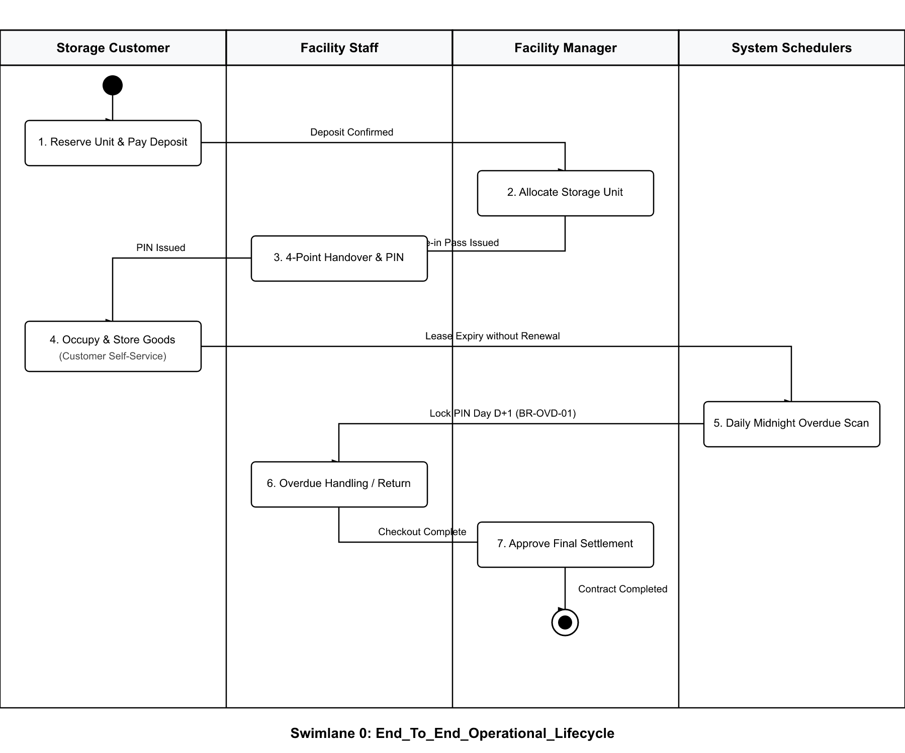

---

### 1.1.1 Flow 1 — Storage Unit Reservation & Waitlist CRM

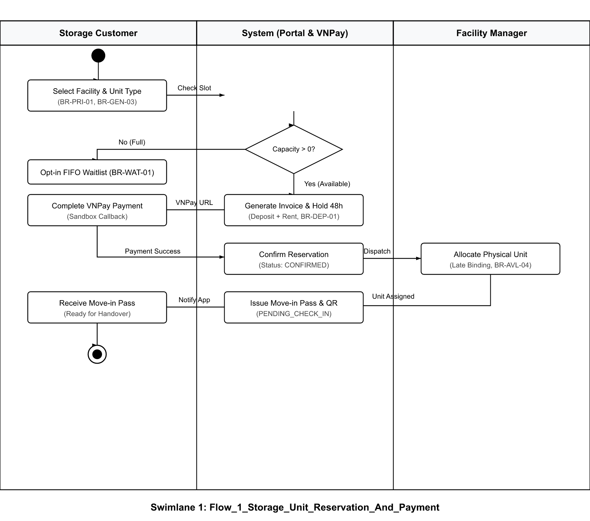

---

### 1.1.2 Flow 2 — Check-in, Physical Handover & Auto-Activation

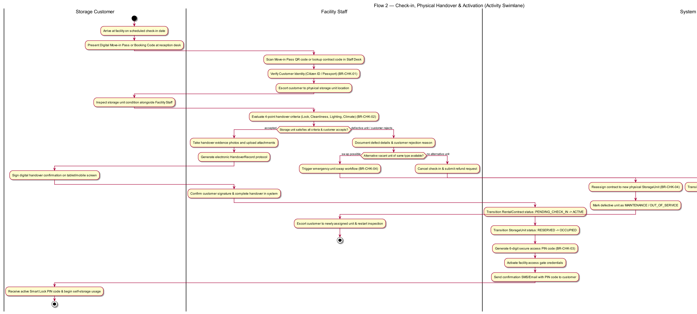

---

### 1.1.3 Flow 3 — Unit Return, Win-Win Early Return & Final Settlement

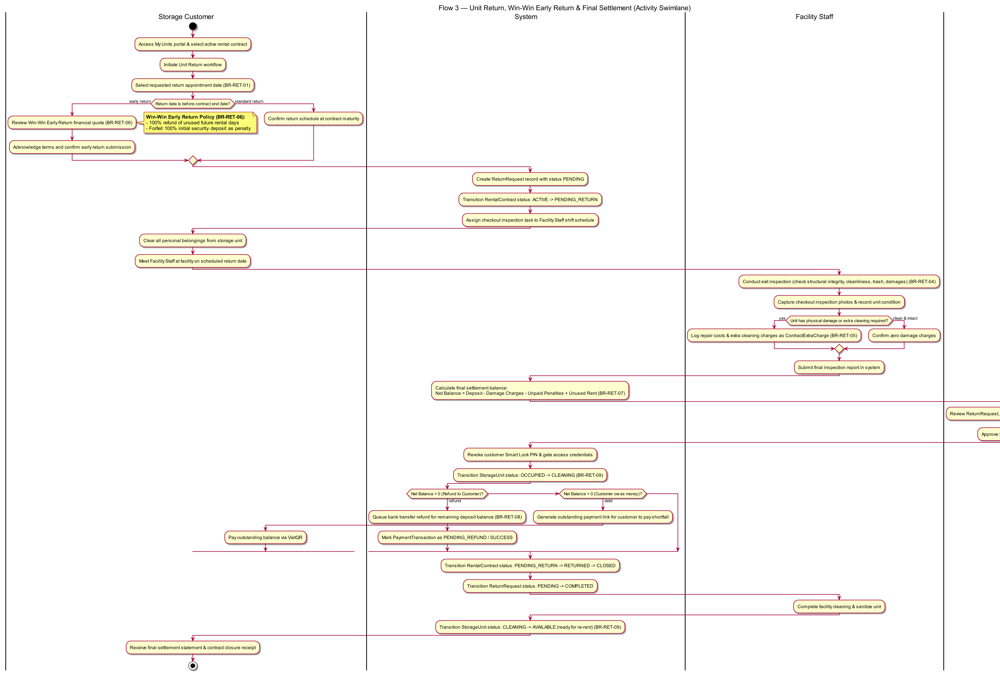

---

### 1.1.4 Flow 4 — Business Operations Management, Pricing & Revenue

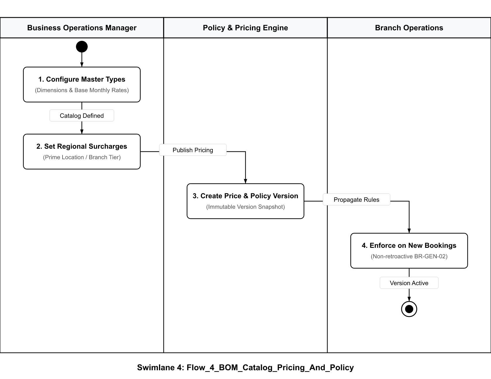

---

### 1.1.5 Flow 5 — Facility Unit Layout Management & Staff Task Dispatch

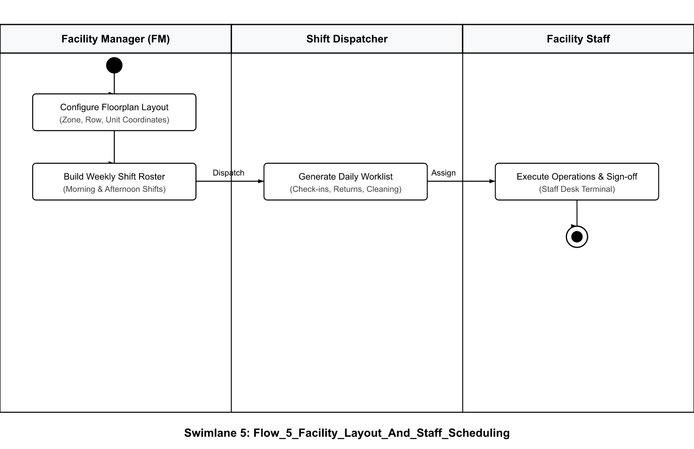

---

### 1.1.6 Flow 6.1 — Contract Renewal & Conflict Resolution

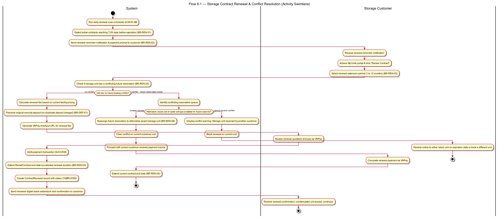

---

### 1.1.7 Flow 6.2 — Overdue Handling, Penalty Escalation & Eviction

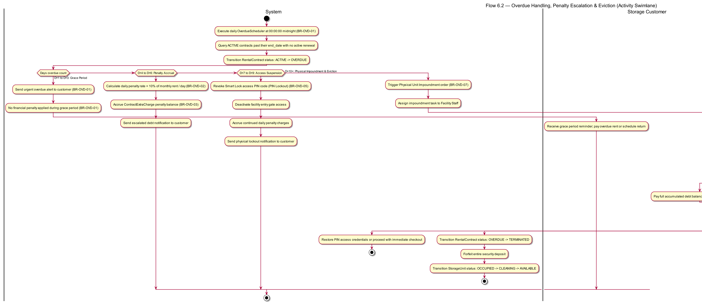

---

### 1.1.8 Flow 7 — Customer Support, Incident Management & Compensation

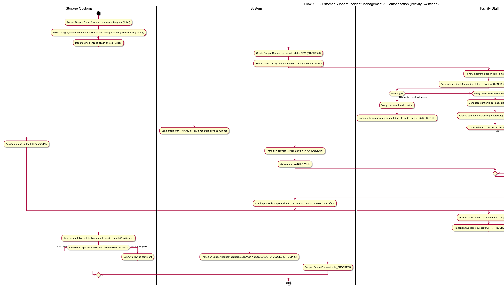

---

## 1.2 Entity State Machine Diagrams

### 1.2.1 RentalContract Entity State Machine

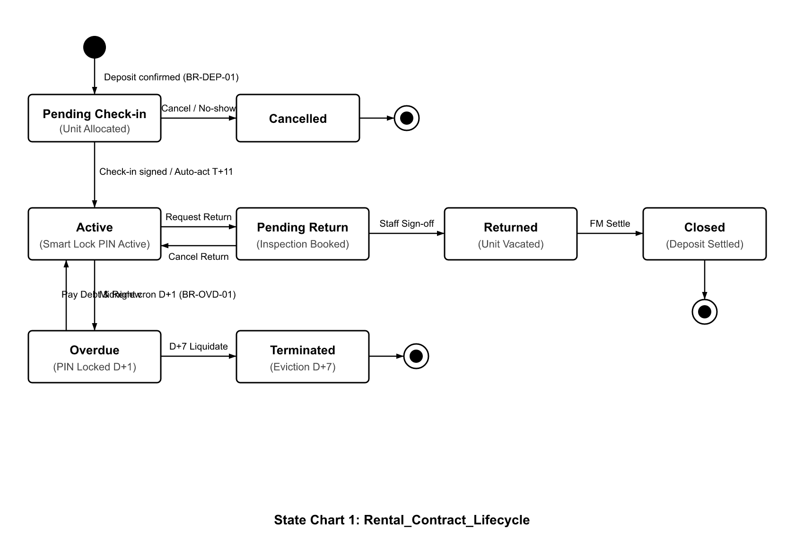

---

### 1.2.2 StorageUnit Entity State Machine

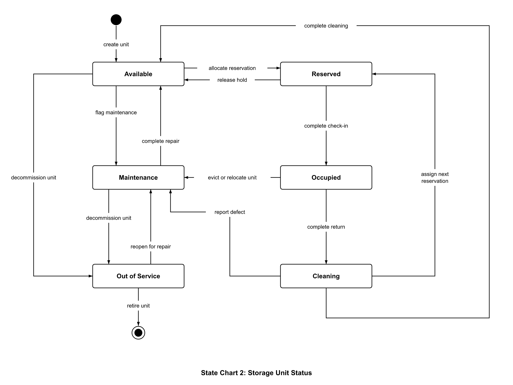

---

### 1.2.3 Reservation Entity State Machine

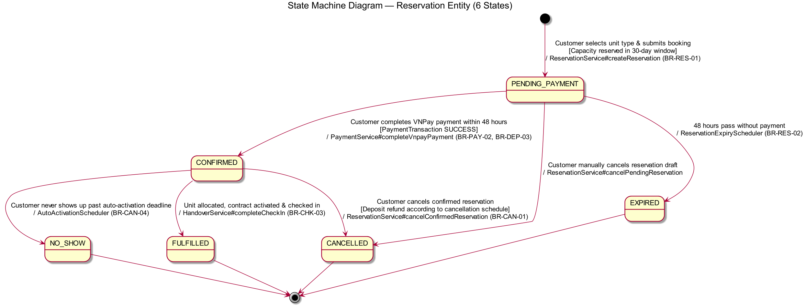

---

### 1.2.4 SupportRequest Entity State Machine

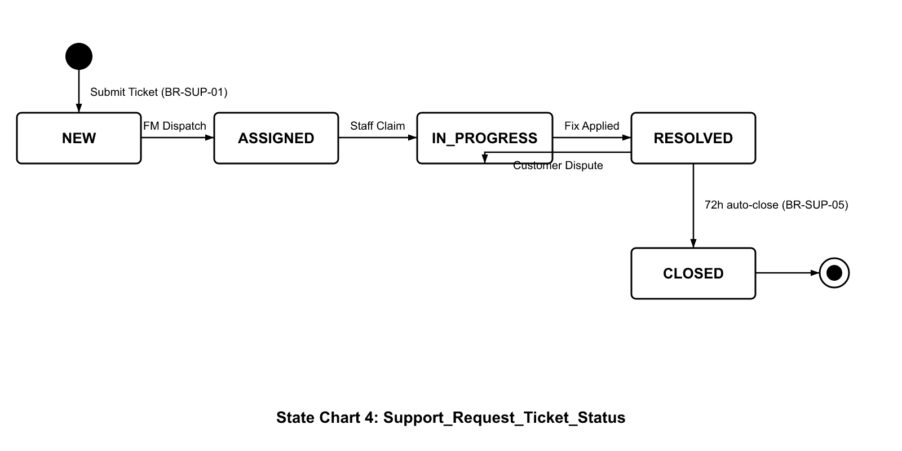

---

### 1.2.5 Waitlist Entity State Machine

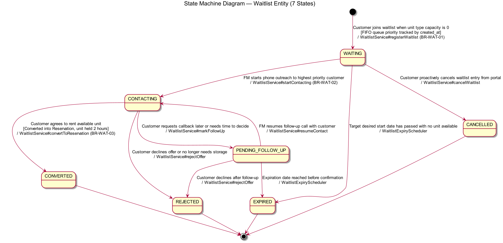

---

### 1.2.6 PaymentTransaction Entity State Machine

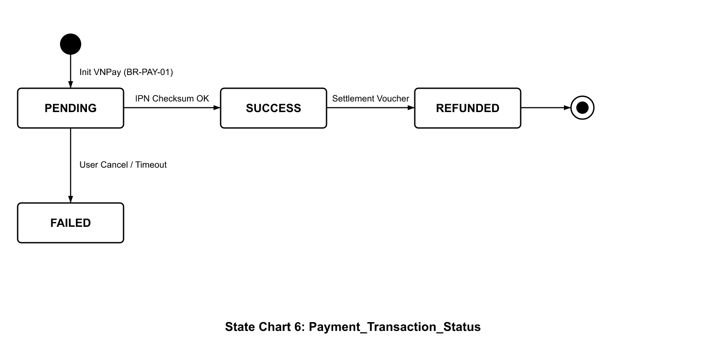

---

# 2. DATA MODEL SPECIFICATION

## 2.1 Conceptual Data Model (CDM)

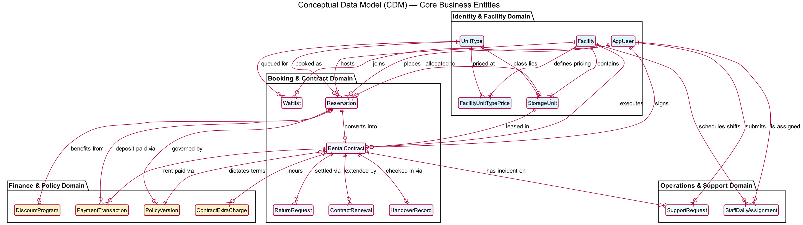

---

## 2.2 Unified Physical Entity-Relationship Diagram (ERD)

---

# 3. BUSINESS RULES & SYSTEM ENFORCEMENT

The following formal specification establishes the system's operational invariants, parameter boundaries, financial calculation models, and concrete enforcement mechanics adhering to international requirements engineering standards. The specification is organized across 12 core functional modules, detailing atomic declarative business rules alongside exact system enforcement actions and error handling.

| Function | Rule |
| :--- | :--- |
| **User Authentication, RBAC & Profile Management** _(Cross-Cutting Infrastructure)_ | 1. **Registration Input Sanitization (`BR-GEN-07`):** User registration requires normalized textual inputs with trimmed whitespace, domestic 10-digit mobile format (`0xxxxxxxxx`), and valid email structure. Malformed inputs return HTTP 400 Bad Request with field-specific validation error details. 2. **Password Complexity & BCrypt Hashing (`BR-ACC-01`):** Passwords require a minimum of 8 characters containing at least one uppercase letter, one lowercase letter, one digit, and one special character, securely salted and hashed using BCrypt before persistence. Weak passwords return HTTP 400 Bad Request; plain text passwords are never stored or logged. 3. **Account Identity Uniqueness (`BR-ACC-02`):** Email addresses and phone numbers must be strictly unique across all active accounts. Duplicate registration attempts are rejected with HTTP 409 Conflict. 4. **Two-Factor Email Account Activation (`BR-ACC-03`):** Newly registered accounts initialize in Unverified status; system issues a single-use 6-digit OTP token valid for 10 minutes with a 60-second resend cooldown. Unverified accounts are blocked from authenticated customer operations until token verification transitions account to Active. 5. **Stateless Dual-Token Authentication (`BR-ACC-04`):** Valid credentials issue a 15-minute stateless JWT access token alongside a 7-day cryptographically random refresh token stored in an HTTP-only, secure, strict same-site cookie. Expired or invalid tokens return HTTP 401 Unauthorized; refresh token rotation is enforced upon renewal. 6. **High-Performance Credential Caching (`BR-ACC-05`):** User authorization credentials are loaded from a 5-minute in-memory cache during authenticated API requests to eliminate redundant database queries. Cache entries are automatically evicted upon password update, role reassignment, or account deactivation. 7. **Multi-Facility Branch RBAC Isolation (`BR-ACC-06`):** Facility Staff and Facility Managers can query or modify data strictly within their assigned facility branch. Cross-facility access attempts are rejected with HTTP 403 Forbidden; operations remain partitioned to assigned branch scope. 8. **Session-Scoped Anti-IDOR Protection (`BR-ACC-07`):** User profile viewing and modification resolve user identity strictly from authenticated security session context without client-supplied IDs. Client ID tampering returns HTTP 403 Forbidden; modifying email or phone revokes verification status. |
| **Public Catalog Browsing & Quota Availability** _(Flow 1 — Booking Intake)_ | 1. **Public Unauthenticated Browsing (`SC-01`):** Prospective customers can browse active facilities, Unit Types, spatial dimensions, and standard rental rates without requiring login credentials. 2. **Quota-Based Availability Calculation (`BR-AVL-01`):** Available storage quota equals total active units of target Unit Type minus overlapping active contracts and pending reservations across requested booking dates. Units under Maintenance or Out of Service are strictly excluded from usable capacity. 3. **Post-Lease Operational Safety Buffer (`BR-AVL-02`):** The system automatically reserves an 8-day operational buffer immediately following every contract expiration date. Capacity quota remains locked during this 8-day window to prevent double-booking during turnover, cleaning, and overdue recovery. 4. **Pessimistic Inventory Locking (`BR-AVL-03`):** Reservation checkout acquires a pessimistic row-level database lock on the Unit Type inventory record. Concurrent checkout attempts are rejected with HTTP 409 Conflict if remaining capacity quota reaches zero. 5. **Inactive Facility & Type Exclusion (`BR-BOM-03`):** Deactivated facilities and inactive Unit Types are automatically excluded from public search results and availability calculations. |
| **Online Storage Reservation, VNPay Payment & Waitlist CRM** _(Flow 1 — Booking Intake)_ | 1. **Advance Booking Window Limit (`BR-RES-01`):** Reservation start dates must fall between the current date and a maximum of 30 days in advance. Requests exceeding 30 days return HTTP 400 Bad Request and redirect to the Waitlist CRM. 2. **Whole-Month Rental Structure (`BR-GEN-03`):** Rental durations must be structured in whole positive integer months (minimum 1 month). Fractional monthly bookings or zero-day spans are rejected with HTTP 400 Bad Request. 3. **Anti-Hoarding Draft Reservation Cap (`BR-SPAM-01`):** Customers are limited to a maximum of 3 concurrent pending draft reservations. Additional draft attempts return HTTP 429 Too Many Requests until existing drafts are paid or cancelled. 4. **48-Hour Temporary Capacity Hold (`BR-RES-02`):** Draft reservations hold a capacity quota slot in Pending Payment status for exactly 48 hours without binding a physical unit. Unpaid drafts automatically expire after 48 hours, restoring held capacity to the public pool. 5. **Mandatory 100% Upfront Settlement (`BR-PAY-01`):** Booking checkout requires 100% upfront settlement comprising total rental fees for the term plus a security deposit equal to 1.0 month of rent. Partial payments, split installments, or deferred settlements are rejected. 6. **VNPay Gateway Session & Idempotency (`BR-PAY-02`):** Online payment checkout URLs expire in 15 minutes; callbacks validate cryptographic HMAC checksums and process transaction references idempotently. Duplicate callbacks return HTTP 200 without creating duplicate ledger entries. 7. **Tiered Cancellation Refund Policy (`BR-CAN-01`):** Cancellations submitted 7 days or more prior to move-in receive 100% rent and 100% deposit refund (`BR-CAN-01`); cancellations between 48 hours and 7 days prior receive 100% rent refund and forfeit 50% deposit (`BR-CAN-02`); cancellations within 48 hours receive 100% rent refund and forfeit 100% deposit (`BR-CAN-03`). Provider-fault cancellations receive 100% full refund plus priority rebooking (`BR-CAN-05`). 8. **Waitlist CRM FIFO Queue & Consultation Lock (`BR-WAT-01`):** Customers register in the free FIFO Waitlist CRM when requested inventory is exhausted (`BR-WAT-01`); Facility Managers acquire an exclusive 2-hour consultation lock in Contacting status, converting agreed consultations into 24-hour payment hold reservations or auto-releasing the lock to Waiting (`BR-WAT-02`..`04`). |
| **Move-in Pass Verification, Physical Handover & Auto-Activation** _(Flow 2 — Check-in & Handover)_ | 1. **Move-in Pass & Citizen ID Verification (`BR-CHK-01`):** On-site check-in requires verifying customer digital QR Move-in Pass and government Citizen ID or Passport against booking records. Check-in is rejected if credentials mismatch or if staff member belongs to a different facility branch (`BR-ACC-04`). 2. **Physical Handover Preconditions (`BR-CHK-02`):** Physical handover walkthrough requires 100% payment, physical unit allocated in Reserved status matching confirmed Unit Type, and on-duty staff assigned from same branch. Handover e-form submission is blocked if any precondition is unmet. 3. **4-Point Handover Inspection & Dual Signatures (`BR-CHK-03`):** Physical walkthrough requires completing the 4-point inspection checklist (lock, clean, light, HVAC) and executing mutual digital signatures. Handover completion is blocked without dual electronic signatures confirmed. 4. **Lease Activation & Unit State Transition (`BR-CHK-04`):** Confirmation of mutual digital signatures transitions contract from Pending Check-in to Active, and unit from Reserved to Occupied. System immediately triggers cryptographic smart access PIN generation and automated delivery. 5. **Smart Access PIN Generation & Perimeter Scoping (`BR-ACC-01`):** Lease activation generates a unique cryptographically random 6-digit access PIN operating perimeter gates and unit keypads strictly during active lease term. Plain text PIN is never stored or logged. 6. **Self-Service PIN Regeneration (`BR-ACC-07`):** Customers experiencing access lockout or forgotten credentials can regenerate a new access PIN online via self-service portal at zero cost in real-time. Old PIN is immediately invalidated; on-site hardware outages are supported by master keys and battery packs (`BR-SUP-01`). 7. **Instant Defect Unit Swap Protocol (`BR-CHK-06`):** Pre-assigned units exhibiting defects during walkthrough transition to Maintenance, triggering immediate manager reassignment of an alternative Available unit of identical type without contract cancellation or extra fees (`BR-AVL-05`). 8. **Auto-Assignment & Unattended Auto-Activation (`BR-AVL-06`):** Midnight scheduler auto-assigns vacant units on move-in day with free higher-tier upgrade if matching tier is exhausted (`BR-AVL-06`). Customers receive a 10-day grace window; unattended auto-activation occurs on Day 11 (Deemed Acceptance) with access PIN sent via SMS/email, securing 100% revenue (`BR-CAN-04`, `BR-CHK-05`). |
| **Lease Return, Win-Win Early Termination & Final Settlement** _(Flow 3 — Return & Settlement)_ | 1. **Online Return Intent Notice (`BR-RET-01`):** Customers vacate by submitting return notice online while contract is Active, transitioning contract status to Pending Return. Generates an inspection dispatch task on the Staff Desk operational queue (`BR-RET-10`). 2. **Pre-Inspection Return Cancellation Window (`BR-RET-12`):** Customers can cancel a pending return notice only before staff initiates physical inspection walkthrough. Cancelling return restores contract to Active (if before end date) or Overdue (if past end date). 3. **Available Settlement Balance Evaluation (`BR-RET-04`):** Return financial settlement balance evaluates as $\max(\text{Deposit}, \text{Unused Rent})$, serving as the maximum baseline credit pool from which damage deductions and outstanding debts are subtracted. 4. **Win-Win Early Termination Proration (`BR-RET-06`):** Move-outs during final month ($\le 30$ days left) refund 100% deposit and retain unused days; premature move-outs ($> 30$ days left) forfeit 100% deposit and refund 100% unused future rental days. Daily proration calculated as $\text{Monthly Rent} / 30$; 100% deposit and rent refunded with zero penalty on facility fault. 5. **Move-out Physical Inspection & Photo Evidence (`BR-RET-02`):** Move-out inspection requires staff to inspect structure, lock, cleanliness, and trash, attaching mandatory timestamped photos for any damage. Inspection record is blocked from submission without photographic evidence of reported defects. 6. **Standardized Surcharge Catalog Binding (`BR-RET-08`):** Repair and trash clearance deductions must be selected strictly from BOM-approved surcharge price schedules. Staff is blocked from inputting arbitrary or non-catalog prices; snapshots are immutably bound to inspection record. 7. **Net Settlement Balancing & Contract Closure (`BR-RET-05`):** Final net balance computes as $\text{Net Balance} = \text{Available Balance} - \text{Damage Deductions} - \text{Overdue Debt}$. Positive balance is refunded within 7 business days; negative deficit is invoiced and paid online before manager approves transition to Closed (`BR-RET-07`). 8. **Post-Checkout Cleaning Quarantine (`BR-RET-09`):** Checkout confirmation transitions storage unit immediately to Cleaning status and revokes smart lock access permanently. Direct transition to Available is blocked; unit releases to Available or Reserved after staff cleaning confirmation or upon a 5-day automated release (`BR-AVL-02`). |
| **Master Unit Types & Dynamic System Policy Governance** _(Flow 4 — BOM Operations)_ | 1. **Centralized Master Unit Type Governance (`BR-BOM-01`):** Creating or updating Unit Types is the exclusive enterprise authority of the Business Operations Manager. Action attempted by Facility Manager or non-BOM roles returns HTTP 403 Forbidden; catalog applies globally across all facilities. 2. **Standard Spatial Metrics Specification (`BR-PRI-01`):** Unit Types standardize dimensions ($W, L, H$ in meters), deriving usable volume ($V = W \times L \times H$), floor area ($A = W \times L$), and base monthly price. Derived metrics calculate automatically; duplicate Unit Type codes or display names are rejected by unique constraints. 3. **Unit Type Soft-Delete Relational Guard (`BR-BOM-02`):** Deleting a Unit Type requires system verification that zero physical units or contracts are linked to that type. Physical deletion is blocked with HTTP 409 Conflict if linked; BOM may only toggle status to Inactive. 4. **Inactive Unit Type Grandfathering Protocol (`BR-BOM-03`):** Deactivated Unit Types are immediately excluded from public search and new bookings while active contracts continue until expiration. System blocks contract renewal on deactivated Unit Types; units retire Out of Service upon lease return (`BR-BOM-04`, `05`). 5. **Dynamic System Parameter Engine (`BR-GEN-01`):** Operational parameters (multipliers, hold hours, buffers, grace periods, penalty rates) are governed dynamically through system policy without code modifications. Hardcoded business constants are strictly prohibited; all rules read dynamically from active system policy. 6. **Immutable Policy Version Snapshotting (`BR-GEN-02`):** Confirmed reservations and contracts permanently bind immutable snapshots of policy parameters active at creation timestamp. Subsequent policy or pricing updates do not apply retroactively to existing active contracts. 7. **Administrative Boundary Validation (`BR-GEN-01`):** Policy parameter updates enforce strict validation ranges: rates $\ge 0$, penalty caps $\le 100\%$, and hold windows $> 0$ hours. Invalid parameters return HTTP 400 Bad Request. |
| **Regional Pricing Tiering, Surcharges & Ledger Audit** _(Flow 4 — BOM Operations)_ | 1. **Regional Facility Price Overrides (`BR-PRI-02`):** BOM facility-specific pricing configurations supersede catalog base prices for that specific facility branch. Public catalog and reservation calculations reflect facility-specific rates. 2. **Standard 30-Day Monthly Day Divisor (`BR-PRI-03`):** Daily prorated rental rates compute as monthly rent divided by 30 ($\text{Daily Rent} = \text{Monthly Rent} / 30$). A uniform 30-day divisor applies across all calculations regardless of actual days in the calendar month. 3. **Deterministic Currency Ceiling Rounding (`BR-GEN-04`):** Calculated fee line items in VND round up to the nearest 1,000 VND ceiling. Total payable sum equals sum of rounded items without secondary re-rounding. 4. **Standardized Auxiliary Surcharge Catalog (`BR-PRI-04`):** Auxiliary fees are categorized into 4 enterprise groups: Access Key, Cleaning, Damage Repair, and Value-Added Services. Staff select items strictly from BOM-approved fee schedules with immutable price snapshots. 5. **4-Stream Disaggregated Financial Ledgers (`BR-BOM-05`):** Enterprise financial cash flows partition into 4 distinct streams: Rental Revenues, Security Deposits, Overdue Penalties, and Extra Surcharges (`BR-BOM-06`). Each payment transaction record references originating contract and payment order entity. 6. **Automated Daily Financial Reconciliation (`BR-PAY-06`):** Daily reconciliation jobs audit online payment gateway settlements against accounts receivable ledgers. Discrepancies greater than 0 VND trigger automated security alerts to BOM and Administrator. |
| **Facility Unit Spatial Layout & Staff Task Dispatch** _(Flow 5 — Facility Management)_ | 1. **Strict Unit Type Spatial Instantiation (`BR-FM-01`):** Provisioning physical storage units requires instantiating active BOM-approved Unit Types. FM cannot create arbitrary dimensions or unapproved environmental specifications. 2. **Spatial Grid Coordinate Uniqueness (`BR-FM-02`):** Storage compartment spatial grid coordinates (floor, zone, row, column) must be unique within each facility branch. Duplicate spatial coordinates return HTTP 409 Conflict (`BR-AVL-06`). 3. **Maintenance Capacity Quota Decrement (`BR-AVL-05`):** Compartments transitioning to Maintenance or Out of Service immediately decrement branch usable capacity quota, preventing overbooking in catalog search and reservation intake engines. 4. **Closed Unit State Machine (`BR-RET-09`):** Units strictly transition through closed states: Available $\to$ Reserved $\to$ Occupied $\to$ Cleaning $\to$ Available / Reserved; Maintenance and Out of Service. Direct transition from Cleaning to Available is prohibited. 5. **Immutable Unit Transition Audit Log (`BR-GEN-06`):** Status changes on physical units record an immutable audit log detailing operator ID, previous status, target status, reason code, and timestamp. 6. **Shift-Based Same-Branch Task Dispatch (`BR-FM-05`):** Dispatching check-in handovers, inspections, or maintenance tasks is restricted to active staff members assigned to that branch (`BR-ACC-04`). Cross-facility task dispatch returns HTTP 400 Bad Request. 7. **Staff Desk Worklist Aggregation & Alerts (`BR-FM-06`):** Daily operational tasks aggregate on Staff Desk queue and visually flag pending move-ins nearing grace period expiry, ensuring timely physical handover walkthrough and preventing unattended leakage. |
| **Self-Service Contract Renewal & Unit Relocation** _(Flow 6.1 — Contract Renewal)_ | 1. **Self-Service Online Renewal Window (`BR-REN-01`):** Self-service online renewal is permitted exclusively while contract is Active and at least 20 days remain before expiration date (`BR-REN-02`). Renewal option is locked on UI and API if fewer than 20 days remain or if contract is not Active. 2. **T-20 Cutoff Rule & Waitlist Trigger (`BR-REN-09`):** Contracts reaching 20 days prior to expiration without confirmed renewal lock online self-service and flag unit for expiration. Unit becomes eligible for waitlist customer matching and advance booking intake. 3. **Whole-Month Extension Constraints (`BR-REN-03`):** Contract renewal extensions must be structured in whole integer months between 1 and 12 months (`BR-REN-07`). Fractional monthly renewal extensions are rejected with HTTP 400 Bad Request. 4. **Security Deposit Automatic Rollover (`BR-DEP-05`):** Contract renewals automatically roll over existing security deposits into the renewed term without duplicate charges. No additional deposit invoice is generated unless rental price has increased. 5. **Active Catalog Pricing on Renewal (`BR-REN-05`):** Contract renewals reflect current active catalog pricing at renewal timestamp rather than original lease rates. System calculates renewal quote dynamically from current price snapshot and advances contract end date upon payment (`BR-REN-04`). 6. **Supervised Exception Renewal & Late Fee (`BR-REN-10`):** Exception renewals approved within final 20 days require FM authorization, cannot conflict with paid waitlist deposits, and assess a fixed 200,000 VND late fee added to renewal invoice. Renewal is rejected if waitlist deposit is already collected. 7. **2-Step Unit Tier Change & 24h Dual PIN (`BR-REN-11`):** Upgrading or downgrading unit categories requires a 2-step transition (settle old contract, issue new contract) with 24-hour dual-PIN access. Old PIN is automatically revoked after 24 hours, transitioning old compartment to Cleaning (`BR-REN-12`). |
| **Overdue Penalty Escalation, Foreclosure & Warehouse Auction** _(Flow 6.2 — Overdue Handling)_ | 1. **Day 1 Midnight Overdue Transition & PIN Lock (`BR-OVD-01`):** Contracts expiring without renewal or return notice transition to Overdue at midnight; access PIN is immediately suspended under the "No Pay, No PIN" policy (`BR-OVD-05`). Landlord lien is secured; customer is blacklisted from booking new units (`BR-OVD-09`) and locked from self-renewal (`BR-REN-06`). 2. **Grace Storage Fee Tier (Days 1 to 3) (`BR-OVD-02`):** Overdue days 1 to 3 assess a daily storage fee of 5% of deposit per day (accumulating up to 15%) with zero contract violation penalty. System dispatches daily payment reminder emails and SMS notifications. 3. **Penalty Escalation Tier (Days 4 to 6) (`BR-OVD-03`):** Overdue days 4 to 6 incur an additional 10% daily violation penalty on top of storage fees (Day 4: 25%, Day 5: 35%, Day 6: 45%, Day 7: 55%). Automated daily escalation warnings and eviction notice SMS are dispatched (`BR-OVD-06`). 4. **55% Cumulative Overdue Fee Cap (`BR-OVD-04`):** Total cumulative overdue charges (storage fees plus violation penalties) are strictly capped at 55% of the security deposit. Maximum accrued debt is bounded to 55% of security deposit prior to formal foreclosure. 5. **Intra-Day PIN Reprovisioning Protocol (`BR-OVD-08`):** Settling 100% of accrued overdue debt online restores temporary PIN access valid until 23:59:59 and unlocks return notice submission. Submitting return notice immediately revokes temporary PIN; failure to submit return before midnight re-locks PIN without extending Day 7 deadline. 6. **Day 7 Forced Eviction & 100% Deposit Liquidation (`BR-OVD-07`):** Contracts reaching Day 7 overdue are forcibly terminated; 100% of security deposit is liquidated (55% for overdue debt, 45% for lock cutting, transport, and inventory auditing). Unit enters Maintenance for 1-day content inventory and returns to Available on Day 8, satisfying the 8-day buffer (`BR-AVL-02`). 7. **Central Warehouse 30-Day Holding & Auction (`BR-OVD-11`):** Impounded belongings are held in Central Warehouse for up to 30 days; unclaimed goods are liquidated via public auction. Reclaiming goods within 30 days requires paying storage deficit; FM approves contract closure with zero balance post-auction. |
| **Customer Support Incident Handling, SLA & Liability Protection** _(Flow 7 — Support & SLA)_ | 1. **Standardized Support Intake & Urgent Routing (`BR-SUP-01`):** Customer support tickets categorize into 5 classes: Unit Damage, Lock Access, Payment Issue, Belongings Inquiry, and Other (`BR-SUP-02`). Lock Access is auto-flagged urgent for on-duty shift response; rigid 2-hour countdown timers are eliminated. 2. **On-Site Liability Attribution & Surcharge Settlement (`BR-SUP-02`):** Support incident investigation attributes liability: company fault carries 100% facility responsibility; customer fault assesses surcharges from BOM catalog. Ticket closure is blocked until customer settles all assessed surcharges. 3. **Emergency Relocation Flag & Unit Reassignment (`BR-SUP-03`):** Severe structural or environmental hazards threatening stored goods trigger emergency relocation flagging by inspecting staff. FM reassigns contract to equivalent vacant unit of same type at identical rent, moving damaged unit to Maintenance (`BR-AVL-05`). 4. **No-Bailment Commercial Lease Doctrine & Liability Caps (`BR-SUP-04`):** Tenant stores property under commercial space lease doctrine (no bailment, exclusive tenant key/PIN control); standard damage liability is capped at 10,000,000 VND. Optional extended protection (50,000 VND/month up to 50,000,000 VND); storing prohibited hazardous contraband voids all liability protection. 5. **Force Majeure Disaster Relief Voucher (`BR-BMP-03`):** Force majeure facility disasters (e.g. fire) provide 100% full refund plus a 1-month rental compensation voucher for future leases, disbursed immediately with priority relocation to another facility branch. 6. **7 Business Days Inactivity Auto-Close (`BR-SUP-05`):** Resolved support tickets without customer dispute automatically transition to Closed status after 7 consecutive business days (`BR-SUP-03`). Weekends and official public holidays are excluded. |
| **Facility Usage Rate, Occupancy Analytics & System Audit Logs** _(Analytics & System Audit)_ | 1. **Standardized Usage Rate Formula (`BR-BOM-03`):** Facility space utilization evaluates via deterministic formula: $\text{Usage Rate} = \text{Occupied Units} / \text{Usable Capacity}$, where usable capacity strictly excludes units in Maintenance or Out of Service. 2. **Database-Push Analytical Aggregation (`BR-BOM-04`):** Revenue and occupancy analytical reports execute aggregations (SUM, COUNT, GROUP BY) directly within database queries. In-memory collection filtering is prohibited to prevent out-of-memory errors on large contract volumes. 3. **Role-Scoped Analytical Access (`BR-BOM-04`):** Cross-facility comparative scorecards and revenue velocity metrics are restricted strictly to Business Operations Managers and System Administrators; Facility Managers access only branch-level occupancy. 4. **Temporal Query Filter Validation (`BR-GEN-06`):** Analytical query filters validate that start date precedes end date and aggregation window does not exceed 12 calendar months. Requests violating bounds return HTTP 400 Bad Request. 5. **Immutable System Activity Audit Logging (`SA-04`):** Security authentication events, role changes, financial transactions, and unit status transitions create immutable system audit logs detailing operator ID, IP address, target entity, old/new value, and timestamp; logs are append-only (`BR-GEN-06`). |

---

_Report compiled and verified by Antigravity Technical Lead for SWP391 Final Defense._
