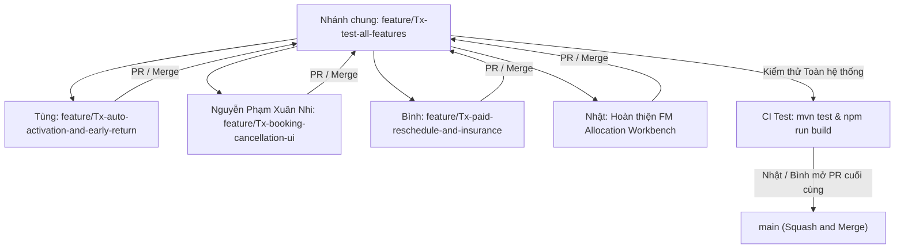

# Kế hoạch Triển khai & Phân công Công việc: Hiện thực hóa 6 Trụ cột Đổi mới Hệ thống

> **Ngày ban hành:** 05/11/2026  
> **Người chủ trì phân công (thay Lead Gia Bình):** Lê Thanh Tùng (Backend Lead)  
> **Áp dụng cho:** Toàn bộ 4 thành viên (Lê Thanh Tùng, Nguyễn Phạm Xuân Nhi, Nguyễn Văn Gia Bình, Huỳnh Nhật)  
> **Nhánh nền tảng tích hợp chung:** `feature/Tx-test-all-features`  
> **Tài liệu tham chiếu:** [`docs/BUSINESS-RULES.md`](BUSINESS-RULES.md) · [`docs/WORKFLOWS.md`](WORKFLOWS.md) · [`docs/_archive/GAP-ANALYSIS-UNIT-ALLOCATION-REDESIGN.md`](_archive/GAP-ANALYSIS-UNIT-ALLOCATION-REDESIGN.md) · [`docs/DASHBOARD.md`](DASHBOARD.md)

---

## 1. QUY TRÌNH PHỐI HỢP GIT TEAM (ZERO-CONFLICT WORKFLOW)

Để đảm bảo không bị xung đột commit hay giẫm chân nhau, cả nhóm tuân thủ nghiêm ngặt quy trình 5 bước sau:



1. **Bước 1 (Pull code mới nhất):**
   ```powershell
   git checkout feature/Tx-test-all-features
   git pull origin feature/Tx-test-all-features
   ```
2. **Bước 2 (Tạo nhánh riêng theo đúng tên quy định bên dưới):**
   ```powershell
   git checkout -b feature/Tx-...
   ```
3. **Bước 3 (Thực hiện code và tự kiểm tra cục bộ):**
   - Backend: `$env:JAVA_HOME = 'C:\Program Files\Java\jdk-17' ; mvn clean test`
   - Frontend: `npm --prefix frontend run build`
4. **Bước 4 (Commit & Push nhánh):**
   - Commit Conventional Commits tiếng Việt: `git commit -m "feat(...): mô tả"`
   - Push lên remote: `git push -u origin feature/Tx-...`
5. **Bước 5 (Tạo PR vào `feature/Tx-test-all-features`):**
   - Nhật sẽ review và merge vào nhánh `feature/Tx-test-all-features`. Sau khi test toàn hệ thống xanh 100%, Nhật mở PR cuối cùng vào `main`.

---

## 2. PHÂN CÔNG CHI TIẾT & HƯỚNG DẪN CODE TỪNG NGƯỜI

---

### 👤 2.1. LÊ THANH TÙNG (Backend Lead — WS4)

* **Tên nhánh bắt buộc:** `feature/Tx-auto-activation-and-early-return`
* **Lệnh khởi tạo nhánh:**
  ```powershell
  git checkout feature/Tx-test-all-features ; git pull origin feature/Tx-test-all-features ; git checkout -b feature/Tx-auto-activation-and-early-return
  ```

#### Nhiệm vụ 1: Tạo Tác vụ Nền Tự động kích hoạt (Auto-Activation) lúc $T+11$ (`BR-CAN-04`)
* **File cần tạo mới:** `backend/src/main/java/com/swp391/selfstorage/contract/scheduler/AutoCheckInActivationScheduler.java`
* **Nghiệp vụ:** Chạy `00:00:00` hàng ngày. Quét các hợp đồng `PENDING_CHECK_IN` có `startDate` đã quá 10 ngày ân hạn (`cutoffDate = LocalDate.now().minusDays(10)`). Hệ thống tự động chuyển sang `ACTIVE`, tự sinh mã PIN 6 số điện tử nếu chưa có, và bảo toàn 100% doanh thu.
* **Mã nguồn chuẩn:**
  ```java
  package com.swp391.selfstorage.contract.scheduler;

  import com.swp391.selfstorage.contract.entity.ContractStatus;
  import com.swp391.selfstorage.contract.entity.RentalContract;
  import com.swp391.selfstorage.contract.repository.RentalContractRepository;
  import lombok.RequiredArgsConstructor;
  import lombok.extern.slf4j.Slf4j;
  import org.springframework.scheduling.annotation.Scheduled;
  import org.springframework.stereotype.Component;
  import org.springframework.transaction.annotation.Transactional;

  import java.time.LocalDate;
  import java.time.OffsetDateTime;
  import java.util.List;

  @Slf4j
  @Component
  @RequiredArgsConstructor
  public class AutoCheckInActivationScheduler {

      private final RentalContractRepository contractRepository;

      @Scheduled(cron = "0 0 0 * * ?")
      @Transactional
      public void scanAndAutoActivateContracts() {
          LocalDate cutoffDate = LocalDate.now().minusDays(10);
          List<RentalContract> pendingContracts = contractRepository.findByStatus(ContractStatus.PENDING_CHECK_IN);

          for (RentalContract contract : pendingContracts) {
              if (contract.getStartDate() != null && contract.getStartDate().isBefore(cutoffDate)) {
                  log.info("Auto-Activating contract {} at T+11 (Start date: {})", contract.getCode(), contract.getStartDate());
                  contract.setStatus(ContractStatus.ACTIVE);
                  contract.setActivatedAt(OffsetDateTime.now());
                  if (contract.getAccessPin() == null) {
                      String generatedPin = String.format("%06d", (int)(Math.random() * 900000) + 100000);
                      contract.setAccessPin(generatedPin);
                  }
                  contractRepository.save(contract);
              }
          }
      }
  }
  ```

#### Nhiệm vụ 2: Công thức Quyết toán Trả kho Sớm Win-Win (`BR-RET-06`)
* **File cần sửa:** `backend/src/main/java/com/swp391/selfstorage/contract/service/impl/ContractServiceImpl.java` (Tại hàm `previewSettlement` và `settleContract`).
* **Công thức nghiệp vụ:**
  * `Tiền hoàn = Tiền thuê phần thời hạn chưa dùng (100%) - Phí hư hại vật chất - Phí vệ sinh (nếu có)`.
  * Tiền cọc Deposit (1 tháng): Phạt 100% (tịch thu) do kết thúc hợp đồng trước hạn.

---

### 👤 2.2. NGUYỄN PHẠM XUÂN NHI (Frontend Lead — WS2)

* **Tên nhánh bắt buộc:** `feature/Tx-booking-cancellation-ui`
* **Lệnh khởi tạo nhánh:**
  ```powershell
  git checkout feature/Tx-test-all-features ; git pull origin feature/Tx-test-all-features ; git checkout -b feature/Tx-booking-cancellation-ui
  ```

#### Nhiệm vụ 1: Khóa Cửa sổ Đặt trước Tối đa 30 ngày (`BR-RES-01`)
* **File cần sửa:** `frontend/src/features/customer/components/BookingCustomerForm.tsx`
* **Nghiệp vụ:** Tại trường nhập ngày bắt đầu thuê (`startDate`), thiết lập thuộc tính `max` cho ô input:
  ```tsx
  const maxBookingDate = useMemo(() => {
    const d = new Date();
    d.setDate(d.getDate() + 30);
    return d.toISOString().split('T')[0];
  }, []);

  <input
    type="date"
    min={todayStr}
    max={maxBookingDate}
    value={startDate}
    onChange={(e) => setStartDate(e.target.value)}
    className="..."
  />
  ```

#### Nhiệm vụ 2: Chuẩn hóa Modal Hủy Đặt chỗ 3 Tầng Phân cấp Airbnb (`BR-CAN-01..03`)
* **File cần sửa:** `frontend/src/features/customer/components/CancelCheckInModal.tsx`
* **Nghiệp vụ:** Cập nhật khối tính toán tiền hoàn (tại dòng 60–85) để hiển thị chi tiết cho khách:
  ```tsx
  const diffTime = startDateTime.getTime() - todayZero.getTime();
  const daysUntilStart = Math.ceil(diffTime / (1000 * 60 * 60 * 24));

  let depositRefund = 0;
  let cancellationTier = '';

  if (daysUntilStart >= 7) {
    depositRefund = depositAmount; // Hoàn 100% cọc
    cancellationTier = 'Hủy sớm (trước ≥ 7 ngày): Hoàn 100% tiền cọc + 100% tiền thuê';
  } else if (daysUntilStart >= 2) {
    depositRefund = Math.round(depositAmount * 0.5); // Phạt 50% cọc
    cancellationTier = 'Hủy lửng (2 - 6 ngày): Phạt 50% cọc, hoàn lại 50% cọc + 100% tiền thuê';
  } else {
    depositRefund = 0; // Phạt 100% cọc
    cancellationTier = 'Hủy sát nút (< 48 giờ): Phạt 100% cọc, hoàn lại 100% tiền thuê';
  }

  const totalRefund = rentalFee + depositRefund;
  ```

#### Nhiệm vụ 3: Tích hợp Chỉ số IoT Telemetry & Ký số vào `DigitalMoveInPassModal.tsx`
* **File cần sửa:** `frontend/src/features/customer/components/DigitalMoveInPassModal.tsx`
* **Nghiệp vụ:** Hiển thị 3 thẻ thông số IoT mô phỏng (Nhiệt độ `24.5°C`, Độ ẩm `52%RH`, Pin khóa `98% - Online`) và ô nhập Chữ ký số / Họ tên để nhận mã PIN 24/7.

---

### 👤 2.3. NGUYỄN VĂN GIA BÌNH (Technical Lead — WS1)

* **Tên nhánh bắt buộc:** `feature/Tx-paid-reschedule-and-insurance`
* **Lệnh khởi tạo nhánh:**
  ```powershell
  git checkout feature/Tx-test-all-features ; git pull origin feature/Tx-test-all-features ; git checkout -b feature/Tx-paid-reschedule-and-insurance
  ```

#### Nhiệm vụ 1: Dời Ngày Nhận Kho Có Thu Phí theo Ngày (`BR-RES-06`)
* **Backend:** `backend/src/main/java/com/swp391/selfstorage/contract/service/impl/ContractServiceImpl.java` (tại hàm `rescheduleRentalPeriod` dòng 1456 đã có sẵn).
  * Bổ sung kiểm tra báo trước tối thiểu 48 giờ:
    ```java
    long hoursUntilStart = Duration.between(LocalDateTime.now(), contract.getStartDate().atStartOfDay()).toHours();
    if (hoursUntilStart < 48) {
        throw new CustomException(ErrorCode.VALIDATION_FAILED, "Yêu cầu dời ngày nhận kho phải gửi trước ít nhất 48 giờ");
    }
    ```
  * Bổ sung chặn dời quá 7 ngày:
    ```java
    long diffDays = ChronoUnit.DAYS.between(contract.getStartDate(), newStartDate);
    if (diffDays > 7 || diffDays < 1) {
        throw new CustomException(ErrorCode.VALIDATION_FAILED, "Thời gian dời ngày nhận kho chỉ được phép từ 1 đến tối đa 7 ngày");
    }
    ```
  * Tính phí dời ngày: `long rescheduleFee = diffDays * (contract.getMonthlyPriceSnapshot() / 30);`
* **Frontend:** `frontend/src/features/customer/components/ReschedulePeriodModal.tsx` (đã có sẵn).
  * Giới hạn `maxDate`: `new Date(contract.startDate) + 7 ngày`.
  * Hiển thị bảng tính: `Số ngày dời: X ngày -> Phí dời cần đóng: formatVND(X * đơn_giá / 30)`.

#### Nhiệm vụ 2: Tùy chọn Gói Bảo Vệ Hàng Hóa Mở Rộng 50M (`BR-SUP-04`)
* **Frontend:** `frontend/src/features/customer/components/BookingCustomerForm.tsx` & `BookingPriceSummary.tsx`
  * Thêm checkbox: `[ ] Tham gia Gói bảo vệ tài sản mở rộng (+50.000 đ/tháng - Bảo hiểm đền bù tới 50.000.000 đ)`.
  * Khi chọn: Tự động cộng thêm `50.000 * rentalMonths` vào tổng thanh toán.

---

### 👤 2.4. HUỲNH NHẬT (Gatekeeper & Allocation Workbench — WS3)

* **Nhánh phụ trách chính:** `feature/Tx-test-all-features`
* **Nhiệm vụ:**
  1. Hoàn thiện nốt phần giao diện **Bàn làm việc Phân bổ Ô kho (Unit Allocation Workbench)** để FM gán ô `AVAILABLE` cho hợp đồng `PENDING_CHECK_IN`.
  2. Tiếp nhận Pull Request từ Tùng, Nguyễn Phạm Xuân Nhi, Bình gửi về nhánh `feature/Tx-test-all-features`.
  3. Chạy kiểm thử tự động trên máy:
     ```powershell
     mvn clean test
     npm --prefix frontend run build
     ```
  4. Sau khi test xanh 100%, Nhật bấm merge PR của các bạn vào `feature/Tx-test-all-features`.
  5. Mở Pull Request cuối cùng từ `feature/Tx-test-all-features` vào `main` để báo cáo hoàn thành!

---

## 3. CHECKLIST ĐỊNH NGHĨA HOÀN THÀNH (DEFINITION OF DONE - DoD)

Mỗi bạn sau khi làm xong phải tự kiểm tra các tiêu chí sau trước khi tạo PR:
- [ ] Code không có cảnh báo lỗi cú pháp / compiler.
- [ ] Backend: `mvn test` pass 100%.
- [ ] Frontend: `npm run build` không bị lỗi TypeScript hoặc Lint.
- [ ] Không chỉnh sửa sang file ngoài phạm vi phân công của mình.
- [ ] Viết mô tả Pull Request rõ ràng theo chuẩn của dự án.
