# Đặc tả Yêu cầu: User Stories & Phân rã Use Cases

> **Self-Storage Facility Rental and Management System**
> Tài liệu duy nhất tổng hợp toàn bộ **Quy chuẩn, User Stories & Acceptance Criteria** cho 5 nhóm tác nhân và **Phân rã Use Cases** cho 7 luồng nghiệp vụ cốt lõi kèm luồng nền tảng.

---

## Mục lục

1. [PHẦN 0: QUY TẮC VIẾT & CẬP NHẬT (QUY CHUẨN DÀNH CHO AI & NHÓM)](#phần-0-quy-tắc-viết--cập-nhật-quy-chuẩn-dành-cho-ai--nhóm)
2. [PHẦN 1: USER STORIES & ACCEPTANCE CRITERIA](#phần-1-user-stories--acceptance-criteria)
   - [1. Storage Customer (SC-01 → SC-06)](#1-storage-customer-sc-01--sc-06)
   - [2. Facility Staff & Facility Manager (FS-_ & FM-_)](#2-facility-staff--facility-manager-fs---fm-)
   - [3. Business Operations Manager & System Administrator (BM-_ & SA-_)](#3-business-operations-manager--system-administrator-bm---sa-)
   - [4. Bảng tổng hợp User Stories toàn hệ thống](#4-bảng-tổng-hợp-user-stories-toàn-hệ-thống)
3. [PHẦN 2: PHÂN RÃ USE CASES THEO LUỒNG NGHIỆP VỤ](#phần-2-phân-rã-use-cases-theo-luồng-nghiệp-vụ)
   - [Flow 1 — Storage Unit Reservation](#flow-1--storage-unit-reservation)
   - [Flow 2 — Storage Check-in and Handover](#flow-2--storage-check-in-and-handover)
   - [Flow 3 — Rented Storage Unit Management](#flow-3--rented-storage-unit-management)
   - [Flow 4 — Business Rules, Fee Management and Revenue Monitoring](#flow-4--business-rules-fee-management-and-revenue-monitoring)
   - [Flow 5 — Facility Storage and Staff Management](#flow-5--facility-storage-and-staff-management)
   - [Flow 6 — Storage Renewal and Overdue Handling](#flow-6--storage-renewal-and-overdue-handling)
   - [Flow 7 — Support Request and Issue Handling](#flow-7--support-request-and-issue-handling)
   - [Use case nền tảng ngoài 7 luồng (UC-SYS-\*)](#use-case-nền-tảng-ngoài-7-luồng)
   - [Bản đồ phủ 27 mã yêu cầu](#bản-đồ-phủ-mã-yêu-cầu)
   - [Use Case Diagram tổng](#use-case-diagram-tổng)

---

## PHẦN 0: QUY TẮC VIẾT & CẬP NHẬT (QUY CHUẨN DÀNH CHO AI & NHÓM)

Để đảm bảo tính nhất quán tuyệt đối giữa mã nguồn, kiểm thử tự động và tài liệu nghiệp vụ, mọi thành viên và tác nhân AI bắt buộc tuân thủ 4 nguyên tắc sau khi đọc hoặc bổ sung yêu cầu:

### 1. Quy ước đặt mã định danh

- **Mã User Story:** `US-<mã yêu cầu>.<số thứ tự>`
  - Ví dụ: `US-SC-01.1` (story đầu tiên của chức năng SC-01), `US-FS-02.3` (story thứ 3 của FS-02).
  - **Quy tắc bất biến:** Không bao giờ đánh số lại các story cũ khi có yêu cầu mới. Story mới luôn được nối tiếp số thứ tự vào cuối nhóm chức năng tương ứng.
- **Mã Use Case:** `UC-F<số flow>-<số thứ tự>` hoặc `UC-SYS-<số thứ tự>`
  - Ví dụ: `UC-F1-01` (use case 1 thuộc Flow 1), `UC-SYS-01` (use case hệ thống nền tảng).
  - **Quy tắc định nghĩa một lần:** Mỗi use case chỉ được đặc tả chi tiết tại luồng nó sinh ra. Các luồng khác nếu tái sử dụng chỉ cần trích dẫn mã định danh.

### 2. Định dạng chuẩn của User Story

Mỗi User Story bắt buộc tuân theo mẫu 3 phần:

> **Là** `<Actor>`, **tôi muốn** `<hành động / mục tiêu nghiệp vụ>`, **để** `<giá trị nhận được>`.

Bảng thuộc tính đi kèm mỗi story:

| Thuộc tính             | Quy chuẩn                                                                                                    |
| :--------------------- | :----------------------------------------------------------------------------------------------------------- |
| **Use case liên quan** | Trỏ đúng mã`UC-F*-*` tương ứng ở Phần 2                                                                      |
| **Độ ưu tiên**         | Phân loại theo MoSCoW (`Must`, `Should`, `Could`)                                                            |
| **Story point**        | Ước lượng theo chuỗi Fibonacci (`1`, `2`, `3`, `5`, `8`) đo độ phức tạp logic                                |
| **Tham chiếu quy tắc** | Trỏ tới mã quy tắc`BR-*` trong `docs/BUSINESS-RULES.md` nếu có dính líu đến tiền, cọc, phí phạt hoặc hạn mức |

### 3. Tiêu chuẩn viết Acceptance Criteria (AC)

- Viết theo cấu trúc BDD: **Given** [tiền điều kiện] – **When** [hành động người dùng/hệ thống] – **Then** [kết quả mong đợi].
- **Ràng buộc bắt buộc (Negative Branch Rule):** Mỗi User Story bắt buộc phải có ít nhất một AC mô tả **nhánh thất bại / ngoại lệ** (ví dụ: dữ liệu không hợp lệ, kho hết chỗ, thanh toán thất bại, không có quyền truy cập, token hết hạn...).
- Acceptance Criteria chính là bản thiết kế để AI và lập trình viên viết Unit Test / Integration Test trước khi code (TDD).

### 4. Quy trình cập nhật khi có thay đổi nghiệp vụ

1. **Thảo luận & Thống nhất:** Khi phát sinh luồng nghiệp vụ mới hoặc thay đổi hành vi hiện tại, ghi nhận vào `docs/DASHBOARD.md` trước.
2. **Cập nhật tài liệu:** Bổ sung story mới vào cuối nhóm chức năng trong tài liệu này (hoặc bổ sung AC vào story hiện hữu nếu chỉ là nhánh rẽ).
3. **Cập nhật Test Code:** Viết test case tương ứng với AC mới, đảm bảo test chạy xanh trước khi merge.

---

## PHẦN 1: USER STORIES & ACCEPTANCE CRITERIA

### 1. Storage Customer (SC-01 → SC-06)

## 2. SC-01 — Xem thông tin dịch vụ

_Xem danh sách cơ sở lưu trữ, loại ô kho, kích thước, giá thuê và các ô kho còn trống._

### `US-SC-01.1` — Tìm cơ sở lưu trữ phù hợp

> **Là** Storage Customer, **tôi muốn** tìm và lọc danh sách Facility theo khu vực, **để** chọn được
> cơ sở gần chỗ tôi ở nhất.

| Use case   | Ưu tiên | Story point | Giai đoạn |
| ---------- | ------- | :---------: | :-------: |
| `UC-F1-01` | Must    |      3      |    P2     |

**Acceptance Criteria**

- **AC-1** — _Given_ tôi đang ở trang danh sách cơ sở, _when_ trang tải xong, _then_ tôi thấy danh
  sách Facility đang hoạt động kèm tên, địa chỉ, số ô kho còn trống và khoảng giá thuê từ – đến.
- **AC-2** — _Given_ tôi nhập từ khóa vào ô tìm kiếm, _when_ tôi tìm, _then_ hệ thống trả về các
  Facility có tên hoặc địa chỉ khớp từ khóa, không phân biệt hoa thường và không phân biệt dấu.
- **AC-3** — _Given_ tôi chọn bộ lọc tỉnh/thành hoặc quận/huyện, _when_ áp dụng, _then_ chỉ những
  Facility thuộc khu vực đó được hiển thị, và bộ lọc đang áp dụng được hiển thị rõ để gỡ bỏ.
- **AC-4** — _Given_ không có Facility nào khớp điều kiện lọc, _when_ danh sách trả về rỗng, _then_
  hệ thống hiển thị thông báo "Không tìm thấy cơ sở phù hợp" kèm nút xóa bộ lọc, **không** hiển thị
  trang trắng hay lỗi.
- **AC-5** — _Given_ tôi **chưa đăng nhập**, _when_ tôi mở trang danh sách cơ sở, _then_ tôi vẫn xem
  được đầy đủ thông tin — đây là trang công khai.

---

### `US-SC-01.2` — Xem chi tiết loại ô kho và giá thuê

> **Là** Storage Customer, **tôi muốn** xem các Unit Type của một Facility kèm kích thước và giá,
> **để** chọn được kích thước vừa với lượng đồ cần gửi.

| Use case   | Ưu tiên | Story point | Giai đoạn |
| ---------- | ------- | :---------: | :-------: |
| `UC-F1-02` | Must    |      3      |    P2     |

**Acceptance Criteria**

- **AC-1** — _Given_ tôi mở trang chi tiết một Facility, _when_ trang tải xong, _then_ tôi thấy danh
  sách Unit Type kèm kích thước (dài × rộng × cao), diện tích, giá thuê theo tháng và capacity hiện
  có của từng loại.
- **AC-2** — _Given_ một Unit Type có capacity, _when_ tôi xem, _then_ nút "Đặt chỗ" ở trạng thái
  bật; _given_ Unit Type không còn capacity, _then_ nút bị vô hiệu hóa kèm nhãn "Tạm hết".
- **AC-3** — _Given_ giá thuê được cấu hình theo `BM-03`, _when_ trang hiển thị giá, _then_ giá phải
  là giá hiện hành của **đúng cơ sở đó** — hai cơ sở khác nhau có thể có giá khác nhau cho cùng
  Unit Type.
- **AC-4** — _Given_ tôi xem một Unit Type, _when_ trang hiển thị, _then_ hệ thống nêu rõ số tiền
  Deposit tương ứng theo `BR-DEP-01` (mặc định bằng một tháng tiền thuê).
- **AC-5** — _Given_ Facility đang bị ngừng khai thác, _when_ tôi truy cập đường dẫn cũ, _then_ hệ
  thống trả về thông báo cơ sở không còn hoạt động thay vì hiển thị dữ liệu cũ.

---

### `US-SC-01.3` — Kiểm tra ô kho còn trống theo thời gian

> **Là** Storage Customer, **tôi muốn** kiểm tra ô kho còn trống theo ngày bắt đầu và thời hạn thuê
> dự kiến, **để** biết chắc có chỗ trước khi đặt.

| Use case   | Ưu tiên | Story point | Giai đoạn |
| ---------- | ------- | :---------: | :-------: |
| `UC-F1-03` | Must    |      5      |    P2     |

**Acceptance Criteria**

- **AC-1** — _Given_ tôi chọn Facility, Unit Type, ngày bắt đầu và số tháng thuê, _when_ tôi bấm
  kiểm tra, _then_ hệ thống trả về số ô kho còn trống cho **đúng khoảng thời gian** đó.
- **AC-2** — _Given_ tôi chọn ngày bắt đầu trong quá khứ hoặc chọn ngày bắt đầu vượt quá 30 ngày kể từ hôm nay (`startDate > CURRENT_DATE + 30`), _when_ tôi bấm kiểm tra, _then_ hệ thống báo lỗi không hợp lệ theo `BR-RES-01` ("Ngày bắt đầu thuê phải từ hôm nay và không được vượt quá 30 ngày") và không gọi tra cứu.
- **AC-3** — _Given_ thời hạn thuê tôi nhập nhỏ hơn 1 tháng hoặc không phải số tháng nguyên, _when_
  tôi gửi, _then_ hệ thống báo lỗi theo `BR-GEN-03`.
- **AC-4** — _Given_ có capacity slot đang được Reservation khác giữ cho khoảng thuê giao nhau,
  _when_ hệ thống tính Availability, _then_ slot đó chỉ bị trừ **một lần** theo `BR-AVL-01` và không
  được trả cho hai khách.
- **AC-5** — _Given_ không còn ô kho trống của Unit Type đã chọn, _when_ kết quả trả về, _then_ hệ
  thống gợi ý các Unit Type khác còn trống tại cùng cơ sở, hoặc cùng Unit Type ở cơ sở lân cận.

---

## 3. SC-02 — Đặt chỗ ô kho

_Đặt chỗ bằng cách chọn cơ sở, loại ô kho, ngày bắt đầu và thời hạn thuê._

### `US-SC-02.1` — Tạo đặt chỗ ô kho

> **Là** Storage Customer, **tôi muốn** tạo Reservation bằng cách chọn cơ sở, hạng kho (Unit Type), ngày bắt
> đầu và thời hạn thuê, **để** giữ được một suất của hạng kho phù hợp cho kỳ thuê của mình.

| Use case               | Ưu tiên | Story point | Giai đoạn |
| ---------------------- | ------- | :---------: | :-------: |
| `UC-F1-04`, `UC-F1-06` | Must    |      8      |    P3     |

**Acceptance Criteria**

- **AC-1** — _Given_ tôi đã đăng nhập và chọn đủ Facility, Unit Type, ngày bắt đầu, số tháng thuê,
  _when_ tôi xác nhận, _then_ hệ thống tạo Reservation _Pending Payment_, giữ một suất hạn ngạch của
  hạng kho đó và để `storage_unit_id` trống theo `BR-RES-02`.
- **AC-2** — _Given_ Reservation vừa tạo, _when_ hệ thống giữ capacity, _then_ slot được giữ đúng
  `reservation.hold_hours` (48 giờ) theo `BR-DEP-03`, và thời hạn còn lại được hiển thị dạng đếm
  ngược trên màn hình thanh toán.
- **AC-3** — _Given_ tôi **chưa đăng nhập**, _when_ tôi bấm "Đặt chỗ", _then_ hệ thống chuyển tôi
  sang màn hình đăng nhập và **giữ nguyên** lựa chọn để quay lại đúng bước đang dở.
- **AC-4** — _Given_ capacity slot cuối cùng vừa được yêu cầu đồng thời khác giữ trước, _when_ tôi
  xác nhận, _then_ hệ thống báo "Loại ô kho vừa hết chỗ, vui lòng chọn lại" và không overbook theo
  `BR-AVL-03`.
- **AC-5** — _Given_ tôi đang có hợp đồng ở trạng thái _Overdue_, _when_ tôi cố tạo Reservation mới,
  _then_ hệ thống từ chối và nêu lý do theo `BR-OVD-09`.
- **AC-6** — _Given_ tôi đã có một Reservation _Pending Payment_ chưa thanh toán, _when_ tôi tạo
  thêm Reservation mới, _then_ hệ thống cho phép — mỗi Reservation giữ capacity và hết hạn độc lập
  theo `BR-RES-03`.

---

### `US-SC-02.2` — Xem ước tính chi phí trước khi xác nhận

> **Là** Storage Customer, **tôi muốn** thấy bảng chi tiết các khoản phải trả trước khi xác nhận,
> **để** không bị bất ngờ về số tiền.

| Use case   | Ưu tiên | Story point | Giai đoạn |
| ---------- | ------- | :---------: | :-------: |
| `UC-F1-05` | Must    |      3      |    P3     |

**Acceptance Criteria**

- **AC-1** — _Given_ tôi đã chọn xong Unit Type và thời hạn, _when_ màn hình xác nhận hiển thị,
  _then_ tôi thấy tách bạch: đơn giá tháng, số tháng, tổng phí thuê, tiền Deposit, và tổng cộng.
- **AC-2** — _Given_ bảng chi phí hiển thị, _when_ tôi đọc, _then_ mọi số tiền đã được làm tròn lên
  đến 1.000 đ theo `BR-GEN-04` và hiển thị đơn vị VND.
- **AC-3** — _Given_ có chương trình giảm giá đang áp dụng theo `BM-03`, _when_ bảng chi phí hiển
  thị, _then_ khoản giảm được thể hiện thành một dòng riêng kèm tên chương trình.
- **AC-4** — _Given_ tôi đổi số tháng thuê, _when_ giá trị thay đổi, _then_ bảng chi phí được tính
  lại ngay mà không phải tải lại trang.
- **AC-5** — _Given_ tôi đang ở màn hình xác nhận, _when_ tôi đọc điều khoản, _then_ hệ thống hiển
  thị rõ quy tắc hoàn tiền khi hủy (`BR-CAN-01`, `BR-CAN-02`) và quy tắc **
  trả kho sớm (hoàn 100% tiền thuê chưa dùng, phạt 100% tiền cọc Deposit và trừ hư hại)** (`BR-RET-06`), và tôi phải tích xác nhận đã đọc mới đặt được.
- **AC-6** — _Given_ bảng giá bị Business Operations Manager thay đổi trong lúc tôi còn đang ở màn
  hình xác nhận, _when_ tôi bấm đặt chỗ, _then_ hệ thống **từ chối** tạo Reservation theo mức giá cũ,
  hiển thị bảng chi phí đã cập nhật kèm cảnh báo giá vừa thay đổi, và yêu cầu tôi xác nhận lại — tôi
  không bao giờ bị tính một mức giá khác với mức vừa nhìn thấy.
- **AC-7** — _Given_ tôi ở màn hình chọn dịch vụ gia tăng, _when_ tôi tích chọn "Gói Bảo vệ Hàng hóa Mở rộng (+50.000 đ/tháng)", _then_ bảng chi phí tự động cộng thêm phí bảo vệ `50.000 × N tháng` và hợp đồng ghi nhận quyền bồi thường hàng hóa lên tới 50.000.000 VNĐ theo `BR-SUP-04`.

---

### `US-SC-02.3` — Nhận xác nhận đặt chỗ và lịch hẹn check-in

> **Là** Storage Customer, **tôi muốn** nhận xác nhận đặt chỗ kèm lịch hẹn check-in, **để** biết khi
> nào và đến đâu để nhận ô kho.

| Use case   | Ưu tiên | Story point | Giai đoạn |
| ---------- | ------- | :---------: | :-------: |
| `UC-F1-09` | Must    |      3      |    P3     |

**Acceptance Criteria**

- **AC-1** — _Given_ tôi vừa thanh toán thành công, _when_ giao dịch được ghi nhận, _then_
  Reservation chuyển sang _Confirmed_ và tôi thấy màn hình xác nhận kèm mã đặt chỗ.
- **AC-2** — _Given_ Reservation đã _Confirmed_, _when_ tôi xem chi tiết, _then_ tôi thấy mã ô kho
  được phân bổ, vị trí ô kho trong cơ sở, địa chỉ cơ sở, ngày giờ hẹn check-in và giấy tờ cần mang.
- **AC-3** — _Given_ Reservation chuyển sang _Confirmed_, _when_ hệ thống xử lý xong, _then_ tôi
  nhận được email xác nhận trong vòng 5 phút; email gửi lỗi thì hệ thống ghi log và thử lại, đồng
  thời thông tin vẫn xem được đầy đủ trong ứng dụng.
- **AC-4** — _Given_ tôi mở lại ứng dụng sau đó, _when_ tôi vào mục đặt chỗ của tôi, _then_ tôi tra
  cứu lại được toàn bộ Reservation đang hiệu lực và đã kết thúc.

---

### `US-SC-02.4` — Hủy đặt chỗ trước khi nhận kho

> **Là** Storage Customer, **tôi muốn** hủy Reservation và biết trước số tiền được hoàn, **để** chủ
> động khi kế hoạch thay đổi.

| Use case   | Ưu tiên | Story point | Giai đoạn |
| ---------- | ------- | :---------: | :-------: |
| `UC-F1-10` | Must    |      5      |    P3     |

**Acceptance Criteria**

- **AC-1** — _Given_ Reservation của tôi đang _Confirmed_ và chưa Check-in, _when_ tôi bấm hủy,
  _then_ hệ thống hiển thị **trước** số tiền sẽ được hoàn, tính theo `BR-CAN-01`, `BR-CAN-02` hoặc
  `BR-CAN-08` tùy thời điểm hủy, và yêu cầu tôi xác nhận lần nữa.
- **AC-2** — _Given_ tôi hủy sớm trước 7 ngày trở lên so với ngày bắt đầu thuê ($\\ge 7$ ngày), _when_ tôi xác nhận, _then_ số tiền hoàn bằng 100% phí thuê cộng 100% Deposit theo `BR-CAN-01`.
- **AC-3** — _Given_ tôi hủy trong khoảng từ 2 đến 6 ngày trước ngày bắt đầu ($\\ge 48$ giờ và $< 7$ ngày), _when_ tôi xác nhận, _then_ số tiền hoàn bằng 100% phí thuê cộng 50% Deposit (phạt 50% tiền cọc) theo `BR-CAN-02`.
- **AC-3b** — _Given_ tôi hủy sát nút trong vòng 48 giờ trước ngày bắt đầu, _when_ tôi xác nhận, _then_ số tiền hoàn bằng 100% phí thuê và phạt 100% tiền cọc Deposit (hoàn 0% cọc) theo `BR-CAN-03`.
- **AC-4** — _Given_ tôi đã hủy Reservation, _when_ việc hủy hoàn tất, _then_ ô kho trở lại
  _Available_ ngay và Reservation chuyển sang _Cancelled_; hoàn tiền được theo dõi riêng và lỗi hoàn
  tiền không khôi phục Reservation theo `BR-PAY-05`.
- **AC-5** — _Given_ Reservation đã ở trạng thái _Cancelled_, _when_ tôi cố hủy lần nữa hoặc khôi
  phục, _then_ hệ thống từ chối theo `BR-CAN-07`.
- **AC-6** — _Given_ tôi đã check-in nhận kho, _when_ tôi mở Reservation đó, _then_ **không** có nút
  hủy — trường hợp này phải đi theo quy trình trả kho ở `US-SC-05.4`.

### `US-SC-02.5` — Đăng ký Danh sách chờ (Waitlist) khi hết kho trống

> **Là** Storage Customer, **tôi muốn** đăng ký vào danh sách chờ khi loại kho tại cơ sở mong muốn đã
> hết chỗ, **để** được Quản lý cơ sở chủ động liên hệ tư vấn và giữ chỗ ưu tiên ngay khi có kho trống.

| Use case   | Ưu tiên | Story point | Giai đoạn |
| ---------- | ------- | :---------: | :-------: |
| `UC-F1-13` | Should  |      5      |    P3     |

**Acceptance Criteria**

- **AC-1 (Đăng ký miễn phí):** _Given_ một loại kho tại cơ sở có công suất khả dụng bằng 0 (`available = 0`), _when_ tôi bấm "Đăng ký Danh sách chờ" và chọn ngày mong muốn bắt đầu thuê (`target_start_date`), _then_ hệ thống lưu bản ghi hàng đợi miễn phí (0 VNĐ) và xếp tôi theo thứ tự FIFO `BR-WAT-01`.
- **AC-2 (Nhận tư vấn độc quyền 2h từ FM):** _Given_ đến lượt tôi trong danh sách chờ khi có kho trống, _when_ FM bấm "Bắt đầu tư vấn", _then_ hệ thống chuyển hồ sơ sang `CONTACTING` và khóa độc quyền 2 giờ cho FM đó hỗ trợ `BR-WAT-02`.
- **AC-3 (Thanh toán cọc 24h khi chốt thuê):** _Given_ tôi đồng ý thuê sau khi được FM tư vấn, _when_ FM bấm tạo đơn cọc, _then_ hệ thống gửi SMS/Email kèm đơn Reservation (`PENDING_PAYMENT`) để tôi hoàn tất thanh toán cọc trong 24 giờ qua VNPay `BR-WAT-03`.
- **AC-4 (Nhắc nhở và Gia hạn T-3):** _Given_ đến mốc trước 3 ngày so với `target_start_date` mà chưa có kho, _when_ tôi nhận được thông báo nhắc hẹn, _then_ tôi có thể bấm link gia hạn thêm 15 ngày hoặc để đơn tự hết hạn khi qua ngày mong muốn `BR-WAT-06`.
- **AC-5 (Chủ động hủy yêu cầu):** _Given_ tôi không còn nhu cầu chờ, _when_ tôi bấm "Hủy yêu cầu chờ", _then_ hệ thống chuyển trạng thái sang `CANCELLED` `BR-WAT-06`.

---

## 4. SC-03 — Thanh toán

_Thanh toán tiền cọc, phí thuê, phí gia hạn hoặc các khoản phụ thu._

### `US-SC-03.1` — Thanh toán Deposit và phí thuê N tháng

> **Là** Storage Customer, **tôi muốn** thanh toán Deposit và toàn bộ phí thuê N tháng trong một
> lần, **để** hoàn tất đặt chỗ.

| Use case   | Ưu tiên | Story point | Giai đoạn |
| ---------- | ------- | :---------: | :-------: |
| `UC-F1-07` | Must    |      8      |    P3     |

**Acceptance Criteria**

- **AC-1** — _Given_ Reservation của tôi đang _Pending Payment_, _when_ tôi mở màn hình thanh toán,
  _then_ tôi thấy tách bạch toàn bộ phí thuê N tháng, Deposit, giảm giá và phụ phí trả trước; không
  chấp nhận thanh toán một phần theo `BR-PAY-01`.
- **AC-2** — _Given_ tôi chọn phương thức thanh toán và xác nhận, _when_ cổng thanh toán trả về
  thành công và unit được phân bổ, _then_ hệ thống ghi nhận một giao dịch, chuyển Reservation sang
  _Confirmed_, tạo Contract _Pending Check-in_ và gửi biên nhận theo `BR-PAY-02`.
- **AC-3** — _Given_ Deposit và phí thuê được thu, _when_ giao dịch được ghi nhận, _then_ hai khoản
  được ghi **tách bạch** trong sổ giao dịch theo `BR-DEP-02`, vì Deposit sẽ được quyết toán riêng khi
  trả kho.
- **AC-4** — _Given_ cổng thanh toán trả về thất bại, _when_ tôi quay lại ứng dụng, _then_
  Reservation **vẫn** ở _Pending Payment_, capacity vẫn được giữ tới hết 48 giờ, và tôi thanh toán
  lại được theo `BR-PAY-03`.
- **AC-5** — _Given_ tôi bấm thanh toán hai lần liên tiếp hoặc cổng gửi callback trùng, _when_ hệ
  thống xử lý, _then_ chỉ **một** giao dịch được ghi nhận và tôi không bị trừ tiền hai lần.
- **AC-6** — _Given_ tôi thanh toán sau khi thời hạn giữ chỗ 48 giờ đã hết, _when_ tôi gửi giao dịch,
  _then_ hệ thống từ chối vì Reservation đã _Expired_ theo `BR-DEP-03` và hướng dẫn tôi đặt lại.
- **AC-7** — _Given_ giao dịch vừa thành công nhưng không thể phân bổ Storage Unit do thay đổi ngoài
  dự kiến, _when_ hệ thống hoàn tất xử lý, _then_ Reservation không được xác nhận và toàn bộ khoản
  vừa thu được hoàn về phương thức gốc theo `BR-AVL-05`.

---

### `US-SC-03.2` — Thanh toán phí gia hạn

> **Là** Storage Customer, **tôi muốn** thanh toán phí gia hạn, **để** tiếp tục sử dụng ô kho mà
> không bị gián đoạn.

| Use case   | Ưu tiên | Story point | Giai đoạn |
| ---------- | ------- | :---------: | :-------: |
| `UC-F6-03` | Must    |      5      |    P4     |

**Acceptance Criteria**

- **AC-1** — _Given_ tôi chọn gia hạn N tháng, _when_ màn hình thanh toán hiển thị, _then_ số tiền
  được tính theo **bảng giá tại thời điểm gia hạn** theo `BR-REN-05`, và mức chênh so với giá cũ
  được nêu rõ nếu giá đã thay đổi.
- **AC-2** — _Given_ thanh toán gia hạn thành công, _when_ giao dịch được ghi nhận, _then_ ngày kết
  thúc hợp đồng được dời thêm đúng N tháng, tính từ ngày kết thúc cũ chứ không phải ngày thanh toán,
  theo `BR-REN-04`, không chờ Facility Manager duyệt thủ công.
- **AC-3** — _Given_ hợp đồng của tôi đang _Overdue_, _when_ tôi gia hạn, _then_ hệ thống gộp **phí
  quá hạn còn nợ + phí thuê kỳ mới** vào một giao dịch theo `BR-REN-06`, và không cho tôi thanh toán
  riêng phần phí thuê.
- **AC-4** — _Given_ thanh toán gia hạn thất bại, _when_ tôi quay lại, _then_ Contract không bị dời
  hạn và không phát sinh khoản nợ mới; nếu hết hạn trước lần thanh toán thành công thì Contract
  chuyển _Overdue_ theo `BR-REN-10`.
- **AC-5** — _Given_ tôi gia hạn khi hợp đồng đang _Overdue_ và bị khóa truy cập, _when_ thanh toán
  thành công, _then_ Access Code của tôi được mở lại trong vòng 1 giờ theo `BR-OVD-08`.

---

### `US-SC-03.3` — Thanh toán phụ phí và khoản nộp bổ sung

> **Là** Storage Customer, **tôi muốn** thanh toán các khoản phụ thu phát sinh, **để** tất toán hợp
> đồng dứt điểm.

| Use case   | Ưu tiên | Story point | Giai đoạn |
| ---------- | ------- | :---------: | :-------: |
| `UC-F3-13` | Should  |      3      |    P4     |

**Acceptance Criteria**

- **AC-1** — _Given_ có khoản phụ thu được ghi nhận cho hợp đồng của tôi (chi phí khắc phục hư hỏng,
  cấp lại chìa khóa vật lý), _when_ tôi mở hợp đồng, _then_ khoản đó hiện trong mục "Cần thanh toán" kèm
  lý do và ngày phát sinh.
- **AC-2** — _Given_ quyết toán trả kho cho kết quả âm theo `BR-RET-04`, _when_ hợp đồng chuyển sang
  chờ tất toán, _then_ hệ thống hiển thị đúng số tiền tôi phải nộp thêm và không cho đóng hợp đồng
  tới khi nộp đủ.
- **AC-3** — _Given_ tôi thanh toán khoản phụ thu thành công, _when_ giao dịch hoàn tất, _then_ mục
  "Cần thanh toán" về 0 và trạng thái hợp đồng được cập nhật tương ứng.
- **AC-4** — _Given_ khoản phụ thu do lập nhầm, _when_ Facility Manager hủy khoản đó, _then_ khoản
  biến mất khỏi mục cần thanh toán của tôi và lý do hủy được ghi nhật ký.

---

### `US-SC-03.4` — Xem lịch sử giao dịch và hóa đơn

> **Là** Storage Customer, **tôi muốn** xem lại toàn bộ giao dịch và tải hóa đơn, **để** đối chiếu
> chi tiêu và làm chứng từ.

| Use case   | Ưu tiên | Story point | Giai đoạn |
| ---------- | ------- | :---------: | :-------: |
| `UC-F3-02` | Should  |      3      |    P4     |

**Acceptance Criteria**

- **AC-1** — _Given_ tôi mở mục lịch sử thanh toán, _when_ trang tải xong, _then_ tôi thấy danh sách
  giao dịch sắp xếp mới nhất trước, mỗi dòng gồm ngày, loại khoản (Deposit / phí thuê / phí gia hạn /
  phí quá hạn / phụ thu / hoàn tiền), số tiền và trạng thái.
- **AC-2** — _Given_ tôi chọn một giao dịch thành công, _when_ tôi bấm tải hóa đơn, _then_ hệ thống
  xuất file PDF chứa thông tin cơ sở, ô kho, kỳ thuê và chi tiết các khoản.
- **AC-3** — _Given_ tôi có nhiều hợp đồng, _when_ tôi lọc theo hợp đồng hoặc theo khoảng thời gian,
  _then_ danh sách chỉ hiển thị giao dịch khớp điều kiện lọc.
- **AC-4** — _Given_ tôi chưa phát sinh giao dịch nào, _when_ tôi mở mục này, _then_ hệ thống hiển
  thị trạng thái rỗng có hướng dẫn, không phải bảng trắng.

---

## 5. SC-04 — Check-in nhận kho

_Đến nhận ô kho được cấp theo lịch hẹn đã đặt._

### `US-SC-04.1` — Xem lịch hẹn check-in

> **Là** Storage Customer, **tôi muốn** xem lịch hẹn check-in và những thứ cần mang theo, **để** đến
> nhận kho đúng hẹn và không thiếu giấy tờ.

| Use case               | Ưu tiên | Story point | Giai đoạn |
| ---------------------- | ------- | :---------: | :-------: |
| `UC-F1-09`, `UC-F2-05` | Must    |      2      |    P3     |

**Acceptance Criteria**

- **AC-1** — _Given_ tôi có Reservation _Confirmed_, _when_ tôi mở chi tiết, _then_ tôi thấy ngày
  giờ hẹn, địa chỉ cơ sở, mã ô kho, vị trí ô kho và danh sách giấy tờ cần mang.
- **AC-2** — _Given_ lịch hẹn của tôi là ngày mai, _when_ hệ thống chạy tác vụ nhắc lịch, _then_ tôi
  nhận được thông báo nhắc trước 1 ngày.
- **AC-3** — _Given_ tôi mở chi tiết Reservation, _when_ trang hiển thị, _then_ có mã đặt chỗ dạng
  QR hoặc mã ngắn để Facility Staff tra cứu nhanh ở `UC-F2-01`.
- **AC-4** — _Given_ tôi đã bước vào thời gian ân hạn `checkin.grace_days` (10 ngày) mà chưa nhận kho, _when_ tôi mở ứng dụng,
  _then_ hệ thống hiển thị thông báo nhắc nhở kèm 3 lựa chọn hành động: "Nhận kho Online ngay", "Dời ngày nhận kho" (`BR-RES-06`), hoặc "Hủy tự nguyện" (`BR-CAN-08`), đồng thời thông báo sau 10 ngày hệ thống sẽ áp dụng cơ chế tự động kích hoạt (Auto-Activation) để bảo lưu kho theo `BR-CAN-04`.

---

### `US-SC-04.2` — Xác nhận nhận ô kho (Check-in Online hoặc Tại chỗ)

> **Là** Storage Customer, **tôi muốn** thực hiện Check-in Online bằng chữ ký điện tử trên ứng dụng hoặc xác nhận bàn giao tại chỗ tại quầy, **để** nhận Access Code / mã PIN 24/7 và bắt đầu sử dụng ô kho linh hoạt mà không bắt buộc phải gặp nhân viên.

| Use case   | Ưu tiên | Story point | Giai đoạn |
| ---------- | ------- | :---------: | :-------: |
| `UC-F2-05` | Must    |      5      |    P3     |

**Acceptance Criteria**

- **AC-1** — _Given_ Facility Staff đã lập biên bản bàn giao tại chỗ ở `UC-F2-03`, _when_ tôi xác nhận trên
  ứng dụng, _then_ Reservation chuyển sang _Fulfilled_ và Contract chuyển từ _Pending Check-in_
  sang _Active_.
- **AC-2** — _Given_ tôi đã hoàn tất Check-in (Online hoặc Tại chỗ), _when_ hệ thống xử lý xong, _then_ Access Code / mã PIN của tôi
  hiển thị ngay trong ứng dụng và trạng thái ô kho chuyển sang _Occupied_ theo `UC-F2-06`.
- **AC-3** — _Given_ tôi đã xác nhận check-in, _when_ tôi mở biên bản bàn giao, _then_ tôi xem lại
  được hiện trạng ô kho lúc nhận, kèm ảnh chụp nghiệm thu sạch sẽ của cơ sở.
- **AC-4** — _Given_ tôi chọn **Check-in Online (Digital Move-In)** trên ứng dụng, _when_ ô kho đã được FM phân bổ (`storage_unit_id` khác null), _then_ hệ thống hiển thị ảnh nghiệm thu hiện trạng ô kho, thông tin CCCD và cho phép tôi ký số điện tử (E-Sign) vào biên bản bàn giao số.
- **AC-5** — _Given_ tôi ký số thành công trong luồng Check-in Online, _when_ hệ thống ghi nhận, _then_ Contract lập tức chuyển sang _Active_, ô kho chuyển sang _Occupied_, và hệ thống cấp ngay mã PIN 6 số cùng mã QR mở cửa 24/7 gửi qua Email/SMS (`BR-CHK-03`, `BR-CHK-04`).
- **AC-6** — _Given_ tôi không đồng ý với hiện trạng ô kho ghi trong biên bản, _when_ tôi từ chối
  xác nhận, _then_ hệ thống mở một Support Request theo Flow 7 và không chuyển hợp đồng sang _Active_.
- **AC-7** — _Given_ tôi không thao tác Check-in Online và cũng không đến cơ sở trong suốt 10 ngày ân hạn, _when_ đến 00:00 ngày T+11, _then_ hệ thống áp dụng cơ chế tự động kích hoạt (Auto-Activation) chuyển Contract sang _Active_, sinh mã PIN gửi qua Email/SMS theo `BR-CAN-04` để bảo toàn quyền sử dụng kho cho tôi.

---

### `US-SC-04.3` — Dời ngày nhận kho có thu phí theo ngày (Paid Reschedule)

> **Là** Storage Customer, **tôi muốn** dời ngày bắt đầu nhận kho khi có việc bận đột xuất và sẵn sàng trả phí giữ kho theo ngày, **để** bảo lưu hợp đồng mà không bị hủy đơn mất cọc.

| Use case               | Ưu tiên | Story point | Giai đoạn |
| ---------------------- | ------- | :---------: | :-------: |
| `UC-F1-09`, `UC-F2-08` | Could   |      3      |    P3     |

**Acceptance Criteria**

- **AC-1** — _Given_ tôi có hợp đồng ở trạng thái _Pending Check-in_ và còn cách ngày bắt đầu thuê ít nhất 48 giờ ($\ge 48$h), _when_ tôi bấm "Dời ngày nhận kho", _then_ hệ thống hiển thị màn hình chọn ngày mới cho phép tịnh tiến từ 1 đến tối đa 7 ngày (`reschedule.max_days = 7`).
- **AC-2** — _Given_ tôi chọn dời $N$ ngày ($1 \le N \le 7$), _when_ hệ thống tính toán, _then_ hiển thị chi tiết Phí dời ngày = $N \times (\text{Đơn giá tháng} / 30)$ theo `BR-RES-06`, `BR-PRI-03` và yêu cầu tôi thanh toán khoản phí này.
- **AC-3** — _Given_ tôi thanh toán phí dời ngày thành công và hạng kho còn hạn ngạch trống, _when_ giao dịch hoàn tất, _then_ ngày bắt đầu và ngày kết thúc hợp đồng tịnh tiến thêm $N$ ngày (`newEndDate = oldEndDate + N`), thời lượng thuê $M$ tháng được bảo toàn 100%.
- **AC-4** — _Given_ tôi muốn dời quá 7 ngày (như dời sang tháng sau), _when_ tôi thao tác, _then_ hệ thống từ chối dời ngày và hướng dẫn tôi thực hiện Hủy đơn theo `US-SC-02.4` hoặc thực hiện Nhận kho Online theo `US-SC-04.2`.
- **AC-5** — _Given_ thời gian tới ngày bắt đầu thuê nhỏ hơn 48 giờ ($< 48$h), _when_ tôi mở hợp đồng, _then_ nút "Dời ngày nhận kho" bị vô hiệu hóa và hệ thống thông báo chỉ có thể Nhận kho Online hoặc Hủy đơn chịu phạt cọc.
- **AC-6** — _Given_ tôi đã thực hiện dời ngày nhận kho thành công 1 lần, _when_ tôi xem lại hợp đồng trên Portal, _then_ nút "Dời ngày nhận kho" bị khóa vĩnh viễn (disabled) kèm ghi chú "Mỗi hợp đồng chỉ được phép dời lịch nhận kho tối đa 1 lần duy nhất" theo `BR-RES-06`.

---

## 6. SC-05 — Quản lý ô kho đã thuê

_Theo dõi và quản lý một hoặc nhiều ô kho đang thuê._

### `US-SC-05.1` — Xem danh sách ô kho đang thuê

> **Là** Storage Customer thuê nhiều ô kho, **tôi muốn** xem tất cả ô kho của mình trong một màn
> hình, **để** nắm nhanh cái nào sắp hết hạn và cái nào cần xử lý.

| Use case   | Ưu tiên | Story point | Giai đoạn |
| ---------- | ------- | :---------: | :-------: |
| `UC-F3-01` | Must    |      5      |    P4     |

**Acceptance Criteria**

- **AC-1** — _Given_ tôi đang thuê nhiều ô kho, _when_ tôi mở trang quản lý, _then_ mỗi ô kho là một
  thẻ riêng gồm mã ô kho, cơ sở, Unit Type, ngày kết thúc và trạng thái hợp đồng.
- **AC-2** — _Given_ một hợp đồng còn dưới 7 ngày là hết hạn, _when_ danh sách hiển thị, _then_ thẻ
  đó có cảnh báo trực quan kèm nút "Gia hạn".
- **AC-3** — _Given_ một hợp đồng đang _Overdue_, _when_ danh sách hiển thị, _then_ thẻ đó được đánh
  dấu nổi bật kèm số ngày quá hạn và số tiền đang nợ.
- **AC-4** — _Given_ tôi có hợp đồng đã đóng, _when_ tôi chuyển sang tab lịch sử, _then_ tôi xem lại
  được các hợp đồng _Closed_ và _Terminated_ cùng kết quả quyết toán.
- **AC-5** — _Given_ tôi chưa thuê ô kho nào, _when_ tôi mở trang này, _then_ hệ thống hiển thị
  trạng thái rỗng kèm nút dẫn tới trang đặt chỗ.

---

### `US-SC-05.2` — Xem chi tiết hợp đồng và lịch sử truy cập

> **Là** Storage Customer, **tôi muốn** xem chi tiết một hợp đồng và lịch sử ra vào ô kho, **để**
> kiểm soát được ai đã truy cập và khi nào.

| Use case               | Ưu tiên | Story point | Giai đoạn |
| ---------------------- | ------- | :---------: | :-------: |
| `UC-F3-02`, `UC-F3-04` | Should  |      5      |    P4     |

**Acceptance Criteria**

- **AC-1** — _Given_ tôi mở một hợp đồng, _when_ trang tải xong, _then_ tôi thấy kỳ thuê, đơn giá,
  Deposit đang giữ, các lần gia hạn đã thực hiện và tình trạng thanh toán.
- **AC-2** — _Given_ hợp đồng đang _Active_, _when_ tôi xem, _then_ Access Code hiện hành được hiển
  thị kèm trạng thái hoạt động hoặc bị khóa.
- **AC-3** — _Given_ đã có lượt ra vào được ghi nhận, _when_ tôi mở tab lịch sử truy cập, _then_ tôi
  thấy danh sách thời điểm ra vào kèm người truy cập, mới nhất trước.
- **AC-4** — _Given_ hợp đồng không thuộc về tôi, _when_ tôi truy cập bằng đường dẫn trực tiếp,
  _then_ hệ thống trả về lỗi không có quyền, theo phân quyền dữ liệu ở `SA-03`.

---

### `US-SC-05.3` — Nhận nhắc hạn và gia hạn hợp đồng

> **Là** Storage Customer, **tôi muốn** được nhắc trước khi hợp đồng hết hạn và gia hạn ngay trong
> ứng dụng, **để** không bị khóa kho vì quên hạn.

| Use case               | Ưu tiên | Story point | Giai đoạn |
| ---------------------- | ------- | :---------: | :-------: |
| `UC-F6-01`, `UC-F6-02` | Must    |      5      |    P4     |

**Acceptance Criteria**

- **AC-1** — _Given_ hợp đồng của tôi còn 60 ngày (2 tháng) hoặc 7, 3, 1 ngày trước mốc khóa gia hạn (trước 1 tháng), _when_ tác vụ nhắc gia hạn chạy,
  _then_ tôi nhận thông báo nhắc gia hạn theo `BR-REN-01`; nếu trước 1 tháng tôi không gia hạn, hệ thống tự động khóa tính năng gia hạn và kích hoạt tiến trình chuẩn bị trả kho khi đến hạn.
- **AC-2** — _Given_ tôi bấm gia hạn, _when_ màn hình mở ra, _then_ tôi chọn được số tháng gia hạn
  từ 1 tới 12 tháng theo `BR-REN-03` và `BR-REN-07`, và thấy ngay số tiền tương ứng.
- **AC-3** — _Given_ tôi gia hạn thành công, _when_ hệ thống xử lý xong, _then_ ô kho của tôi
  **giữ nguyên**, không bị đổi sang ô khác, theo `BR-REN-08`.
- **AC-4** — _Given_ tôi đang nợ phí quá hạn chưa thanh toán, _when_ tôi mở màn hình gia hạn, _then_
  khoản nợ được gộp vào tổng phải trả theo `BR-REN-06`, hiển thị thành dòng riêng.
- **AC-5** — _Given_ hợp đồng của tôi đã _Terminated_, _when_ tôi cố gia hạn, _then_ hệ thống từ chối
  theo `BR-REN-02` và hướng dẫn tôi đặt hợp đồng mới.
- **AC-6** — _Given_ ô kho trong khoảng gia hạn đã có người khác đặt trước trong tương lai (xung đột capacity commitment), _when_ tôi
  yêu cầu Renewal, _then_ hệ thống từ chối trước khi thu tiền, không hủy commitment cũ và hướng dẫn
  tôi chuẩn bị trả kho hoặc tạo Reservation mới theo `BR-REN-09`.

---

### `US-SC-05.4` — Đăng ký trả kho

> **Là** Storage Customer, **tôi muốn** đăng ký trả kho và đặt lịch hẹn kiểm tra, **để** kết thúc hợp
> đồng và lấy lại tiền cọc.

| Use case   | Ưu tiên | Story point | Giai đoạn |
| ---------- | ------- | :---------: | :-------: |
| `UC-F3-05` | Must    |      5      |    P4     |

**Acceptance Criteria**

- **AC-1** — _Given_ Contract của tôi đang _Active_, _when_ tôi đăng ký Return, _then_ hệ thống yêu
  cầu ngày hẹn cách hiện tại ít nhất `return.notice_days` (7 ngày); nếu ngày đó sau hạn Contract,
  hệ thống cảnh báo Contract sẽ vào _Overdue_ theo `BR-RET-10`.
- **AC-2** — _Given_ tôi chọn ngày trả hợp lệ hoặc bấm "Báo trả kho" sau khi dọn xong đồ, _when_ tôi xác nhận, _then_ hợp đồng chuyển _Pending Return_ và yêu cầu được gửi đến Facility Manager để điều phối Facility Staff xuống trực tiếp nghiệm thu ô kho theo `FS-04`. Nếu ngày hẹn sau ngày kết thúc, Contract vẫn chuyển _Overdue_ từ D+1 theo `BR-RET-10` dù đang _Pending Return_.
- **AC-3** — _Given_ tôi đăng ký trả kho **sớm** hơn ngày kết thúc hợp đồng, _when_ màn hình xác nhận
  hiển thị, _then_ hệ thống nêu rõ phần phí thuê chưa dùng **được hoàn 100% nhưng tiền cọc Deposit bị phạt 100% làm phí vi phạm hợp đồng kèm khấu trừ hư hại hiện trường** theo `BR-RET-06`, và
  tôi phải xác nhận đã đọc.
- **AC-4** — _Given_ tôi đã đăng ký trả kho, _when_ tôi xem hợp đồng, _then_ tôi thấy số tiền Deposit
  dự kiến được hoàn, kèm ghi chú rằng con số cuối phụ thuộc kết quả kiểm tra hiện trạng theo
  `BR-RET-04`.
- **AC-5** — _Given_ tôi đã đăng ký Return, Facility Staff chưa bắt đầu inspection và Contract chưa
  hết hạn, _when_ tôi hủy yêu cầu, _then_ Contract trở lại _Active_ và lịch hẹn bị hủy; các trường
  hợp còn lại bị từ chối theo `BR-RET-12`.
- **AC-6** — _Given_ tôi không có mặt vào ngày hẹn kiểm tra và hợp đồng đã qua ngày kết thúc, _when_
  tác vụ quá hạn chạy, _then_ hợp đồng chuyển sang _Overdue_ theo `BR-RET-07`.
- **AC-7** — _Given_ Contract đang _Overdue_ trong 3 ngày ân hạn (D+1..D+3), _when_ tôi xem thẻ hợp đồng, _then_ nút "Báo trả kho" vẫn hiển thị để tôi hẹn nghiệm thu dọn đồ lấy lại 100% cọc (`BR-OVD-02`); _given_ Contract bước sang D+4..D+10, _when_ tôi xem, _then_ nút "Báo trả kho" bị khóa/ẩn và tôi phải bấm "Đóng nợ phạt quá hạn" để thanh toán hết nợ trước khi trả kho theo `BR-RET-11`.

---

### `US-SC-05.5` — Theo dõi tình trạng quá hạn và khoản nợ

> **Là** Storage Customer đang quá hạn, **tôi muốn** biết chính xác mình nợ bao nhiêu và điều gì sắp
> xảy ra, **để** kịp xử lý trước khi bị khóa kho hoặc mất tài sản.

| Use case               | Ưu tiên | Story point | Giai đoạn |
| ---------------------- | ------- | :---------: | :-------: |
| `UC-F6-01`, `UC-F3-02` | Must    |      5      |    P4     |

**Acceptance Criteria**

- **AC-1** — _Given_ hợp đồng của tôi vào _Overdue_, _when_ tôi mở hợp đồng, _then_ tôi thấy số ngày
  quá hạn cụ thể (D+n), phí quá hạn đã phát sinh và tổng số tiền cần thanh toán. Hệ thống tuyệt đối không hiển thị nút thuê ô kho mới theo `BR-OVD-09`.
- **AC-2** — _Given_ tôi đang trong 3 ngày ân hạn (D+1..D+3), _when_ tôi xem, _then_ hệ thống nêu rõ chưa phát sinh phí (0 VND), ẩn nút đóng nợ phạt và hiển thị nút "Báo trả kho" để tôi hoàn tất dọn đồ trả kho nhận 100% tiền cọc Deposit theo `BR-OVD-02`.
- **AC-3** — _Given_ phí quá hạn của tôi đã chạm trần 70% tiền cọc, _when_ tôi xem, _then_ hệ thống nêu rõ phí đã đạt mức tối đa và không tăng thêm, theo `BR-OVD-04`.
- **AC-4** — _Given_ tôi quá hạn trong khoảng D+4 đến D+9, _when_ hệ thống gửi thông báo nhắc nợ hằng ngày, _then_ tôi nhận được thông báo nêu rõ số phí phát sinh (10% tiền cọc mỗi ngày), nút "Báo trả kho" bị ẩn và nút "Đóng nợ phạt quá hạn" hiển thị rõ ràng, kèm hạn chót D+10 sẽ bị chấm dứt hợp đồng theo `BR-OVD-03`, `BR-OVD-06`.
- **AC-5** — _Given_ hợp đồng của tôi chạm mốc D+10, _when_ hệ thống xử lý, _then_ hợp đồng chuyển
  _Terminated_, mã truy cập bị thu hồi và Facility Manager lập danh sách thu dọn ô kho theo
  `BR-OVD-05`, `BR-OVD-07`, `BR-OVD-11`.
- **AC-6** — _Given_ tôi thanh toán đủ khoản nợ trước D+10, _when_ giao dịch thành công, _then_ hệ
  thống cho phép tôi hoàn tất thủ tục trả kho hoặc kích hoạt lại hợp đồng theo `BR-OVD-08`.

---

## 7. SC-06 — Gửi yêu cầu hỗ trợ

_Báo sự cố liên quan tới ô kho, khóa, mã truy cập, thanh toán hoặc tài sản lưu trữ._

### `US-SC-06.1` — Gửi yêu cầu hỗ trợ

> **Là** Storage Customer, **tôi muốn** gửi yêu cầu hỗ trợ kèm mô tả và ảnh, **để** sự cố của tôi
> được xử lý đúng người và đủ thông tin.

| Use case   | Ưu tiên | Story point | Giai đoạn |
| ---------- | ------- | :---------: | :-------: |
| `UC-F7-01` | Must    |      5      |    P4     |

**Acceptance Criteria**

- **AC-1** — _Given_ tôi đang thuê ít nhất một ô kho, _when_ tôi tạo yêu cầu hỗ trợ, _then_ tôi chọn
  được loại sự cố: ô kho, khóa, Access Code, thanh toán, tài sản lưu trữ hoặc khác.
- **AC-2** — _Given_ tôi chọn loại sự cố và nhập mô tả, _when_ tôi gửi, _then_ hệ thống tạo yêu cầu
  với mã theo dõi, trạng thái _Mới_, và gắn đúng ô kho cùng cơ sở liên quan.
- **AC-3** — _Given_ tôi muốn minh họa sự cố, _when_ tôi đính kèm ảnh, _then_ hệ thống nhận tối đa 5
  ảnh, mỗi ảnh không quá 5 MB, và báo lỗi rõ ràng nếu vượt giới hạn.
- **AC-4** — _Given_ tôi để trống mô tả hoặc không chọn loại sự cố, _when_ tôi gửi, _then_ hệ thống
  chặn và chỉ rõ trường còn thiếu.
- **AC-5** — _Given_ yêu cầu được tạo, _when_ hệ thống xử lý xong, _then_ yêu cầu xuất hiện trong
  hàng đợi tiếp nhận của Facility Staff tại đúng cơ sở đó, theo `UC-F7-03`.
- **AC-6** — _Given_ tôi báo sự cố hư hại tài sản lưu trữ do lỗi kỹ thuật cơ sở, _when_ nhân viên nghiệm thu xác nhận lỗi công ty, _then_ hệ thống áp dụng hạn mức bồi thường hàng hóa theo `BR-SUP-04` (tối đa 10.000.000 VNĐ cho gói cơ bản hoặc 50.000.000 VNĐ nếu có Gói Bảo vệ Mở rộng).

---

### `US-SC-06.2` — Theo dõi và trao đổi về yêu cầu hỗ trợ

> **Là** Storage Customer, **tôi muốn** theo dõi tiến độ và trao đổi thêm với nhân viên, **để** biết
> sự cố của mình đang được xử lý tới đâu.

| Use case   | Ưu tiên | Story point | Giai đoạn |
| ---------- | ------- | :---------: | :-------: |
| `UC-F7-02` | Must    |      3      |    P4     |

**Acceptance Criteria**

- **AC-1** — _Given_ tôi đã gửi yêu cầu, _when_ tôi mở danh sách yêu cầu của mình, _then_ tôi thấy
  mã, loại sự cố, ngày gửi và trạng thái hiện tại của từng yêu cầu.
- **AC-2** — _Given_ trạng thái yêu cầu thay đổi, _when_ nhân viên cập nhật, _then_ tôi nhận thông
  báo và mốc thời gian thay đổi được ghi vào dòng thời gian của yêu cầu.
- **AC-3** — _Given_ yêu cầu chưa đóng, _when_ tôi gửi thêm bình luận hoặc ảnh, _then_ nội dung được
  thêm vào yêu cầu và nhân viên phụ trách nhận được thông báo.
- **AC-4** — _Given_ yêu cầu đã đóng, _when_ tôi mở lại, _then_ tôi chỉ xem được lịch sử, không gửi
  thêm bình luận, và có nút mở yêu cầu mới tham chiếu tới yêu cầu cũ.

---

### `US-SC-06.3` — Theo dõi kết quả và đóng sự cố

> **Là** Storage Customer, **tôi muốn** theo dõi biên bản và ảnh hiện trường sau khắc phục của nhân viên, **để** nắm rõ nguyên nhân, trách nhiệm và kết quả xử lý sự cố tại ô kho của mình mà không cần qua quy trình chờ nghiệm thu trực tuyến phức tạp.

| Use case   | Ưu tiên | Story point | Giai đoạn |
| ---------- | ------- | :---------: | :-------: |
| `UC-F7-08` | Should  |      3      |    P4     |

**Acceptance Criteria**

- **AC-1** — _Given_ Facility Staff hoàn tất xử lý tại hiện trường và nộp biên bản theo `US-FS-05.2`, _when_ tôi kiểm tra danh sách hỗ trợ, _then_ yêu cầu chuyển thẳng sang trạng thái _Đã đóng_ kèm đầy đủ biên bản kết quả xử lý, phân định trách nhiệm lỗi (Công ty hoặc Khách hàng) và ảnh chụp nghiệm thu hiện trường.
- **AC-2** — _Given_ yêu cầu hỗ trợ đã đóng, _when_ tôi phát sinh sự cố hoặc nhu cầu hỗ trợ mới tại ô kho, _then_ hệ thống cho phép tôi bấm "Tạo yêu cầu hỗ trợ mới" (`US-SC-06.1`) theo `BR-SUP-03`.

---

---

### 2. Facility Staff & Facility Manager (FS-_ & FM-_)

## 2. FS-01 — Kiểm tra đặt chỗ

_Kiểm tra thông tin đặt chỗ của khách khi khách đến nhận ô kho._

### `US-FS-01.1` — Tra cứu và xác minh thông tin đặt chỗ của khách

> **Là** Facility Staff, **tôi muốn** tra cứu đơn đặt chỗ bằng mã Reservation, số điện thoại hoặc CCCD của khách, **để** xác minh khách hàng đến đúng lịch hẹn và đủ điều kiện nhận kho.

| Use case               | Ưu tiên | Story point | Giai đoạn |
| ---------------------- | ------- | :---------: | :-------: |
| `UC-F2-01`, `UC-F2-02` | Must    |      5      |    P3     |

**Acceptance Criteria**

- **AC-1** — _Given_ tôi đã đăng nhập với vai trò Facility Staff tại Facility phụ trách, _when_ tôi nhập mã Reservation, số điện thoại hoặc số CCCD vào ô tìm kiếm, _then_ hệ thống hiển thị họ tên khách, Unit Type, ngày hẹn, toàn bộ phí thuê N tháng và Deposit đã thu, cùng Storage Unit đã phân bổ sau Payment.
- **AC-2** — _Given_ khách xuất trình giấy tờ tùy thân, _when_ tôi đối chiếu thông tin trên hệ thống, _then_ tên và số giấy tờ phải trùng khớp với thông tin đăng ký trên đơn đặt chỗ theo `BR-CHK-01` và `UC-F2-02`.
- **AC-3** — _Given_ khách chưa thanh toán đủ toàn bộ phí thuê N tháng và Deposit theo `BR-PAY-01` và `BR-CHK-02`, _when_ xem chi tiết, _then_ hệ thống hiển thị cảnh báo "Chưa hoàn tất Payment" và vô hiệu thao tác Handover.
- **AC-4** — _Given_ đơn đặt chỗ thuộc một Facility khác, _when_ tôi tra cứu, _then_ hệ thống thông báo "Đơn đặt chỗ thuộc cơ sở khác" và nêu rõ tên cơ sở đúng để hướng dẫn khách.
- **AC-5** — _Given_ mã Reservation không tồn tại hoặc đã bị hủy, _when_ tôi tìm kiếm, _then_ hệ thống thông báo "Không tìm thấy thông tin đặt chỗ hợp lệ".

---

### `US-FS-01.2` — Theo dõi khách đến trễ và đơn được tự động kích hoạt (Auto-Activation)

> **Là** Facility Staff, **tôi muốn** theo dõi khách đến trễ trong thời gian ân hạn hoặc các hợp đồng đã được tự động kích hoạt (Auto-Activation), **để** sẵn sàng hỗ trợ khách cất đồ bất kỳ lúc nào mà không làm thất thoát doanh thu của cơ sở.

| Use case   | Ưu tiên | Story point | Giai đoạn |
| ---------- | ------- | :---------: | :-------: |
| `UC-F2-08` | Should  |      3      |    P3     |

**Acceptance Criteria**

- **AC-1** — _Given_ khách đến sau khung giờ hẹn trong ngày nhưng trước giờ đóng cửa cơ sở, _when_ tôi mở đơn nhận kho, _then_ hệ thống cho phép tiếp tục quy trình bàn giao bình thường và ghi nhận mốc thời gian thực tế.
- **AC-2** — _Given_ hết ngày hẹn mà khách chưa đến hoặc chưa Check-in Online, _when_ tôi rà soát danh sách, _then_ hệ thống hiển thị số ngày còn lại trong `checkin.grace_days` (tối đa 10 ngày); cơ sở không hủy đơn và giữ nguyên ô kho đã phân bổ.
- **AC-3** — _Given_ hết `checkin.grace_days` (10 ngày) mà khách chưa Check-in Online và chưa đến nhận trực tiếp, _when_ scheduled job chạy lúc 00:00 ngày $T+11$, _then_ hệ thống tự động kích hoạt hợp đồng sang _Active_ (`Auto-Activation`), sinh mã PIN/QR điện tử gửi qua Email/SMS cho khách, giữ nguyên ô kho ở trạng thái _Occupied_ và bảo toàn 100% doanh thu theo `BR-CAN-04`, `BR-CHK-05`.
- **AC-4** — _Given_ khách đến cơ sở cất đồ sau ngày $T+11$ (hợp đồng đã được kích hoạt tự động), _when_ tôi tra cứu thông tin khách hàng, _then_ hệ thống hiển thị hợp đồng đang _Active_ và mã PIN đã cấp; nhân viên hỗ trợ dẫn khách đến đúng ô kho đã bàn giao trên hệ thống.

---

## 3. FS-02 — Hỗ trợ check-in và bàn giao

_Hỗ trợ check-in và bàn giao ô kho, khóa, thẻ truy cập hoặc mã truy cập._

### `US-FS-02.1` — Bàn giao ô kho và lập biên bản bàn giao tại chỗ

> **Là** Facility Staff, **tôi muốn** cùng khách kiểm tra ô kho thực tế và xác nhận biên bản bàn giao trên hệ thống, **để** chính thức giao quyền sử dụng ô kho cho khách hàng.

| Use case   | Ưu tiên | Story point | Giai đoạn |
| ---------- | ------- | :---------: | :-------: |
| `UC-F2-03` | Must    |      5      |    P3     |

**Acceptance Criteria**

- **AC-1** — _Given_ đơn đặt chỗ đã hợp lệ và khách đã đến tận nơi, _when_ tôi dẫn khách kiểm tra ô kho, _then_ tôi và khách kiểm tra hiện trạng cửa, khóa, sàn kho và thiết bị đi kèm.
- **AC-2** — _Given_ ô kho sạch sẽ và nguyên vẹn theo `BR-CHK-02` và `UC-F2-03`, _when_ tôi tạo biên bản bàn giao, _then_ hệ thống ghi nhận mã biên bản, mã ô kho, thời gian bàn giao, tên nhân viên thực hiện và họ tên khách theo `BR-CHK-03`.
- **AC-3** — _Given_ ô đã được FM gán phát sinh lỗi vật lý, _when_ tôi báo cáo tại màn hình Handover, _then_ ô đó chuyển _Maintenance_ và FM chọn một ô _Available_ cùng loại để tôi bàn giao tiếp. Chỉ khi hết ô thay thế, hoặc khách từ chối nhận, lượt Handover bị hủy và Facility Manager hoàn tiền 100% trong 3 ngày làm việc theo `BR-CHK-06`.
- **AC-4** — _Given_ ô kho đạt yêu cầu và khách đồng ý nhận kho, _when_ khách xác nhận ký số biên bản bàn giao điện tử, _then_ biên bản được lưu trữ vĩnh viễn và gửi bản sao PDF về email của khách.

---

### `US-FS-02.2` — Cấp phương tiện truy cập ô kho

> **Là** Facility Staff, **tôi muốn** cấp chìa khóa vật lý hoặc kích hoạt mã Access Code cho khách, **để** khách có phương tiện ra vào ô kho thuận tiện và an toàn.

| Use case   | Ưu tiên | Story point | Giai đoạn |
| ---------- | ------- | :---------: | :-------: |
| `UC-F2-04` | Must    |      5      |    P3     |

**Acceptance Criteria**

- **AC-1** — _Given_ ô kho sử dụng khóa điện tử, _when_ tôi bấm "Kích hoạt Access Code", _then_ hệ thống sinh mã PIN cá nhân 6 số duy nhất theo `BR-ACC-01` hoặc kích hoạt mã QR mở khóa và hiển thị trên ứng dụng của khách theo `UC-F2-04`.
- **AC-2** — _Given_ ô kho sử dụng khóa cơ vật lý, _when_ tôi bàn giao chìa khóa cho khách, _then_ tôi ghi nhận mã định danh chìa khóa vật lý vào biên bản bàn giao của hợp đồng thuê.
- **AC-3** — _Given_ hệ thống loại bỏ hoàn toàn thẻ từ RFID, _when_ cấp phát phương tiện truy cập, _then_ giao diện chỉ cho phép kích hoạt mã PIN/QR điện tử hoặc ghi nhận chìa khóa cơ, không có tùy chọn nhập thẻ từ.
- **AC-4** — _Given_ hệ thống cấp mã truy cập thành công, _when_ kiểm tra quyền truy cập, _then_ mã chỉ có hiệu lực mở đúng ô kho đã phân bổ và cửa cổng chung của đúng cơ sở đó trong thời hạn hợp đồng theo `BR-ACC-02`.

---

## 4. FS-03 — Cập nhật trạng thái ô kho

_Cập nhật trạng thái ô kho sau bàn giao, trong quá trình sử dụng, sau khi trả kho, hoặc khi cần kiểm tra / bảo trì._

### `US-FS-03.1` — Cập nhật trạng thái ô kho sau bàn giao

> **Là** Facility Staff, **tôi muốn** trạng thái ô kho tự động chuyển sang "Đang sử dụng" ngay sau khi hoàn tất bàn giao, **để** sơ đồ kho cập nhật chính xác và tránh bàn giao nhầm cho người khác.

| Use case   | Ưu tiên | Story point | Giai đoạn |
| ---------- | ------- | :---------: | :-------: |
| `UC-F2-06` | Must    |      3      |    P3     |

**Acceptance Criteria**

- **AC-1** — _Given_ biên bản bàn giao `US-FS-02.1` vừa được ký duyệt, _when_ giao dịch lưu thành công, _then_ trạng thái của Storage Unit tương ứng lập tức chuyển từ _Reserved_ sang _Occupied_ theo `BR-CHK-04` và `UC-F2-06`.
- **AC-2** — _Given_ ô kho đã chuyển sang _Occupied_, _when_ người khác xem sơ đồ cơ sở, _then_ ô kho đó hiển thị màu xanh đậm/trạng thái đã thuê và không thể gán cho bất kỳ đơn đặt chỗ nào khác.
- **AC-3** — _Given_ quá trình lưu biên bản bàn giao thất bại do lỗi mạng, _when_ hệ thống phục hồi, _then_ giao dịch được rollback và trạng thái ô kho không bị đổi sai lệch.

---

### `US-FS-03.2` — Cập nhật trạng thái sau khi thu hồi kho

> **Là** Facility Staff, **tôi muốn** vô hiệu hóa mã truy cập và chuyển trạng thái ô kho sang chờ vệ sinh sau khi khách trả kho, **để** ngăn chặn việc ra vào trái phép và chuẩn bị ô kho cho lượt thuê mới.

| Use case               | Ưu tiên | Story point | Giai đoạn |
| ---------------------- | ------- | :---------: | :-------: |
| `UC-F3-07`, `UC-F3-09` | Must    |      3      |    P4     |

**Acceptance Criteria**

- **AC-1** — _Given_ Facility Staff đã xác nhận inspection theo `BR-RET-02`, _when_ tôi bấm "Thu hồi quyền truy cập", _then_ Access Code / PIN bị vô hiệu ngay theo `BR-ACC-03` và `BR-RET-09`.
- **AC-2** — _Given_ khách dùng thẻ từ hoặc chìa khóa cơ, _when_ khách bàn giao lại thẻ/chìa, _then_ tôi xác nhận đã thu hồi vật phẩm trên hệ thống.
- **AC-3** — _Given_ quyền truy cập đã thu hồi, _when_ biên bản Return được xác nhận, _then_ Storage Unit tự động chuyển từ _Occupied_ sang _Cleaning_ theo `BR-RET-09`.
- **AC-4** — _Given_ ô kho đã dọn xong, _when_ tôi bấm "Sẵn sàng khai thác", _then_ unit chuyển _Reserved_ nếu còn Reservation _Confirmed_ chưa Check-in (future claim); không thì _Available_ theo `BR-RET-09`.

---

### `US-FS-03.3` — Đánh dấu ô kho cần bảo trì hoặc hoàn tất sửa chữa

> **Là** Facility Staff, **tôi muốn** chuyển trạng thái ô kho sang bảo trì khi phát hiện hư hại hoặc chuyển lại trạng thái trống sau khi sửa chữa xong, **để** phản ánh đúng tình trạng khai thác của cơ sở.

| Use case               | Ưu tiên | Story point | Giai đoạn |
| ---------------------- | ------- | :---------: | :-------: |
| `UC-F3-12`, `UC-F7-07` | Should  |      3      |    P4     |

**Acceptance Criteria**

- **AC-1** — _Given_ Storage Unit đang _Available_ bị phát sinh sự cố (thấm dột, kẹt cửa, hỏng đèn), _when_ tôi báo cáo bảo trì, _then_ trạng thái chuyển sang _Maintenance_ kèm ghi chú nguyên nhân.
- **AC-2** — _Given_ Storage Unit đang _Maintenance_, _when_ hệ thống tính Availability hoặc tìm unit để phân bổ, _then_ loại trừ unit này theo `BR-AVL-01`.
- **AC-3** — _Given_ công tác sửa chữa bảo dưỡng đã hoàn tất, _when_ tôi nghiệm thu và cập nhật "Hoàn tất bảo trì", _then_ trạng thái ô kho trở lại _Available_.
- **AC-4** — _Given_ ô kho đang có khách thuê (_Occupied_), _when_ tôi muốn chuyển sang bảo trì, _then_ hệ thống từ chối thao tác trực tiếp và yêu cầu xử lý qua quy trình Support Ticket hoặc chuyển kho.

---

## 5. FS-04 — Xác nhận tình trạng khi trả kho

_Kiểm tra và xác nhận tình trạng ô kho khi khách trả kho._

### `US-FS-04.1` — Kiểm tra hiện trạng ô kho và lập biên bản nghiệm thu trả kho

> **Là** Facility Staff, **tôi muốn** cùng khách kiểm tra thực tế ô kho lúc trả kho và nhập kết quả nghiệm thu vào hệ thống, **để** làm căn cứ hoàn trả tiền cọc hoặc tính phí bồi thường hư hại.

| Use case   | Ưu tiên | Story point | Giai đoạn |
| ---------- | ------- | :---------: | :-------: |
| `UC-F3-06` | Must    |      5      |    P4     |

**Acceptance Criteria**

- **AC-1** — _Given_ khách hàng làm thủ tục trả kho, _when_ tôi mở yêu cầu trả kho của hợp đồng tương ứng, _then_ hệ thống hiển thị danh mục kiểm tra (Checklist): Toàn bộ tài sản đã dọn sạch, Sàn và tường nguyên vẹn, Ổ khóa và bản lề không biến dạng.
- **AC-2** — _Given_ ô kho nguyên vẹn và sạch sẽ theo `BR-RET-02`, _when_ tôi tích chọn đạt tất cả tiêu chí và lưu, _then_ hệ thống ghi nhận kết quả "Đạt tiêu chuẩn trả kho - Đề xuất hoàn 100% Deposit".
- **AC-3** — _Given_ ô kho bị hư hại hoặc còn rác bẩn chưa dọn, _when_ tôi ghi nhận, _then_ hệ thống bắt buộc tôi nhập mô tả hư hại, tải lên ít nhất 1 ảnh chụp hiện trường và chọn loại phụ phí khấu trừ theo `BR-RET-04` và `BR-RET-08`.
- **AC-4** — _Given_ biên bản kiểm tra được tạo xong, _when_ tôi và khách xác nhận, _then_ biên bản nghiệm thu được gửi lên Facility Manager để thực hiện quyết toán hợp đồng theo `UC-F3-08`.
- **AC-5** — _Given_ khách gửi yêu cầu trả kho sau khi đã dọn sạch ô kho, _when_ Facility Manager điều phối nhân viên hoặc nhân viên ca trực chủ động tiếp nhận, _then_ nhiệm vụ nghiệm thu xuất hiện trên tab "Nhiệm vụ của tôi" tại trang Nghiệm thu trả kho (`SCR-FS-04`) để nhân viên tiến hành đối soát ngay.

---

## 6. FS-05 — Xử lý sự cố tại chỗ

_Tiếp nhận và xử lý on-site problems như mất chìa khóa, lỗi mã truy cập, ô kho hư hỏng, hoặc yêu cầu hỗ trợ của khách._

### `US-FS-05.1` — Xử lý sự cố mất chìa khóa hoặc lỗi mã truy cập

> **Là** Facility Staff, **tôi muốn** xác minh danh tính khách tại quầy và cấp lại mã truy cập hoặc hỗ trợ cắt khóa/thay khóa cơ, **để** khách hàng lấy lại quyền vào ô kho kịp thời khi gặp sự cố.

| Use case               | Ưu tiên | Story point | Giai đoạn |
| ---------------------- | ------- | :---------: | :-------: |
| `UC-F7-03`, `UC-F7-05` | Must    |      5      |    P4     |

**Acceptance Criteria**

- **AC-1** — _Given_ khách báo quên hoặc hỏng mã PIN/QR, _when_ tôi đối chiếu đúng CCCD của chủ hợp đồng, _then_ hệ thống cho phép tôi bấm "Cấp lại Access Code", sinh mã mới và thu hồi mã cũ theo `BR-ACC-03`, `UC-F7-05` và `BR-SUP-01`.
- **AC-2** — _Given_ khách báo mất chìa khóa cơ, _when_ xác minh danh tính thành công, _then_ tôi hỗ trợ cắt khóa cơ cũ, cấp ổ khóa mới và thu phí cấp lại khóa theo quy định phụ phí tại `BM-03`.
- **AC-3** — _Given_ người đến yêu cầu mở khóa không phải chủ hợp đồng và không có tên trong danh sách người được ủy quyền (`UC-F3-03`), _when_ tôi kiểm tra, _then_ hệ thống từ chối cấp quyền và tôi không được phép mở kho.
- **AC-4** — _Given_ sự cố được xử lý xong, _when_ tôi cập nhật yêu cầu, _then_ thời gian xử lý và hình thức hỗ trợ được ghi vào nhật ký lịch sử của ô kho.

---

### `US-FS-05.2` — Khắc phục hư hỏng vật lý của ô kho và đóng yêu cầu hỗ trợ

> **Là** Facility Staff, **tôi muốn** xử lý các sự cố cơ sở vật chất (kẹt cửa cuốn, ẩm mốc, đèn hỏng) và ghi nhận kết quả, **để** đảm bảo an toàn cho tài sản của khách hàng.

| Use case               | Ưu tiên | Story point | Giai đoạn |
| ---------------------- | ------- | :---------: | :-------: |
| `UC-F7-06`, `UC-F7-08` | Must    |      5      |    P4     |

**Acceptance Criteria**

- **AC-1** — _Given_ tôi được phân công một ticket sự cố hư hỏng ô kho, _when_ tôi đến hiện trường kiểm tra, _then_ tôi chuyển trạng thái ticket sang _In Progress_.
- **AC-2** — _Given_ sự cố được khắc phục tại chỗ (tra dầu bản lề, thay bóng đèn, gia cố vách, thay ổ khóa), _when_ hoàn thành nghiệm thu, _then_ tôi phân định trách nhiệm lỗi (Lỗi do công ty hay Lỗi do khách hàng) và chọn các phụ phí phát sinh từ biểu phí BOM (`BM-03`); nếu do lỗi kỹ thuật/cơ sở thì khách được miễn phí 100% (0 VND); nếu do lỗi khách hàng thì bắt buộc xác nhận khách đã thanh toán toàn bộ phụ phí mới được hoàn tất nghiệm thu theo `BR-SUP-02`.
- **AC-3** — _Given_ sự cố nghiêm trọng không thể khắc phục ngay (dột trần lớn gây ướt đồ), _when_ tôi ghi nhận, _then_ hệ thống cho phép đẩy cờ khẩn cấp lên Facility Manager để kích hoạt phương án di dời đồ sang ô kho dự phòng.
- **AC-4** — _Given_ việc sửa chữa hoàn tất, _when_ tôi nộp biên bản nghiệm thu hiện trường, _then_ hệ thống chuyển trạng thái ticket sang _Đã đóng_ theo `BR-SUP-03` và khách hàng có thể tra cứu toàn bộ kết quả trong mục Đã đóng.

---

## 7. FS-06 — Theo dõi công việc hằng ngày

_Theo dõi danh sách khách hàng cần nhận kho, trả kho hoặc cần hỗ trợ trong ngày._

### `US-FS-06.1` — Theo dõi danh sách công việc bàn giao, trả kho và sự cố trong ngày

> **Là** Facility Staff, **tôi muốn** xem danh sách tổng hợp các lượt khách hẹn check-in, hẹn trả kho và các sự cố cần xử lý trong ca trực của mình, **để** chủ động sắp xếp thời gian tiếp đón và không bỏ sót công việc.

| Use case   | Ưu tiên | Story point | Giai đoạn |
| ---------- | ------- | :---------: | :-------: |
| `UC-F5-05` | Must    |      3      |    P4     |

**Acceptance Criteria**

- **AC-1** — _Given_ tôi mở màn hình ca trực hằng ngày, _when_ trang tải xong, _then_ tôi thấy 3 tab công việc rõ ràng: (1) Lịch hẹn nhận kho trong ngày, (2) Lịch hẹn trả kho trong ngày, (3) Danh sách sự cố và nhiệm vụ vận hành (bao gồm nhiệm vụ gắn/tháo khóa ngoài Overlock được hệ thống tự động giao theo `US-FM-04.3`).
- **AC-2** — _Given_ danh sách lịch hẹn nhận kho, _when_ tôi xem chi tiết, _then_ hiển thị giờ hẹn, tên khách, số điện thoại, mã ô kho được gán và trạng thái (Chưa đến / Đã đến / Đã bàn giao).
- **AC-3** — _Given_ có một khách hàng mới đặt lịch hẹn check-in gấp trong ngày, _when_ cơ sở dữ liệu cập nhật, _then_ danh sách tự động làm mới và hiển thị huy hiệu thông báo việc mới.
- **AC-4** — _Given_ tôi lọc công việc theo trạng thái "Chưa xử lý", _when_ áp dụng, _then_ chỉ hiển thị các lượt hẹn và sự cố còn tồn đọng trong ca trực.

---

## 8. FM-01 — Quản lý ô kho tại cơ sở

_Quản lý ô kho tại cơ sở phụ trách, bao gồm loại ô kho, kích thước, vị trí, giá thuê và trạng thái ô kho._

### `US-FM-01.1` — Quản lý danh mục loại ô kho tại cơ sở

> **Là** Facility Manager, **tôi muốn** cấu hình danh mục Unit Type và kích thước tiêu chuẩn cho cơ sở của mình, **để** chuẩn hóa không gian cho thuê theo đúng thiết kế mặt bằng.

| Use case   | Ưu tiên | Story point | Giai đoạn |
| ---------- | ------- | :---------: | :-------: |
| `UC-F5-01` | Must    |      5      |    P2     |

**Acceptance Criteria**

- **AC-1** — _Given_ tôi mở trang danh mục Unit Type tại cơ sở, _when_ trang hiển thị, _then_ liệt kê các loại ô kho hiện có kèm kích thước (dài × rộng × cao), thể tích m³, diện tích m² và tiện ích đi kèm (máy lạnh, ổ cắm điện).
- **AC-2** — _Given_ tôi thêm một Unit Type mới, _when_ tôi nhập tên loại kho và kích thước hợp lệ, _then_ hệ thống lưu thông tin và cho phép gán loại này cho các ô kho vật lý.
- **AC-3** — _Given_ một Unit Type đang có ô kho được thuê hoặc đặt chỗ, _when_ tôi muốn xóa loại này, _then_ hệ thống từ chối xóa và hiển thị thông báo "Đang có ô kho thuộc loại này được sử dụng".
- **AC-4** — _Given_ kích thước nhập vào có số âm hoặc bằng 0, _when_ bấm lưu, _then_ hệ thống báo lỗi validation.

---

### `US-FM-01.2` — Quản lý danh sách ô kho vật lý, vị trí và trạng thái

> **Là** Facility Manager, **tôi muốn** tạo mới, chỉnh sửa thông tin mã số, tầng, dãy và cập nhật trạng thái ô kho, **để** sơ đồ kho của cơ sở luôn phản ánh chính xác thực tế khai thác.

| Use case               | Ưu tiên | Story point | Giai đoạn |
| ---------------------- | ------- | :---------: | :-------: |
| `UC-F5-02`, `UC-F5-03` | Must    |      5      |    P2     |

**Acceptance Criteria**

- **AC-1** — _Given_ tôi mở danh sách Storage Unit của Facility, _when_ trang tải xong, _then_ hiển thị mã, vị trí, Unit Type, giá niêm yết và một trong các trạng thái _Available_, _Reserved_, _Occupied_, _Cleaning_, _Maintenance_, _Out of service_; Access _Suspended_ được hiển thị riêng.
- **AC-2** — _Given_ tôi thêm danh sách ô kho hàng loạt theo mẫu (vd: Dãy B, Tầng 2, từ B-201 đến B-220), _when_ tôi xác nhận, _then_ hệ thống sinh đúng 20 bản ghi ô kho ở trạng thái _Available_.
- **AC-3** — _Given_ mã ô kho bị trùng lặp trong cùng một Facility, _when_ lưu dữ liệu, _then_ hệ thống chặn lại và báo lỗi trùng mã định danh.
- **AC-4** — _Given_ ô kho đang ở trạng thái _Occupied_, _when_ tôi muốn đổi mã số hoặc xóa ô kho, _then_ hệ thống không cho phép thực hiện để bảo toàn tính toàn vẹn của hợp đồng đang chạy.

---

## 9. FM-02 — Phân bổ ô kho cho khách

_FM gán Storage Unit AVAILABLE cùng hạng kho cho đơn đã thanh toán, trước ngày Check-in, và đổi ô khi ô đã gán không dùng được._

### `US-FM-02.1` — Phân bổ ô kho cho đơn đã thanh toán

> **Là** Facility Manager, **tôi muốn** mở hàng đợi các đơn đã thanh toán chưa có ô, rồi chọn một Storage Unit _Available_ cùng loại, **để** gán ô trước ngày Check-in và đổi ô khi cần.

| Use case   | Ưu tiên | Story point | Giai đoạn |
| ---------- | ------- | :---------: | :-------: |
| `UC-F1-08` | Must    |      5      |    P3     |

**Acceptance Criteria**

- **AC-1** — _Given_ Reservation đã _Confirmed_ và `storage_unit_id` còn trống, _when_ tôi mở hàng đợi phân bổ của cơ sở mình phụ trách, _then_ tôi thấy đơn theo Unit Type, ngày bắt đầu và số ô _Available_ cùng loại.
- **AC-2** — _Given_ tôi chọn một Storage Unit _Available_ cùng Unit Type trước ngày Check-in, _when_ tôi xác nhận gán, _then_ `storage_unit_id` được ghi và ô đó chuyển _Reserved_ theo `BR-AVL-04`.
- **AC-3** — _Given_ đơn đã có ô và chưa tới ngày Check-in, _when_ tôi chọn ô _Available_ khác cùng loại, _then_ ô cũ về _Available_ và ô mới chuyển _Reserved_.
- **AC-4** — _Given_ `storage_unit_id` còn trống, _when_ nhân viên gọi Check-in, _then_ hệ thống từ chối với `UNIT_NOT_YET_ALLOCATED` theo `BR-CHK-02`. Nhiệm vụ bàn giao chỉ chạy sau khi ô đã _Reserved_.

---

### `US-FM-02.2` — Giám sát kích hoạt hợp đồng thuê sau bàn giao

> **Là** Facility Manager, **tôi muốn** theo dõi việc kích hoạt hợp đồng thuê ngay sau khi nhân viên bàn giao xong, **để** ghi nhận chính xác thời điểm bắt đầu tính tiền thuê và trách nhiệm pháp lý.

| Use case               | Ưu tiên | Story point | Giai đoạn |
| ---------------------- | ------- | :---------: | :-------: |
| `UC-F1-11`, `UC-F2-07` | Must    |      5      |    P3     |

**Acceptance Criteria**

- **AC-1** — _Given_ Facility Staff hoàn tất biên bản bàn giao và khách đã nhận kho (`US-FS-02.1`), _when_ giao dịch hoàn tất, _then_ hợp đồng thuê chuyển sang trạng thái _Active_ và ngày bắt đầu thuê được chốt chính thức.
- **AC-2** — _Given_ Reservation _Pending Payment_ hết 48 giờ theo `BR-DEP-03`, _when_ scheduled job chạy (`UC-F1-11`), _then_ Reservation chuyển _Expired_ và capacity được giải phóng; không có Contract hoặc Storage Unit cụ thể phải hủy.
- **AC-3** — _Given_ hợp đồng vừa kích hoạt, _when_ tôi tra cứu danh mục hợp đồng cơ sở, _then_ hợp đồng mới hiển thị đầy đủ thông tin: Mã HĐ, Tên khách, Mã ô kho, Ngày hết hạn dự kiến và Số tiền cọc đang giữ.

---

## 10. FM-03 — Theo dõi khách và hợp đồng

_Theo dõi khách hàng đang thuê, hợp đồng thuê, thời hạn thuê và tình trạng thanh toán._

### `US-FM-03.1` — Giám sát danh sách khách hàng và hợp đồng thuê đang hiệu lực

> **Là** Facility Manager, **tôi muốn** theo dõi toàn bộ danh sách hợp đồng thuê đang hoạt động tại cơ sở, **để** nắm rõ ai đang sử dụng ô kho nào và ngày hết hạn của từng người.

| Use case   | Ưu tiên | Story point | Giai đoạn |
| ---------- | ------- | :---------: | :-------: |
| `UC-F3-10` | Must    |      5      |    P4     |

**Acceptance Criteria**

- **AC-1** — _Given_ tôi mở danh mục Contract của Facility, _when_ trang hiển thị, _then_ danh sách có các trạng thái thật _Active_ và _Overdue_; nhãn tính toán "Near Expiration" hiển thị riêng cho Contract còn tối đa 7 ngày.
- **AC-2** — _Given_ tôi lọc theo trạng thái "Sắp hết hạn", _when_ áp dụng, _then_ hiển thị danh sách các hợp đồng có ngày kết thúc trong vòng 7 ngày tới để quản lý chủ động theo dõi gia hạn.
- **AC-3** — _Given_ tôi nhấp vào một hợp đồng, _when_ xem chi tiết, _then_ hiển thị thông tin khách hàng, số điện thoại khẩn cấp, danh sách người được ủy quyền ra vào và biên bản bàn giao ban đầu.
- **AC-4** — _Given_ tôi tìm kiếm theo tên khách hoặc mã ô kho, _when_ nhập từ khóa, _then_ hệ thống trả về đúng các hợp đồng khớp điều kiện tìm kiếm.

---

### `US-FM-03.2` — Theo dõi tình trạng thanh toán và công nợ của từng hợp đồng

> **Là** Facility Manager, **tôi muốn** theo dõi lịch sử thanh toán, kỳ đóng tiền tiếp theo và các khoản nợ của từng khách hàng, **để** kiểm soát dòng tiền và phát hiện sớm các trường hợp chậm thanh toán.

| Use case   | Ưu tiên | Story point | Giai đoạn |
| ---------- | ------- | :---------: | :-------: |
| `UC-F3-11` | Must    |      5      |    P4     |

**Acceptance Criteria**

- **AC-1** — _Given_ một Contract đang thuê, _when_ tôi xem chi tiết tài chính, _then_ hiển thị Deposit, toàn bộ phí thuê N tháng đã thanh toán, ngày kết thúc hiện tại, báo giá Renewal nếu có và tổng nợ tồn đọng.
- **AC-2** — _Given_ khách hàng có phát sinh khoản phụ phí (phí cấp lại khóa, phí vệ sinh), _when_ khoản phí được tạo, _then_ hệ thống cập nhật vào bảng kê công nợ của hợp đồng kèm trạng thái (Chưa thu / Đã thu).
- **AC-3** — _Given_ Contract đã qua ngày kết thúc hơn `overdue.grace_days`, _when_ tôi mở danh sách nợ, _then_ Contract được cảnh báo kèm số ngày Overdue và phí tạm tính theo `BR-OVD-03`.
- **AC-4** — _Given_ tôi xuất danh sách công nợ cơ sở, _when_ file tạo xong, _then_ báo cáo định dạng Excel chứa đầy đủ danh sách các khoản phải thu của cơ sở phụ trách.

---

## 11. FM-04 — Quản lý quy trình vận hành thuê

_Quản lý quy trình bàn giao ô kho, trả kho, gia hạn hợp đồng và xử lý quá hạn tại cơ sở._

### `US-FM-04.1` — Phê duyệt quyết toán hợp đồng và hoàn trả tiền cọc khi trả kho

> **Là** Facility Manager, **tôi muốn** xem xét biên bản nghiệm thu của nhân viên để phê duyệt quyết toán và hoàn trả tiền cọc cho khách, **để** kết thúc hợp đồng thuê minh bạch và đúng quy định.

| Use case               | Ưu tiên | Story point | Giai đoạn |
| ---------------------- | ------- | :---------: | :-------: |
| `UC-F3-05`, `UC-F3-08` | Must    |      5      |    P4     |

**Acceptance Criteria**

- **AC-1** — _Given_ nhân viên đã nộp biên bản nghiệm thu ô kho đạt chuẩn (`US-FS-04.1`), _when_ tôi mở yêu cầu duyệt trả kho, _then_ hệ thống hiển thị số tiền cọc ban đầu và gợi ý hoàn trả 100% cọc theo `BR-RET-04` và `BR-DEP-04`.
- **AC-2** — _Given_ biên bản nghiệm thu có ghi nhận hư hại và đề xuất trừ cọc theo `BR-RET-04` và `BR-RET-08`, _when_ tôi xem xét ảnh chụp và báo giá sửa chữa, _then_ tôi có thể điều chỉnh số tiền khấu trừ trước khi phê duyệt.
- **AC-3** — _Given_ tôi bấm "Phê duyệt quyết toán", _when_ hệ thống xác nhận, _then_ lệnh hoàn Deposit được chuyển sang cổng Payment, Contract chuyển _Closed_ và hóa đơn quyết toán được gửi cho khách.
- **AC-4** — _Given_ khách hàng vẫn còn nợ tiền thuê hoặc phụ phí chưa thanh toán, _when_ thực hiện quyết toán, _then_ hệ thống tự động cấn trừ công nợ vào tiền cọc trước khi hoàn trả phần dư.

---

### `US-FM-04.2` — Giám sát gia hạn Contract tự động

> **Là** Facility Manager, **tôi muốn** giám sát Renewal được hệ thống ghi nhận sau Payment, **để** xử lý ngoại lệ mà không làm chậm quyền sử dụng của khách.

| Use case   | Ưu tiên | Story point | Giai đoạn |
| ---------- | ------- | :---------: | :-------: |
| `UC-F6-04` | Must    |      5      |    P4     |

**Acceptance Criteria**

- **AC-1** — _Given_ khách thanh toán Renewal thành công (`UC-F6-03`), _when_ hệ thống nhận giao dịch, _then_ Contract tự động dời ngày kết thúc theo `BR-REN-03`, `BR-REN-04`, không chờ Facility Manager duyệt.
- **AC-2** — _Given_ capacity commitment tạo trước giao với khoảng Renewal, _when_ khách xác nhận gia hạn, _then_ hệ thống từ chối trước khi thu tiền và màn hình của tôi hiển thị lý do theo `BR-REN-09`.
- **AC-3** — _Given_ Contract đang _Overdue_, _when_ khách chọn Renewal, _then_ hệ thống chỉ kích hoạt lại Contract và Access sau khi giao dịch gồm toàn bộ nợ cùng phí kỳ mới thành công theo `BR-REN-06`.

---

### `US-FM-04.3` — Xử lý hợp đồng quá hạn, khóa quyền truy cập và xử lý tài sản tồn đọng

> **Là** Facility Manager, **tôi muốn** giám sát quy trình tự động xử lý hợp đồng quá hạn từ D+4 đến D+10 và phân công dọn dẹp kho sau D+10, **để** thu hồi công nợ và giải phóng ô kho nhanh chóng.

| Use case                                                               | Ưu tiên | Story point | Giai đoạn |
| ---------------------------------------------------------------------- | ------- | :---------: | :-------: |
| `UC-F6-05`, `UC-F6-06`, `UC-F6-07`, `UC-F6-08`, `UC-F6-09`, `UC-F6-11` | Must    |      8      |    P4     |

**Acceptance Criteria**

- **AC-1** — _Given_ ngày kết thúc đã qua, chưa Renewal và chưa hoàn tất Return, _when_ scheduled job D+1 chạy (`UC-F6-05`), _then_ Contract chuyển _Overdue_ theo `BR-OVD-01`.
- **AC-2** — _Given_ tôi mở màn hình Contracts Hub tab "Quá hạn & Niêm phong", _when_ danh sách hiển thị, _then_ hệ thống thể hiện rõ ràng số ngày quá hạn cụ thể (`Quá hạn D+n ngày`) kèm phân loại 3 mốc: Mốc ân hạn (D+1..D+3, chưa tính phạt), Mốc phạt cộng dồn (D+4..D+9, phạt 10%/ngày), và Mốc vi phạm D+10 (đã khóa PIN, kích hoạt Sealing niêm phong).
- **AC-3** — _Given_ Contract trong khoảng D+1 đến D+3 (ân hạn), _when_ khách hoàn tất dọn kho trả phòng, _then_ được hoàn 100% Deposit (`BR-OVD-02`); _given_ bước sang D+4 đến D+10, _when_ hệ thống chạy hằng ngày, _then_ phí phạt 10% tiền cọc/ngày được cộng dồn và thông báo nhắc dọn đồ được gửi tự động mỗi ngày theo `BR-OVD-03` và `BR-OVD-06`.
- **AC-4** — _Given_ Contract chạm mốc D+10 mà khách chưa xử lý xong, _when_ scheduled job chạy (`UC-F6-07`, `UC-F6-11`), _then_ mã Access Code tự động chuyển _Suspended_, Contract chuyển _Terminated_ và chốt công nợ cấn trừ tiền cọc theo mức trần 70% tiền cọc theo `BR-OVD-04`, `BR-OVD-05`.
- **AC-5** — _Given_ Contract bị chấm dứt tại D+10, _when_ giao dịch lưu thành công, _then_ ô kho chuyển sang trạng thái _Cleaning_ hoặc _Maintaining_ và tự động tạo nhiệm vụ dọn dẹp cho Facility Staff theo `BR-OVD-07`.
- **AC-6** — _Given_ nhiệm vụ dọn dẹp được tạo tại D+10, _when_ nhân viên thực hiện (`UC-F6-09`), _then_ đồ đạc tồn đọng của khách được kiểm kê, niêm phong và chuyển về kho tổng để tôi tự xử lý ngoại tuyến (offline) theo `BR-OVD-11`.
- **AC-7** — _Given_ khách thanh toán nợ trước D+10, _when_ giao dịch thành công, _then_ hợp đồng và quyền truy cập được kích hoạt lại; khi đã quá D+10, hợp đồng đã bị chấm dứt vĩnh viễn và khách muốn thuê phải tạo hợp đồng mới theo `BR-OVD-08`.
- **AC-8** — _Given_ khách hàng đang có hợp đồng quá hạn, _when_ khách cố gắng tạo đơn đặt chỗ mới trên hệ thống, _then_ hệ thống từ chối và cảnh báo yêu cầu tất toán hợp đồng quá hạn theo `BR-OVD-09`.

### `US-FM-04.4` — Gia hạn ngoại lệ (Force Renewal) và Điều chuyển ô kho (Late Binding Bumping)

> **Là** Facility Manager, **tôi muốn** phê duyệt gia hạn ngoại lệ cho khách hàng quá hạn tự phục vụ (T-30 đến T-0) và chủ động điều chuyển ô kho thay thế cho khách mới, **để** bảo vệ doanh thu cơ sở và xử lý linh hoạt các tình huống phát sinh mặt bằng.

| Use case               | Ưu tiên | Story point | Giai đoạn |
| ---------------------- | ------- | :---------: | :-------: |
| `UC-F6-02`, `UC-F2-02` | Must    |      5      |    P4     |

**Acceptance Criteria**

- **AC-1 (Force Renewal khi chưa có người cọc):** _Given_ khách hàng cũ quá hạn T-20 muốn gia hạn (từ T-20 đến T-0), _when_ tôi kiểm tra thấy khách mới trong Waitlist CHƯA thanh toán cọc, _then_ hệ thống cho phép tôi bấm "Gia hạn ngoại lệ", thu thêm phí hành chính cố định 200.000 VNĐ (`BR-REN-10`) và tự động hủy lời mời giữ chỗ của khách trong Waitlist.
- **AC-2 (Khóa tuyệt đối khi khách mới đã cọc):** _Given_ khách mới trong Waitlist hoặc đặt trước đã thanh toán cọc thành công, _when_ tôi bấm gia hạn ngoại lệ cho khách cũ, _then_ hệ thống khóa nút và chặn tuyệt đối, khách cũ bắt buộc phải dọn đồ trả kho trước ngày T-0 (`BR-REN-10`).
- **AC-3 (Late Binding Bumping):** _Given_ ô kho vật lý dự kiến giao cho khách mới gặp sự cố (ẩm dột, hỏng khóa hoặc khách cũ chưa dọn), _when_ tôi xử lý trên màn hình phân bổ, _then_ hệ thống cho phép tôi đổi sang một ô kho khác cùng Unit Type đang AVAILABLE mà không làm đổi giá thuê hay tiền cọc của khách (`BR-BMP-01`).
- **AC-4 (Xử lý Cháy kho toàn cơ sở):** _Given_ cơ sở không còn ô kho nào cùng loại để thay thế, _when_ tôi kích hoạt trạng thái `PENDING_EMERGENCY_RESOLUTION`, _then_ khách hàng được quyền chọn đứng Top 1 Waitlist chu kỳ tới hoặc hủy đơn hoàn 100% tiền kèm voucher bồi thường 10%–20% (`BR-BMP-02`).
- **AC-5 (Đổi hạng kho 2 bước có ân hạn 24h):** _Given_ khách muốn nâng hoặc hạ hạng kho, _when_ tôi hỗ trợ đổi kho, _then_ hệ thống thực hiện quy trình tất toán kho cũ và tạo hợp đồng kho mới, đồng thời cấp 24 giờ ân hạn di chuyển đồ đạc với 2 mã PIN hoạt động song song (`BR-REN-11`, `BR-REN-12`).

### `US-FM-04.5` — Quản trị Danh sách chờ & Tư vấn Chốt Sale (Waitlist Telesales CRM)

> **Là** Facility Manager, **tôi muốn** tiếp cận danh sách khách hàng đang chờ thuê kho dạng CRM Inbox với các công cụ gọi điện, ghi chú và tạo đơn cọc nhanh, **để** tối ưu hóa tỷ lệ lấp đầy cơ sở và chốt hợp đồng nhanh chóng.

| Use case   | Ưu tiên | Story point | Giai đoạn |
| ---------- | ------- | :---------: | :-------: |
| `UC-F1-13` | Must    |      5      |    P3     |

**Acceptance Criteria**

- **AC-1 (CRM Inbox View):** _Given_ tôi đăng nhập với vai trò FM, _when_ tôi mở Tab "Danh sách chờ (Waitlist)", _then_ hệ thống hiển thị danh sách khách đang chờ theo thứ tự FIFO kèm đầy đủ: Tên khách, SĐT, Loại kho cần thuê, Ngày mong muốn nhận kho `BR-WAT-01`.
- **AC-2 (Khóa độc quyền 2h khi Bắt đầu tư vấn):** _Given_ một khách hàng đang ở trạng thái `WAITING`, _when_ tôi bấm "Bắt đầu tư vấn", _then_ hệ thống chuyển trạng thái sang `CONTACTING`, gán `assigned_fm_id = my_id` và khóa độc quyền 2 giờ, ngăn không cho FM khác gọi trùng `BR-WAT-02`.
- **AC-3 (Tạo đơn cọc tức thì khi chốt sale):** _Given_ khách đồng ý thuê qua điện thoại, _when_ tôi bấm "Tạo đơn đặt cọc", _then_ hệ thống tạo đơn Reservation (`PENDING_PAYMENT`) có hiệu lực 24 giờ, chuyển đơn Waitlist sang `CONVERTED` (lưu `converted_reservation_id`) và gửi link thanh toán VNPay tới khách hàng `BR-WAT-03`.
- **AC-4 (Ghi chú và Hẹn gọi lại):** _Given_ khách bận họp hoặc chưa bắt máy, _when_ tôi bấm "Hẹn gọi lại sau" và nhập ghi chú, _then_ trạng thái chuyển sang `PENDING_FOLLOW_UP` và giải phóng khóa để tiếp tục chăm sóc sau `BR-WAT-03`.
- **AC-5 (Ghi nhận khách từ chối):** _Given_ khách đã tìm được kho khác, _when_ tôi bấm "Từ chối" kèm lý do, _then_ hệ thống lưu trạng thái `REJECTED` vào lịch sử và tôi có thể gọi cho lead kế tiếp `BR-WAT-03`.
- **AC-6 (Tự động mở khóa khi Timeout 2h):** _Given_ tôi ở trạng thái `CONTACTING` quá 2 giờ mà chưa chọn kết quả, _when_ job định kỳ chạy, _then_ hệ thống tự động giải phóng khóa đưa đơn về lại `WAITING` `BR-WAT-04`.

---

## 12. FM-05 — Phân công nhân viên

_Phân công Facility Staff hỗ trợ bàn giao, kiểm tra ô kho hoặc xử lý sự cố._

### `US-FM-05.1` — Phân công công việc bàn giao, nghiệm thu và sự cố cho nhân viên cơ sở

> **Là** Facility Manager, **tôi muốn** phân công cụ thể từng ca trực hoặc từng nhiệm vụ (bàn giao, trả kho, sửa chữa) cho nhân viên dưới quyền, **để** công việc tại cơ sở được vận hành trơn tru và rõ ràng trách nhiệm.

| Use case                           | Ưu tiên | Story point | Giai đoạn |
| ---------------------------------- | ------- | :---------: | :-------: |
| `UC-F2-09`, `UC-F5-04`, `UC-F7-04` | Must    |      5      |    P3     |

**Acceptance Criteria**

- **AC-1** — _Given_ danh sách các lượt hẹn check-in và yêu cầu trả kho (`PENDING_RETURN`) trong ngày, _when_ tôi chọn nhiệm vụ và chọn nhân viên trực từ danh sách Staff của cơ sở, _then_ hệ thống cập nhật nhân viên phụ trách qua API `PATCH /contracts/{id}/assign-return` và nhiệm vụ xuất hiện ngay trên màn hình ca trực của nhân viên được gán (`US-FS-06.1`, `US-FS-04.1`).
- **AC-2** — _Given_ có một sự cố hỏng hóc do khách báo về (`US-SC-06.1`), _when_ tôi tiếp nhận, _then_ tôi phân công nhân viên đang trực ca phụ trách xử lý trực tiếp (`UC-F7-04`) mà không áp đặt phân loại khẩn cấp hay đồng hồ đếm ngược SLA theo `BR-SUP-01`.
- **AC-3** — _Given_ một nhân viên đang có quá nhiều nhiệm vụ tồn đọng hoặc báo nghỉ phép, _when_ tôi mở danh sách phân công, _then_ hệ thống hiển thị số lượng task đang gán của từng nhân viên để tôi phân bổ đồng đều.
- **AC-4** — _Given_ tôi muốn điều chuyển nhiệm vụ từ nhân viên A sang nhân viên B, _when_ tôi cập nhật người phụ trách, _then_ hệ thống gửi thông báo thay đổi phân công đến cả hai nhân viên.

---

## 13. FM-06 — Xem báo cáo cơ sở

_Xem báo cáo cơ sở về ô kho trống, ô kho đã thuê, doanh thu, tỷ lệ sử dụng (Usage Rate) và các trường hợp quá hạn._

### `US-FM-06.1` — Xem báo cáo thống kê hoạt động cơ sở, tỷ lệ lấp đầy, doanh thu và nợ quá hạn

> **Là** Facility Manager, **tôi muốn** xem báo cáo tổng hợp tình hình vận hành cơ sở theo thời gian thực, **để** đánh giá hiệu quả khai thác mặt bằng và báo cáo lên cấp quản lý.

| Use case               | Ưu tiên | Story point | Giai đoạn |
| ---------------------- | ------- | :---------: | :-------: |
| `UC-F5-06`, `UC-F6-10` | Must    |      8      |    P5     |

**Acceptance Criteria**

- **AC-1** — _Given_ tôi mở Dashboard báo cáo cơ sở, _when_ trang tải xong, _then_ hiển thị 4 thẻ chỉ số chính: Tổng số ô kho, Số ô kho đang thuê (_Occupied_), Số ô kho trống (_Available_), Số ô kho bảo trì (_Maintenance_).
- **AC-2** — _Given_ các số liệu Storage Unit, _when_ hệ thống tính toán, _then_ hiển thị Usage Rate = số unit _Occupied_ / tổng unit không _Out of service_; Contract _Overdue_ vẫn dùng unit _Occupied_ nên không bị cộng hai lần.
- **AC-3** — _Given_ tôi chọn khoảng thời gian (tháng này, quý này), _when_ xem báo cáo tài chính, _then_ hiển thị tổng doanh thu thu được từ phí thuê, phí cọc và các khoản phụ thu tại cơ sở phụ trách.
- **AC-4** — _Given_ danh sách nợ quá hạn, _when_ xem báo cáo rủi ro, _then_ hiển thị bảng chi tiết các hợp đồng quá hạn kèm tổng số tiền nợ đọng phân theo độ tuổi nợ (D+1 đến D+10, D+11 đến D+30, trên D+30).
- **AC-5** — _Given_ tôi là Facility Manager của Cơ sở A, _when_ tôi mở báo cáo, _then_ hệ thống **chỉ hiển thị dữ liệu của Cơ sở A**, tuyệt đối không xem được doanh thu hay ô kho của Cơ sở B theo đúng phân quyền `SA-03`.

---

---

### 3. Business Operations Manager & System Administrator (BM-_ & SA-_)

## 2. BM-01 — Quản lý danh sách cơ sở

_Quản lý toàn bộ cơ sở lưu trữ trong hệ thống._

### `US-BM-01.1` — Thêm và chỉnh sửa Facility

> **Là** Business Operations Manager, **tôi muốn** tạo mới và sửa thông tin Facility, **để** hệ thống
> có đúng danh sách cơ sở đang kinh doanh.

| Use case   | Ưu tiên | Story point | Giai đoạn |
| ---------- | ------- | :---------: | :-------: |
| `UC-F4-01` | Must    |      5      |    P2     |

**Acceptance Criteria**

- **AC-1** — _Given_ tôi đã đăng nhập với vai trò Business Operations Manager, _when_ tôi mở danh
  sách cơ sở, _then_ tôi thấy mọi Facility trong hệ thống kèm mã, tên, địa chỉ, trạng thái
  (_Active_ / _Inactive_) và số Storage Unit.
- **AC-2** — _Given_ tôi nhập đủ mã cơ sở, tên, địa chỉ, _when_ tôi lưu Facility mới, _then_ hệ thống
  tạo bản ghi ở trạng thái _Active_ và Facility xuất hiện trên trang công khai của Storage Customer
  theo `UC-F1-01`.
- **AC-3** — _Given_ tôi sửa tên hoặc địa chỉ một Facility _Active_, _when_ tôi lưu, _then_ thay đổi
  có hiệu lực ngay với các Reservation và hợp đồng mới; hợp đồng đã ký giữ nguyên địa chỉ đã ghi trên
  hợp đồng.
- **AC-4** — _Given_ mã cơ sở tôi nhập đã tồn tại, _when_ tôi lưu, _then_ hệ thống từ chối và hiển
  thị "Mã cơ sở đã được dùng", không tạo bản ghi trùng.
- **AC-5** — _Given_ tôi bỏ trống tên hoặc địa chỉ, _when_ tôi lưu, _then_ hệ thống từ chối và nêu
  từng trường bắt buộc còn thiếu, không ghi một phần dữ liệu.

---

### `US-BM-01.2` — Ngừng khai thác Facility

> **Là** Business Operations Manager, **tôi muốn** ngừng khai thác một Facility, **để** không nhận
> đặt chỗ mới khi cơ sở đóng hoặc không còn vận hành.

| Use case   | Ưu tiên | Story point | Giai đoạn |
| ---------- | ------- | :---------: | :-------: |
| `UC-F4-01` | Must    |      5      |    P2     |

**Acceptance Criteria**

- **AC-1** — _Given_ Facility không còn hợp đồng _Active_ hoặc _Overdue_ và không còn Reservation
  _Pending Payment_ hoặc _Confirmed_, _when_ tôi chuyển trạng thái sang _Inactive_, _then_ Facility
  biến mất khỏi trang công khai và không tạo Reservation mới được.
- **AC-2** — _Given_ Facility còn hợp đồng _Active_ hoặc _Overdue_, _when_ tôi bấm ngừng khai thác,
  _then_ hệ thống từ chối và liệt kê số hợp đồng còn hiệu lực — tôi không đóng cơ sở khi khách vẫn
  đang thuê.
- **AC-3** — _Given_ Facility còn Reservation _Confirmed_ chưa check-in, _when_ tôi vẫn cần đóng cơ
  sở vì lý do nhà cung cấp, _then_ tôi phải hủy từng Reservation theo `UC-F1-12` và `BR-CAN-05`
  (hoàn 100% mọi khoản) trước khi Facility chuyển _Inactive_.
- **AC-4** — _Given_ Facility đã _Inactive_, _when_ Storage Customer mở đường dẫn cũ, _then_ hệ thống
  báo cơ sở không còn hoạt động, đúng hành vi đã mô tả ở `US-SC-01.2`.
- **AC-5** — _Given_ Facility đang _Inactive_, _when_ tôi kích hoạt lại, _then_ trạng thái về _Active_
  và Facility xuất hiện lại trên trang công khai; các ô kho vẫn giữ trạng thái hiện tại, không tự mở
  bán ô đang _Occupied_ hay _Cleaning_.

### `US-BM-01.3` — Quản lý Danh mục Kiểu kho chuẩn hóa toàn hệ thống (Global Unit Type Master Catalog)

> **Là** Business Operations Manager, **tôi muốn** tạo mới, chỉnh sửa thông số và quản lý trạng thái
> các Kiểu kho (Unit Type) dùng chung cho toàn bộ công ty, **để** chuẩn hóa danh mục sản phẩm lưu trữ,
> đồng bộ quy cách kích thước và phục vụ báo cáo doanh thu theo SKU toàn quốc.

| Use case   | Ưu tiên | Story point | Giai đoạn |
| ---------- | ------- | :---------: | :-------: |
| `UC-F5-01` | Must    |      5      |    P2     |

**Acceptance Criteria**

- **AC-1 (Tạo mới chuẩn SKU):** _Given_ tôi đăng nhập vai trò BOM, _when_ tôi tạo Kiểu kho mới với các trường: mã SKU (`code`), tên hiển thị (`name`), kích thước Dài $\times$ Rộng $\times$ Cao (`length_m`, `width_m`, `height_m`), tải trọng sàn (`max_load_kg_m2`), sức chứa pallet (`pallet_capacity`), phân loại môi trường (`environment`), tính năng nổi bật (`features`) và mô tả, _then_ hệ thống tự động tính diện tích ($m^2$) và thể tích ($m^3$) dạng Read-only theo chuẩn `BR-BOM-01`.
- **AC-2 (Ràng buộc vô hiệu hóa mềm):** _Given_ Kiểu kho đang có Storage Unit hoặc hợp đồng đang chạy, _when_ tôi xóa, _then_ hệ thống từ chối xóa cứng (Hard Delete) và chỉ cho phép chuyển sang trạng thái `INACTIVE` (`BR-BOM-02`).
- **AC-3 (Graceful Deactivation):** _Given_ tôi chuyển Kiểu kho sang `INACTIVE`, _then_ loại kho này lập tức bị ẩn khỏi cổng tìm kiếm & đặt kho của khách mới; các hợp đồng hiện hữu được chạy đến hết hạn nhưng bị KHÓA nút gia hạn tự phục vụ (`BR-BOM-03`, `BR-BOM-04`).
- **AC-4 (Tự động Out of Service):** _Given_ hợp đồng thuộc Kiểu kho `INACTIVE` kết thúc và nghiệm thu trả kho, _then_ ô kho vật lý tự động chuyển sang trạng thái `OUT_OF_SERVICE`, FM không thể phân bổ cho ai nữa (`BR-BOM-05`).

---

## 3. BM-02 — Thiết lập chính sách thuê

_Chính sách chung về đặt cọc, gia hạn, hủy, trả kho và xử lý quá hạn._

Mọi thay đổi đều tạo **phiên bản chính sách mới** theo `BR-GEN-02`. Giá trị mặc định khi khởi tạo
hệ thống lấy từ [BUSINESS-RULES.md § 2](BUSINESS-RULES.md#2-bảng-tham-số-cấu-hình).

### `US-BM-02.1` — Thiết lập chính sách Deposit

> **Là** Business Operations Manager, **tôi muốn** sửa hệ số Deposit và thời gian giữ chỗ, **để**
> thu cọc và giữ capacity đúng chính sách đang áp dụng.

| Use case   | Ưu tiên | Story point | Giai đoạn |
| ---------- | ------- | :---------: | :-------: |
| `UC-F4-02` | Must    |      5      |    P4     |

**Acceptance Criteria**

- **AC-1** — _Given_ tôi mở chính sách Deposit & Đặt trước, _when_ trang tải xong, _then_ tôi thấy
  `deposit.multiplier`, `reservation.hold_hours` và `reservation.max_advance_booking_days` (mặc định 30 ngày) đang hiệu lực, kèm ngày ban hành phiên bản.
- **AC-2** — _Given_ tôi nhập `deposit.multiplier` = `1.0`, `reservation.hold_hours` = `48` và `reservation.max_advance_booking_days` = `30`, _when_
  tôi ban hành phiên bản mới, _then_ Reservation tạo **sau** thời điểm ban hành tính Deposit theo
  `BR-DEP-01`, giữ capacity theo `BR-RES-02`, `BR-DEP-03` và chặn chọn ngày vượt quá 30 ngày theo `BR-RES-01`.
- **AC-3** — _Given_ đã có Reservation _Pending Payment_ hoặc hợp đồng đang hiệu lực, _when_ tôi ban
  hành phiên bản Deposit mới, _then_ các bản ghi cũ **không** bị đổi số tiền cọc hay thời hạn giữ chỗ
  theo `BR-GEN-02`.
- **AC-4** — _Given_ tôi nhập `deposit.multiplier` nhỏ hơn hoặc bằng 0, hoặc
  `reservation.hold_hours` không phải số nguyên dương, _when_ tôi lưu, _then_ hệ thống từ chối và
  nêu trường sai, không ban hành phiên bản.
- **AC-5** — _Given_ tôi chưa xác nhận "Ban hành", _when_ tôi rời màn hình, _then_ bản nháp không
  thay thế phiên bản đang hiệu lực.

---

### `US-BM-02.2` — Thiết lập chính sách Renewal

> **Là** Business Operations Manager, **tôi muốn** cấu hình mốc nhắc hạn và thời hạn gia hạn tối
> thiểu, **để** khách được nhắc và gia hạn đúng quy tắc.

| Use case   | Ưu tiên | Story point | Giai đoạn |
| ---------- | ------- | :---------: | :-------: |
| `UC-F4-03` | Must    |      5      |    P4     |

**Acceptance Criteria**

- **AC-1** — _Given_ tôi mở chính sách Renewal, _when_ trang tải xong, _then_ tôi thấy
  `renewal.reminder_days` (mặc định gồm mốc trước 2 tháng và 7, 3, 1 ngày trước mốc khóa gia hạn), `renewal.min_months` (mặc định `1`) và
  `renewal.max_months` (mặc định `12`) theo `BR-REN-01`, `BR-REN-03`, `BR-REN-07`.
- **AC-2** — _Given_ tôi ban hành phiên bản mới, _when_ scheduled job chạy, _then_ chỉ hợp đồng chưa
  hết hạn nhận nhắc theo danh sách ngày mới; hợp đồng đã gửi nhắc theo phiên bản cũ không bị gửi trùng
  trong cùng một mốc.
- **AC-3** — _Given_ tôi nhập giới hạn tháng không phải số nguyên dương, min lớn hơn max, hoặc một
  mốc trong `renewal.reminder_days` nhỏ hơn hoặc bằng 0, _when_ tôi lưu, _then_ hệ thống từ chối.
- **AC-4** — _Given_ tôi nhập hai mốc nhắc trùng nhau, _when_ tôi lưu, _then_ hệ thống từ chối và
  yêu cầu các mốc phân biệt.
- **AC-5** — _Given_ tôi đổi `renewal.max_months`, _when_ ban hành phiên bản mới, _then_ giới hạn mới
  chỉ áp cho lần Renewal dùng phiên bản đó; các kỳ đã thanh toán không bị thay đổi.

---

### `US-BM-02.3` — Thiết lập chính sách Cancellation & Reschedule

> **Là** Business Operations Manager, **tôi muốn** cấu hình chính sách hủy 3 tầng, chính sách dời ngày nhận kho có thu phí và cơ chế kích hoạt tự động Auto-Activation, **để** vận hành minh bạch và bảo toàn doanh thu cơ sở.

| Use case   | Ưu tiên | Story point | Giai đoạn |
| ---------- | ------- | :---------: | :-------: |
| `UC-F4-04` | Must    |      5      |    P4     |

**Acceptance Criteria**

- **AC-1** — _Given_ tôi mở chính sách Cancellation & Reschedule, _when_ trang tải xong, _then_ tôi thấy
  các tham số đang hiệu lực: Hủy 3 tầng (`cancel.full_refund_days = 7`, `cancel.mid_refund_days = 2`, `cancel.mid_refund_rate = 50%`, `cancel.late_refund_rate = 0%`), Dời ngày (`reschedule.max_days = 7`, `reschedule.notice_hours = 48`) và Ân hạn nhận kho (`checkin.grace_days = 10`).
- **AC-2** — _Given_ tôi ban hành phiên bản mới, _when_ Storage Customer hủy Reservation tạo **sau**
  thời điểm ban hành, _then_ số tiền hoàn tính theo 3 tầng chuẩn Airbnb: hoàn 100% cọc (`BR-CAN-01`), phạt 50% cọc (`BR-CAN-02`), phạt 100% cọc (`BR-CAN-03`); tiền thuê luôn hoàn 100%.
- **AC-3** — _Given_ Storage Customer thao tác dời ngày nhận kho, _when_ hệ thống xử lý, _then_ áp dụng đúng `reschedule.max_days` và `reschedule.notice_hours` của phiên bản chính sách đã snapshot theo `BR-RES-06`.
- **AC-4** — _Given_ tôi nhập tỷ lệ hoàn ngoài khoảng 0–100%, hoặc các tham số ngày/giờ không phải số nguyên không âm, _when_ tôi lưu, _then_ hệ thống từ chối.
- **AC-5** — _Given_ `BR-CAN-04` (Auto-Activation sau 10 ngày ân hạn bảo toàn 100% doanh thu) và `BR-CAN-05` (cơ sở hủy thì hoàn 100%), _when_ tôi xem màn hình, _then_ các quy tắc này được nêu là nguyên tắc bảo vệ doanh thu bắt buộc, không có công tắc tắt.

---

### `US-BM-02.4` — Thiết lập chính sách Return

> **Là** Business Operations Manager, **tôi muốn** đặt số ngày báo trả, thời hạn hoàn Deposit và tỷ
> lệ hoàn khi trả sớm, **để** quyết toán trả kho thống nhất.

| Use case   | Ưu tiên | Story point | Giai đoạn |
| ---------- | ------- | :---------: | :-------: |
| `UC-F4-05` | Must    |      5      |    P4     |

**Acceptance Criteria**

- **AC-1** — _Given_ tôi mở chính sách Return, _when_ trang tải xong, _then_ tôi thấy
  `return.notice_days`, `return.refund_working_days` và `return.early_refund_rate` đang hiệu lực.
- **AC-2** — _Given_ tôi ban hành phiên bản mới, _when_ khách đăng ký Return trên Contract kế thừa
  từ Reservation tạo **sau** thời điểm ban hành, _then_ hệ thống áp `BR-RET-01`, `BR-RET-05` và
  `BR-RET-06` của phiên bản đó.
- **AC-3** — _Given_ `return.early_refund_rate` đang là `100%`, _when_ phiên bản được ban hành, _then_
  màn hình đặt chỗ và chi tiết hợp đồng của Storage Customer hiển thị quy tắc hoàn tiền thuê phần chưa dùng, phạt 100% cọc Deposit và trừ hư hại theo
  `BR-RET-06`.
- **AC-4** — _Given_ tôi nhập `return.notice_days` hoặc `return.refund_working_days` không phải số
  nguyên không âm, hoặc tỷ lệ hoàn ngoài đoạn 0–100%, _when_ tôi lưu, _then_ hệ thống từ chối.
- **AC-5** — _Given_ công thức quyết toán `BR-RET-04` (Deposit trừ hư hỏng, phí quá hạn, phụ phí),
  _when_ tôi xem màn hình, _then_ công thức được nêu để đối chiếu, không phải tham số tôi xóa được.

---

### `US-BM-02.5` — Thiết lập chính sách Overdue

> **Là** Business Operations Manager, **tôi muốn** đặt ân hạn, phí ngày, trần phí và các mốc khóa /
> thông báo / chấm dứt, **để** xử lý quá hạn đúng một bộ mốc trên toàn hệ thống.

| Use case   | Ưu tiên | Story point | Giai đoạn |
| ---------- | ------- | :---------: | :-------: |
| `UC-F4-06` | Must    |      5      |    P4     |

**Acceptance Criteria**

- **AC-1** — _Given_ tôi mở chính sách Overdue, _when_ trang tải xong, _then_ tôi thấy
  `overdue.grace_days` (3), `overdue.daily_rate` (10%), `overdue.cap_rate` (70%),
  `overdue.notice_days` (4), `overdue.lock_access_days` (10) và `overdue.termination_days` (10)
  đang hiệu lực theo `BR-OVD-01..05`.
- **AC-2** — _Given_ các mốc thỏa `grace_days` (D+3) < `notice_days` (D+4) <= `termination_days` (D+10),
  _when_ tôi ban hành, _then_ scheduled job của `UC-F6-05` đến `UC-F6-08` và `UC-F6-11` dùng đúng
  snapshot cho Reservation được tạo **sau** thời điểm ban hành. `UC-F6-09` là thao tác Facility
  Manager sau khi job chấm dứt, không thuộc chuỗi job.
- **AC-3** — _Given_ tôi nhập mốc lệch thứ tự (ví dụ ân hạn lớn hơn mốc chấm dứt), _when_ tôi lưu,
  _then_ hệ thống từ chối và nêu "Các mốc quá hạn phải theo thứ tự: ân hạn (D+3) → bắt đầu tính phí
  (D+4) → khóa truy cập và chấm dứt (D+10)".
- **AC-4** — _Given_ tôi nhập `overdue.daily_rate` hoặc `overdue.cap_rate` nhỏ hơn hoặc bằng 0% hoặc
  lớn hơn 100%, _when_ tôi lưu, _then_ hệ thống từ chối.
- **AC-5** — _Given_ hợp đồng đã _Overdue_ trước khi ban hành, _when_ phiên bản mới có hiệu lực,
  _then_ các mốc D+n của hợp đồng đó **không** bị dịch theo `BR-GEN-02`.
- **AC-6** — _Given_ `BR-OVD-09` (khách Overdue không đặt chỗ mới), _when_ tôi xem màn hình, _then_
  quy tắc này được nêu là bắt buộc, không có công tắc tắt trên màn chính sách này.

---

## 4. BM-03 — Quản lý giá và phí

_Khung giá thuê, phụ phí, phí quá hạn, chính sách giảm giá / miễn phí._

### `US-BM-03.1` — Quản lý khung giá thuê theo Unit Type và Facility

> **Là** Business Operations Manager, **tôi muốn** đặt giá thuê tháng cho từng cặp Unit Type ×
> Facility, **để** khách thấy đúng giá của cơ sở họ chọn.

| Use case   | Ưu tiên | Story point | Giai đoạn |
| ---------- | ------- | :---------: | :-------: |
| `UC-F4-07` | Must    |      5      |    P2     |

**Acceptance Criteria**

- **AC-1** — _Given_ tôi chọn một Facility, _when_ bảng giá tải xong, _then_ mỗi Unit Type đang bán
  tại cơ sở đó có một đơn giá tháng (VND), làm tròn theo `BR-GEN-04`.
- **AC-2** — _Given_ tôi lưu giá mới cho một cặp Unit Type × Facility, _when_ Storage Customer mở
  `UC-F1-02`, _then_ giá hiển thị là giá vừa lưu; cơ sở khác với cùng Unit Type không bị đổi giá.
- **AC-3** — _Given_ đã có Reservation _Pending Payment_, _Confirmed_ hoặc Contract kế thừa snapshot
  theo `BR-GEN-02`, `BR-GEN-05`, _when_ tôi đổi bảng giá, _then_ các bản ghi đó giữ nguyên đơn giá.
- **AC-4** — _Given_ tôi nhập giá nhỏ hơn hoặc bằng 0, hoặc không phải số nguyên nghìn đồng, _when_
  tôi lưu, _then_ hệ thống từ chối.
- **AC-5** — _Given_ một Unit Type chưa có giá tại Facility đang chọn, _when_ Storage Customer xem
  loại đó, _then_ hệ thống không cho đặt chỗ và hiển thị "Chưa niêm yết giá" — tôi phải nhập giá trước
  khi loại đó mở bán.

---

### `US-BM-03.2` — Quản lý phụ phí và phí quá hạn

> **Là** Business Operations Manager, **tôi muốn** cấu hình phí quá hạn và các khoản phụ phí, **để**
> hệ thống tính đúng khi khách trả chậm hoặc phát sinh dịch vụ.

| Use case   | Ưu tiên | Story point | Giai đoạn |
| ---------- | ------- | :---------: | :-------: |
| `UC-F4-08` | Must    |      5      |    P2     |

**Acceptance Criteria**

- **AC-1** — _Given_ tôi mở bảng phí, _when_ trang tải xong, _then_ tôi thấy `overdue.daily_rate` và
  `overdue.cap_rate` dùng cho `BR-OVD-03` và `BR-OVD-04`, hạn mức bồi thường hàng hóa cơ sở `support.goods_liability_cap` (10.000.000 VNĐ), biểu phí Gói bảo vệ mở rộng `insurance.monthly_fee` (50.000 VNĐ/tháng) và quyền lợi tối đa `insurance.coverage_cap` (50.000.000 VNĐ) theo `BR-SUP-04`, cùng danh sách phụ phí có mã, tên, số tiền hoặc cách tính (ví dụ cấp lại khóa cơ).
- **AC-2** — _Given_ tôi thêm phụ phí "Cấp lại khóa cơ" với số tiền cố định, _when_ tôi lưu,
  _then_ Facility Staff chọn được khoản này khi ghi nhận phụ thu cho hợp đồng, và khách thấy khoản đó
  ở `UC-F3-13`.
- **AC-3** — _Given_ tôi sửa `overdue.daily_rate`, _when_ phiên bản có hiệu lực, _then_ chỉ Contract
  kế thừa từ Reservation tạo **sau** thời điểm đó dùng mức mới; Contract cũ giữ cách tính của
  snapshot đã gắn, kể cả chưa chuyển _Overdue_.
- **AC-4** — _Given_ tôi nhập số tiền phụ phí nhỏ hơn 0, hoặc trùng mã phụ phí đã có, _when_ tôi lưu,
  _then_ hệ thống từ chối.
- **AC-5** — _Given_ phụ phí đang được gán cho ít nhất một hợp đồng chưa tất toán, _when_ tôi xóa
  phụ phí đó khỏi danh mục, _then_ hệ thống từ chối và yêu cầu ngừng sử dụng (vô hiệu) thay vì xóa.

---

### `US-BM-03.3` — Quản lý chính sách giảm giá và miễn phí

> **Là** Business Operations Manager, **tôi muốn** ban hành chương trình giảm giá hoặc khung miễn
> phí, **để** áp dụng thống nhất khi ước tính chi phí và thu tiền.

| Use case   | Ưu tiên | Story point | Giai đoạn |
| ---------- | ------- | :---------: | :-------: |
| `UC-F4-09` | Should  |      3      |    P2     |

**Acceptance Criteria**

- **AC-1** — _Given_ tôi tạo chương trình giảm giá với tên, mức giảm (số tiền hoặc %), thời gian hiệu
  lực và phạm vi (toàn hệ thống hoặc một Facility / Unit Type), _when_ tôi ban hành, _then_ màn ước
  tính `UC-F1-05` hiện khoản giảm thành một dòng riêng như `US-SC-02.2`.
- **AC-2** — _Given_ hôm nay nằm ngoài khoảng hiệu lực của chương trình, _when_ khách đặt chỗ,
  _then_ hệ thống **không** cộng dòng giảm giá.
- **AC-3** — _Given_ tôi nhập mức giảm lớn hơn 100% hoặc thời gian kết thúc trước thời gian bắt đầu,
  _when_ tôi lưu, _then_ hệ thống từ chối.
- **AC-4** — _Given_ story này chỉ cấu hình **chính sách / chương trình**, _when_ xem xét các khoản nợ quá hạn, _then_ hệ thống áp dụng thống nhất theo bảng phí quy định và không hỗ trợ tính năng duyệt miễn giảm phí theo vụ trên phần mềm theo `BR-OVD-10`.

---

## 5. BM-04 — Giám sát hiệu quả vận hành

_Theo dõi doanh thu, tỷ lệ lấp đầy kho và hiệu quả hoạt động của từng cơ sở._

### `US-BM-04.1` — Giám sát doanh thu theo cơ sở và toàn hệ thống

> **Là** Business Operations Manager, **tôi muốn** xem doanh thu đã ghi nhận theo cơ sở và theo kỳ,
> **để** biết cơ sở nào đang mang tiền về.

| Use case   | Ưu tiên | Story point | Giai đoạn |
| ---------- | ------- | :---------: | :-------: |
| `UC-F4-10` | Must    |      5      |    P5     |

**Acceptance Criteria**

- **AC-1** — _Given_ tôi chọn khoảng ngày và (tuỳ chọn) một Facility, _when_ dashboard tải xong,
  _then_ tôi thấy tổng doanh thu đã thu thành công, tách Deposit, phí thuê, phí gia hạn, phí quá hạn
  và phụ phí — đơn vị VND, làm tròn `BR-GEN-04`.
- **AC-2** — _Given_ tôi xem toàn hệ thống, _when_ bảng theo cơ sở hiển thị, _then_ tổng từng dòng
  cộng lại đúng bằng tổng hệ thống của cùng kỳ, không lệch do làm tròn hai lần.
- **AC-3** — _Given_ một giao dịch hoàn tiền, _when_ tôi xem kỳ chứa ngày hoàn, _then_ khoản hoàn
  được ghi âm hoặc cột hoàn riêng, không bị tính vào doanh thu đã thu.
- **AC-4** — _Given_ tôi chọn ngày kết thúc trước ngày bắt đầu, _when_ tôi áp dụng bộ lọc, _then_
  hệ thống từ chối và giữ nguyên kỳ đang xem.
- **AC-5** — _Given_ kỳ tôi chọn chưa có giao dịch nào, _when_ dashboard tải xong, _then_ hệ thống
  hiện trạng thái rỗng "Chưa có giao dịch trong kỳ" với các tổng bằng 0, không báo lỗi.

---

### `US-BM-04.2` — Giám sát Usage Rate và hiệu quả vận hành

> **Là** Business Operations Manager, **tôi muốn** xem Usage Rate từng Facility, **để** so hiệu quả
> lấp đầy giữa các cơ sở.

| Use case   | Ưu tiên | Story point | Giai đoạn |
| ---------- | ------- | :---------: | :-------: |
| `UC-F4-11` | Must    |      5      |    P5     |

**Acceptance Criteria**

- **AC-1** — _Given_ tôi mở dashboard vận hành, _when_ dữ liệu tải xong, _then_ mỗi Facility có
  Usage Rate = số Storage Unit _Occupied_ / tổng Storage Unit không _Out of service_, tính tại thời
  điểm xem; Contract _Overdue_ vẫn dùng unit _Occupied_ nên không bị cộng hai lần.
- **AC-2** — _Given_ một Facility, _when_ tôi xem chi tiết, _then_ tôi thấy số unit _Available_,
  _Reserved_, _Occupied_, _Cleaning_, _Maintenance_, _Out of service_ và số Contract _Overdue_;
  Access _Suspended_ được báo riêng, không phải trạng thái Storage Unit.
- **AC-3** — _Given_ hai Facility, _when_ tôi sắp xếp theo Usage Rate, _then_ thứ tự giảm dần hoặc
  tăng dần đúng với số đã tính, không làm tròn trước khi so.
- **AC-4** — _Given_ Facility chưa có Storage Unit nào, _when_ Usage Rate được tính, _then_ hệ thống
  hiển thị "Không xác định" chứ không chia cho 0.
- **AC-5** — _Given_ tôi không có vai trò Business Operations Manager, _when_ tôi gọi đúng đường dẫn
  dashboard, _then_ hệ thống từ chối với lỗi không đủ quyền.

---

## 6. BM-05 — Báo cáo toàn hệ thống

_Xem và xuất báo cáo theo cơ sở, loại ô kho, doanh thu và tình trạng thuê._

### `US-BM-05.1` — Xem và xuất báo cáo theo cơ sở, Unit Type, doanh thu và tình trạng thuê

> **Là** Business Operations Manager, **tôi muốn** xem và xuất báo cáo hệ thống, **để** nộp số liệu
> theo kỳ mà không phải chép tay.

| Use case   | Ưu tiên | Story point | Giai đoạn |
| ---------- | ------- | :---------: | :-------: |
| `UC-F4-12` | Must    |      8      |    P5     |

**Acceptance Criteria**

- **AC-1** — _Given_ tôi chọn kỳ, một hoặc mọi Facility, _when_ tôi xem báo cáo, _then_ tôi thấy các
  lát cắt: theo Facility, theo Unit Type, theo doanh thu (các loại khoản như `US-BM-04.1`) và theo
  tình trạng thuê (số hợp đồng _Active_ / _Overdue_ / _Terminated_, số Reservation _Confirmed_).
- **AC-2** — _Given_ báo cáo đang hiển thị, _when_ tôi xuất, _then_ hệ thống tạo file CSV hoặc PDF
  chứa cùng số liệu trên màn hình, kèm kỳ, người xuất và thời điểm xuất (`Asia/Ho_Chi_Minh`).
- **AC-3** — _Given_ xuất thành công, _when_ tôi mở file, _then_ tổng doanh thu và số hợp đồng khớp
  từng ô với màn hình tại cùng bộ lọc.
- **AC-4** — _Given_ không có dữ liệu trong kỳ, _when_ tôi xuất, _then_ file vẫn được tạo với hàng
  tiêu đề và ghi chú "Không có dữ liệu", không báo lỗi hệ thống.
- **AC-5** — _Given_ tôi bấm xuất hai lần liên tiếp, _when_ hệ thống xử lý, _then_ mỗi lần tạo một
  file độc lập; lần thứ hai không ghi đè nhật ký lần thứ nhất.

---

## 7. SA-01 — Quản lý tài khoản người dùng

_Quản lý tài khoản người dùng trong hệ thống._

### `US-SA-01.1` — Tạo và cập nhật tài khoản

> **Là** System Administrator, **tôi muốn** tạo tài khoản nhân sự và sửa thông tin liên hệ, **để**
> Facility Staff, Facility Manager và Business Operations Manager đăng nhập được.

| Use case    | Ưu tiên | Story point | Giai đoạn |
| ----------- | ------- | :---------: | :-------: |
| `UC-SYS-02` | Must    |      5      |    P2     |

**Acceptance Criteria**

- **AC-1** — _Given_ tôi nhập email, họ tên và vai trò ban đầu, _when_ tôi tạo tài khoản, _then_ hệ
  thống gửi hướng dẫn đặt mật khẩu tới email đó và tài khoản ở trạng thái _Active_.
- **AC-2** — _Given_ Storage Customer tự đăng ký theo `UC-SYS-01`, _when_ tôi mở danh sách người
  dùng, _then_ tôi thấy tài khoản đó và sửa được họ tên, số điện thoại; tôi **không** đổi email đã
  dùng để đăng nhập.
- **AC-3** — _Given_ email tôi nhập đã tồn tại, _when_ tôi tạo tài khoản, _then_ hệ thống từ chối
  với "Email đã được dùng", không tạo bản ghi thứ hai.
- **AC-4** — _Given_ email không đúng định dạng, _when_ tôi lưu, _then_ hệ thống từ chối trước khi
  gửi thư.
- **AC-5** — _Given_ tôi không phải System Administrator, _when_ tôi gọi API tạo tài khoản nhân sự,
  _then_ hệ thống trả về lỗi không đủ quyền.

---

### `US-SA-01.2` — Khóa, mở khóa và vô hiệu hóa tài khoản

> **Là** System Administrator, **tôi muốn** khóa hoặc vô hiệu hóa tài khoản, **để** người không còn
> được phép không đăng nhập được.

| Use case    | Ưu tiên | Story point | Giai đoạn |
| ----------- | ------- | :---------: | :-------: |
| `UC-SYS-02` | Must    |      3      |    P2     |

**Acceptance Criteria**

- **AC-1** — _Given_ tài khoản đang _Active_, _when_ tôi khóa, _then_ phiên đăng nhập hiện tại bị
  thu hồi và lần đăng nhập kế tiếp bị từ chối với "Tài khoản đang bị khóa".
- **AC-2** — _Given_ tài khoản đang bị khóa, _when_ tôi mở khóa, _then_ người dùng đăng nhập được
  lại bằng mật khẩu hiện tại, không cần tạo tài khoản mới.
- **AC-3** — _Given_ tôi vô hiệu hóa tài khoản, _when_ thao tác xong, _then_ tài khoản không xuất
  hiện trong bộ lọc mặc định "Đang hoạt động", không đăng nhập được, và **không** thể tạo tài khoản
  mới trùng email đó.
- **AC-4** — _Given_ đây là tài khoản System Administrator _Active_ cuối cùng, _when_ tôi khóa hoặc
  vô hiệu hóa chính nó, _then_ hệ thống từ chối — hệ thống luôn còn ít nhất một SA đăng nhập được.
- **AC-5** — _Given_ tôi thao tác trên chính tài khoản đang đăng nhập và vẫn còn SA khác _Active_,
  _when_ tôi vô hiệu hóa chính mình, _then_ tôi bị đăng xuất ngay sau khi lưu.

---

## 8. SA-02 — Phân quyền vai trò

_Gán vai trò Storage Customer, Facility Staff, Facility Manager, Business Operations Manager._

### `US-SA-02.1` — Gán vai trò cho người dùng

> **Là** System Administrator, **tôi muốn** gán đúng một vai trò cho từng tài khoản, **để** người
> dùng chỉ thấy đúng portal của họ.

| Use case   | Ưu tiên | Story point | Giai đoạn |
| ---------- | ------- | :---------: | :-------: |
| `UC-F5-07` | Must    |      5      |    P2     |

**Acceptance Criteria**

- **AC-1** — _Given_ tài khoản chưa có vai trò nghiệp vụ, _when_ tôi gán một trong bốn vai trò
  Storage Customer, Facility Staff, Facility Manager, Business Operations Manager, _then_ lần đăng
  nhập kế tiếp mở đúng portal của vai trò đó.
- **AC-2** — _Given_ tài khoản đang là Facility Staff, _when_ tôi đổi sang Facility Manager, _then_
  phiên cũ bị thu hồi; quyền Staff hết hiệu lực ngay, quyền Manager chỉ có sau khi tôi gán Facility
  ở `US-SA-03.1`.
- **AC-3** — _Given_ tôi để trống vai trò hoặc chọn giá trị không thuộc bốn vai trò trên, _when_ tôi
  lưu, _then_ hệ thống từ chối.
- **AC-4** — _Given_ tài khoản là System Administrator, _when_ tôi đổi sang một vai trò nghiệp vụ,
  _then_ hệ thống chỉ cho phép nếu vẫn còn ít nhất một SA _Active_ khác — cùng ràng buộc với
  `US-SA-01.2`.
- **AC-5** — _Given_ đề bài không liệt kê System Administrator trong bốn vai trò gán được, _when_
  tôi mở danh sách vai trò trên màn gán, _then_ không có lựa chọn "tự phong SA" cho tài khoản thường;
  tài khoản SA chỉ được tạo theo quy trình bàn giao ban đầu của hệ thống.

---

## 9. SA-03 — Cấu hình quyền truy cập dữ liệu

_Phân quyền dữ liệu theo vai trò người dùng và theo cơ sở được gán._

### `US-SA-03.1` — Gán quyền dữ liệu theo vai trò và theo Facility

> **Là** System Administrator, **tôi muốn** gán Facility cho Facility Staff và Facility Manager,
> **để** họ chỉ xem và sửa dữ liệu của cơ sở mình phụ trách.

| Use case   | Ưu tiên | Story point | Giai đoạn |
| ---------- | ------- | :---------: | :-------: |
| `UC-F5-08` | Must    |      8      |    P2     |

**Acceptance Criteria**

- **AC-1** — _Given_ người dùng là Facility Manager, _when_ tôi gán một hoặc nhiều Facility, _then_
  người đó chỉ gọi được API và chỉ thấy trên giao diện các ô kho, hợp đồng, Reservation của đúng các
  Facility đó.
- **AC-2** — _Given_ người dùng là Facility Staff, _when_ tôi gán Facility, _then_ danh sách công
  việc hằng ngày `UC-F5-05` chỉ gồm khách của cơ sở được gán.
- **AC-3** — _Given_ người dùng là Business Operations Manager hoặc System Administrator, _when_ tôi
  mở cấu hình Facility, _then_ không bắt buộc gán cơ sở — hai vai trò này xem dữ liệu toàn hệ thống.
- **AC-4** — _Given_ Facility Manager chưa được gán Facility nào, _when_ người đó đăng nhập, _then_
  hệ thống cho vào portal nhưng mọi danh sách nghiệp vụ rỗng và thao tác ghi bị từ chối với "Chưa
  được gán cơ sở".
- **AC-5** — _Given_ tôi gán Facility _Inactive_, _when_ tôi lưu, _then_ hệ thống từ chối — chỉ gán
  Facility _Active_.
- **AC-6** — _Given_ Facility Staff đang xem dữ liệu cơ sở A, _when_ tôi gỡ A khỏi tài khoản đó,
  _then_ phiên bị thu hồi hoặc lần tải trang kế tiếp không còn dữ liệu cơ sở A.

---

## 10. SA-04 — Theo dõi nhật ký

_Theo dõi lịch sử đăng nhập và nhật ký hoạt động của người dùng._

### `US-SA-04.1` — Xem lịch sử đăng nhập

> **Là** System Administrator, **tôi muốn** xem lịch sử đăng nhập, **để** biết tài khoản nào vào hệ
> thống lúc nào.

| Use case    | Ưu tiên | Story point | Giai đoạn |
| ----------- | ------- | :---------: | :-------: |
| `UC-SYS-03` | Must    |      3      |    P5     |

**Acceptance Criteria**

- **AC-1** — _Given_ tôi mở nhật ký đăng nhập, _when_ trang tải xong, _then_ mỗi dòng gồm thời điểm
  (`Asia/Ho_Chi_Minh`), email, kết quả (_Thành công_ / _Thất bại_), lý do thất bại nếu có.
- **AC-2** — _Given_ tôi lọc theo email hoặc khoảng ngày, _when_ áp dụng, _then_ chỉ còn bản ghi
  khớp bộ lọc.
- **AC-3** — _Given_ không có bản ghi khớp, _when_ kết quả trả về, _then_ hệ thống hiện trạng thái
  rỗng, không báo lỗi.
- **AC-4** — _Given_ tôi không phải System Administrator, _when_ tôi gọi API nhật ký đăng nhập,
  _then_ hệ thống từ chối.

---

### `US-SA-04.2` — Xem nhật ký hoạt động người dùng

> **Là** System Administrator, **tôi muốn** xem nhật ký thao tác nghiệp vụ, **để** lần được ai đã
> đổi chính sách, giá, vai trò hoặc trạng thái tài khoản.

| Use case    | Ưu tiên | Story point | Giai đoạn |
| ----------- | ------- | :---------: | :-------: |
| `UC-SYS-03` | Must    |      5      |    P5     |

**Acceptance Criteria**

- **AC-1** — _Given_ Business Operations Manager vừa ban hành chính sách hoặc System Administrator
  vừa đổi vai trò, _when_ tôi mở nhật ký hoạt động, _then_ có bản ghi gồm thời điểm, người thực hiện,
  hành động, đối tượng (mã chính sách, mã tài khoản, mã Facility) và giá trị trước / sau khi đổi.
- **AC-2** — _Given_ tôi lọc theo loại hành động hoặc theo người dùng, _when_ áp dụng, _then_ danh
  sách chỉ còn bản ghi khớp.
- **AC-3** — _Given_ tôi xuất nhật ký, _when_ file tạo xong, _then_ CSV chứa đúng các cột đang xem
  và không chứa mật khẩu hay Access Code.
- **AC-4** — _Given_ không có hoạt động trong khoảng lọc, _when_ tôi xem, _then_ hệ thống hiện trạng
  thái rỗng.
- **AC-5** — _Given_ tôi không phải System Administrator, _when_ tôi gọi API nhật ký hoạt động,
  _then_ hệ thống từ chối.

---

---

### 4. Bảng tổng hợp User Stories toàn hệ thống

#### 4.1. Bảng tổng hợp Storage Customer

## 8. Bảng tổng hợp

| Mã story     | Tên                                        | Mã yêu cầu | Ưu tiên | Point | Giai đoạn | Số AC |
| ------------ | ------------------------------------------ | ---------- | ------- | :---: | :-------: | :---: |
| `US-SC-01.1` | Tìm cơ sở lưu trữ phù hợp                  | `SC-01`    | Must    |   3   |    P2     |   5   |
| `US-SC-01.2` | Xem chi tiết loại ô kho và giá thuê        | `SC-01`    | Must    |   3   |    P2     |   5   |
| `US-SC-01.3` | Kiểm tra ô kho còn trống theo thời gian    | `SC-01`    | Must    |   5   |    P2     |   5   |
| `US-SC-02.1` | Tạo đặt chỗ ô kho                          | `SC-02`    | Must    |   8   |    P3     |   6   |
| `US-SC-02.2` | Xem ước tính chi phí trước khi xác nhận    | `SC-02`    | Must    |   3   |    P3     |   6   |
| `US-SC-02.3` | Nhận xác nhận đặt chỗ và lịch hẹn check-in | `SC-02`    | Must    |   3   |    P3     |   4   |
| `US-SC-02.4` | Hủy đặt chỗ trước khi nhận kho             | `SC-02`    | Must    |   5   |    P3     |   6   |
| `US-SC-03.1` | Thanh toán Deposit và phí thuê N tháng     | `SC-03`    | Must    |   8   |    P3     |   7   |
| `US-SC-03.2` | Thanh toán phí gia hạn                     | `SC-03`    | Must    |   5   |    P4     |   5   |
| `US-SC-03.3` | Thanh toán phụ phí và khoản nộp bổ sung    | `SC-03`    | Should  |   3   |    P4     |   4   |
| `US-SC-03.4` | Xem lịch sử giao dịch và hóa đơn           | `SC-03`    | Should  |   3   |    P4     |   4   |
| `US-SC-04.1` | Xem lịch hẹn check-in                      | `SC-04`    | Must    |   2   |    P3     |   4   |
| `US-SC-04.2` | Xác nhận đã nhận ô kho                     | `SC-04`    | Must    |   5   |    P3     |   5   |
| `US-SC-04.3` | Đổi lịch hẹn check-in                      | `SC-04`    | Could   |   3   |    P3     |   4   |
| `US-SC-05.1` | Xem danh sách ô kho đang thuê              | `SC-05`    | Must    |   5   |    P4     |   5   |
| `US-SC-05.2` | Xem chi tiết hợp đồng và lịch sử truy cập  | `SC-05`    | Should  |   5   |    P4     |   4   |
| `US-SC-05.3` | Nhận nhắc hạn và gia hạn hợp đồng          | `SC-05`    | Must    |   5   |    P4     |   6   |
| `US-SC-05.4` | Đăng ký trả kho                            | `SC-05`    | Must    |   5   |    P4     |   7   |
| `US-SC-05.5` | Theo dõi tình trạng quá hạn và khoản nợ    | `SC-05`    | Must    |   5   |    P4     |   6   |
| `US-SC-06.1` | Gửi yêu cầu hỗ trợ                         | `SC-06`    | Must    |   5   |    P4     |   5   |
| `US-SC-06.2` | Theo dõi và trao đổi về yêu cầu hỗ trợ     | `SC-06`    | Must    |   3   |    P4     |   4   |
| `US-SC-06.3` | Xác nhận kết quả xử lý                     | `SC-06`    | Should  |   3   |    P4     |   4   |

**Theo giai đoạn:** P2 — 3 story / 11 point · P3 — 8 story / 37 point · P4 — 11 story / 47 point.
**Theo ưu tiên:** Must — 17 story / 78 point · Should — 4 story / 14 point · Could — 1 story / 3 point.
**Tổng:** 22 story · 95 story point · 111 acceptance criteria.

#### 4.2. Bảng tổng hợp Facility Staff & Facility Manager

## 14. Bảng tổng hợp

| Mã story     | Tên                                                                          | Mã yêu cầu | Ưu tiên | Point | Giai đoạn | Số AC |
| ------------ | ---------------------------------------------------------------------------- | ---------- | ------- | :---: | :-------: | :---: |
| `US-FS-01.1` | Tra cứu và xác minh thông tin đặt chỗ của khách                              | `FS-01`    | Must    |   5   |    P3     |   5   |
| `US-FS-01.2` | Xử lý khách đến trễ hoặc lỡ hẹn check-in                                     | `FS-01`    | Should  |   3   |    P3     |   4   |
| `US-FS-02.1` | Bàn giao ô kho và lập biên bản bàn giao tại chỗ                              | `FS-02`    | Must    |   5   |    P3     |   4   |
| `US-FS-02.2` | Cấp phương tiện truy cập ô kho                                               | `FS-02`    | Must    |   5   |    P3     |   4   |
| `US-FS-03.1` | Cập nhật trạng thái ô kho sau bàn giao                                       | `FS-03`    | Must    |   3   |    P3     |   3   |
| `US-FS-03.2` | Cập nhật trạng thái sau khi thu hồi kho                                      | `FS-03`    | Must    |   3   |    P4     |   4   |
| `US-FS-03.3` | Đánh dấu ô kho cần bảo trì hoặc hoàn tất sửa chữa                            | `FS-03`    | Should  |   3   |    P4     |   4   |
| `US-FS-04.1` | Kiểm tra hiện trạng ô kho và lập biên bản nghiệm thu trả kho                 | `FS-04`    | Must    |   5   |    P4     |   5   |
| `US-FS-05.1` | Xử lý sự cố mất chìa khóa hoặc lỗi mã truy cập                               | `FS-05`    | Must    |   5   |    P4     |   4   |
| `US-FS-05.2` | Khắc phục hư hỏng vật lý của ô kho và đóng yêu cầu hỗ trợ                    | `FS-05`    | Must    |   5   |    P4     |   4   |
| `US-FS-06.1` | Theo dõi danh sách công việc bàn giao, trả kho và sự cố trong ngày           | `FS-06`    | Must    |   3   |    P4     |   4   |
| `US-FM-01.1` | Quản lý danh mục loại ô kho tại cơ sở                                        | `FM-01`    | Must    |   5   |    P2     |   4   |
| `US-FM-01.2` | Quản lý danh sách ô kho vật lý, vị trí và trạng thái                         | `FM-01`    | Must    |   5   |    P2     |   4   |
| `US-FM-02.1` | Phân bổ ô kho cho đơn đã thanh toán                                          | `FM-02`    | Must    |   5   |    P3     |   4   |
| `US-FM-02.2` | Giám sát kích hoạt hợp đồng thuê sau bàn giao                                | `FM-02`    | Must    |   5   |    P3     |   3   |
| `US-FM-03.1` | Giám sát danh sách khách hàng và hợp đồng thuê đang hiệu lực                 | `FM-03`    | Must    |   5   |    P4     |   4   |
| `US-FM-03.2` | Theo dõi tình trạng thanh toán và công nợ của từng hợp đồng                  | `FM-03`    | Must    |   5   |    P4     |   4   |
| `US-FM-04.1` | Phê duyệt quyết toán hợp đồng và hoàn trả tiền cọc khi trả kho               | `FM-04`    | Must    |   5   |    P4     |   4   |
| `US-FM-04.2` | Giám sát gia hạn Contract tự động                                            | `FM-04`    | Must    |   5   |    P4     |   3   |
| `US-FM-04.3` | Xử lý hợp đồng quá hạn, khóa quyền truy cập và xử lý tài sản tồn đọng        | `FM-04`    | Must    |   8   |    P4     |   8   |
| `US-FM-05.1` | Phân công công việc bàn giao, nghiệm thu và sự cố cho nhân viên cơ sở        | `FM-05`    | Must    |   5   |    P3     |   4   |
| `US-FM-06.1` | Xem báo cáo thống kê hoạt động cơ sở, tỷ lệ lấp đầy, doanh thu và nợ quá hạn | `FM-06`    | Must    |   8   |    P5     |   5   |

**Theo giai đoạn:** P2 — 2 story / 10 point · P3 — 7 story / 31 point · P4 — 11 story / 53 point · P5 — 2 story / 12 point.
**Theo ưu tiên:** Must — 20 story / 100 point · Should — 2 story / 6 point · Could — 0 story.
**Theo actor:** Facility Staff — 11 story / 45 point · Facility Manager — 11 story / 61 point.
**Tổng:** 22 story · 106 story point · 92 acceptance criteria.

#### 4.3. Bảng tổng hợp BOM & System Administrator

## 11. Bảng tổng hợp

| Mã story     | Tên                                                                     | Mã yêu cầu | Ưu tiên | Point | Giai đoạn | Số AC |
| ------------ | ----------------------------------------------------------------------- | ---------- | ------- | :---: | :-------: | :---: |
| `US-BM-01.1` | Thêm và chỉnh sửa Facility                                              | `BM-01`    | Must    |   5   |    P2     |   5   |
| `US-BM-01.2` | Ngừng khai thác Facility                                                | `BM-01`    | Must    |   5   |    P2     |   5   |
| `US-BM-02.1` | Thiết lập chính sách Deposit                                            | `BM-02`    | Must    |   5   |    P4     |   5   |
| `US-BM-02.2` | Thiết lập chính sách Renewal                                            | `BM-02`    | Must    |   5   |    P4     |   5   |
| `US-BM-02.3` | Thiết lập chính sách Cancellation                                       | `BM-02`    | Must    |   5   |    P4     |   5   |
| `US-BM-02.4` | Thiết lập chính sách Return                                             | `BM-02`    | Must    |   5   |    P4     |   5   |
| `US-BM-02.5` | Thiết lập chính sách Overdue                                            | `BM-02`    | Must    |   5   |    P4     |   6   |
| `US-BM-03.1` | Quản lý khung giá thuê theo Unit Type và Facility                       | `BM-03`    | Must    |   5   |    P2     |   5   |
| `US-BM-03.2` | Quản lý phụ phí và phí quá hạn                                          | `BM-03`    | Must    |   5   |    P2     |   5   |
| `US-BM-03.3` | Quản lý chính sách giảm giá và miễn phí                                 | `BM-03`    | Should  |   3   |    P2     |   4   |
| `US-BM-04.1` | Giám sát doanh thu theo cơ sở và toàn hệ thống                          | `BM-04`    | Must    |   5   |    P5     |   5   |
| `US-BM-04.2` | Giám sát Usage Rate và hiệu quả vận hành                                | `BM-04`    | Must    |   5   |    P5     |   5   |
| `US-BM-05.1` | Xem và xuất báo cáo theo cơ sở, Unit Type, doanh thu và tình trạng thuê | `BM-05`    | Must    |   8   |    P5     |   5   |
| `US-SA-01.1` | Tạo và cập nhật tài khoản                                               | `SA-01`    | Must    |   5   |    P2     |   5   |
| `US-SA-01.2` | Khóa, mở khóa và vô hiệu hóa tài khoản                                  | `SA-01`    | Must    |   3   |    P2     |   5   |
| `US-SA-02.1` | Gán vai trò cho người dùng                                              | `SA-02`    | Must    |   5   |    P2     |   5   |
| `US-SA-03.1` | Gán quyền dữ liệu theo vai trò và theo Facility                         | `SA-03`    | Must    |   8   |    P2     |   6   |
| `US-SA-04.1` | Xem lịch sử đăng nhập                                                   | `SA-04`    | Must    |   3   |    P5     |   4   |
| `US-SA-04.2` | Xem nhật ký hoạt động người dùng                                        | `SA-04`    | Must    |   5   |    P5     |   5   |

**Theo giai đoạn:** P2 — 9 story / 44 point · P4 — 5 story / 25 point · P5 — 5 story / 26 point.
**Theo ưu tiên:** Must — 18 story / 92 point · Should — 1 story / 3 point · Could — 0 story.
**Theo actor:** Business Operations Manager — 13 story / 66 point · System Administrator — 6 story / 29 point.
**Tổng:** 19 story · 95 story point · 95 acceptance criteria.

---

## PHẦN 2: PHÂN RÃ USE CASES THEO LUỒNG NGHIỆP VỤ

## 2. Flow 1 — Storage Unit Reservation

_Luồng đặt chỗ ô kho._ Tác nhân chính: **Storage Customer**, **System** · Liên quan: **Facility Manager** (giám sát)

| Mã UC      | Use case                                                                             | Actor chính      | Actor liên quan  | Mã yêu cầu                |
| ---------- | ------------------------------------------------------------------------------------ | ---------------- | ---------------- | ------------------------- |
| `UC-F1-01` | Tìm kiếm và xem danh sách Facility                                                   | Storage Customer | —                | `SC-01`                   |
| `UC-F1-02` | Xem chi tiết Unit Type, kích thước, tiện ích và số chỗ còn trống                     | Storage Customer | —                | `SC-01`                   |
| `UC-F1-03` | Kiểm tra capacity còn trống theo Unit Type và khoảng thuê                            | Storage Customer | —                | `SC-01`                   |
| `UC-F1-04` | Tạo Reservation — chọn Facility, Unit Type, ngày bắt đầu, thời hạn thuê              | Storage Customer | —                | `SC-02`                   |
| `UC-F1-05` | Ước tính chi phí thuê và tiền Deposit phải trả                                       | Storage Customer | —                | `SC-02`, `BM-03`          |
| `UC-F1-06` | Giữ hạn ngạch Unit Type trong 48h khi chờ thanh toán; `storage_unit_id` vẫn trống    | System           | —                | `FM-02`                   |
| `UC-F1-07` | Thanh toán Deposit và toàn bộ phí thuê N tháng                                       | Storage Customer | —                | `SC-03`                   |
| `UC-F1-08` | FM gán Storage Unit _Available_ cùng loại cho đơn đã thanh toán, trước ngày Check-in | Facility Manager | Storage Customer | `FM-02`                   |
| `UC-F1-09` | Nhận lịch hẹn Check-in và xác nhận đặt chỗ thành công                                | Storage Customer | —                | `SC-02`                   |
| `UC-F1-10` | Hủy Reservation trước ngày bắt đầu thuê                                              | Storage Customer | Facility Manager | `SC-02`, `BM-02`          |
| `UC-F1-11` | Tự động cho Reservation hết hạn và giải phóng capacity                               | System           | —                | `FM-02`                   |
| `UC-F1-12` | Hủy Reservation phía cơ sở — ô kho hư hỏng hoặc Facility đóng cửa                    | Facility Manager | Storage Customer | `SC-02`, `FM-02`, `BM-02` |

---

## 3. Flow 2 — Storage Check-in and Handover

_Luồng check-in và bàn giao ô kho._ Tác nhân chính: **Facility Staff** · Liên quan: **Storage Customer**, **Facility Manager**

Activity Diagram: [activity-diagram-flow-2-checkin-handover.drawio](diagrams/activity-diagram-flow-2-checkin-handover.drawio) (lưu trữ cũ: [diagrams/\_archive/activity-flow2-checkin-handover.puml](diagrams/_archive/activity-flow2-checkin-handover.puml)) — quy trình bàn giao linh hoạt: Check-in Online (`UC-F2-05`) hoặc đón tiếp tại chỗ (`UC-F2-01`–`02`), kiểm tra ô FM đã gán và ký số biên bản (`UC-F2-03`, `UC-F2-05`), kích hoạt tự động (`UC-F2-04`, `UC-F2-06`–`07`), xử lý ân hạn 10 ngày và Auto-Activation bảo toàn doanh thu (`UC-F2-08`), phân công ca trực (`UC-F2-09`).

| Mã UC      | Use case                                                                                                | Actor chính      | Actor liên quan                    | Mã yêu cầu                |
| ---------- | ------------------------------------------------------------------------------------------------------- | ---------------- | ---------------------------------- | ------------------------- |
| `UC-F2-01` | Tra cứu Reservation của khách khi khách đến cơ sở                                                       | Facility Staff   | Storage Customer                   | `FS-01`                   |
| `UC-F2-02` | Xác minh danh tính khách và tình trạng thanh toán                                                       | Facility Staff   | Storage Customer                   | `FS-01`                   |
| `UC-F2-03` | Bàn giao ô FM đã gán và lập biên bản; nếu ô lỗi thì FM đổi ô cùng loại rồi bàn giao tiếp                | Facility Staff   | Storage Customer, Facility Manager | `FS-02`, `FM-02`          |
| `UC-F2-04` | Cấp mã Access Code / PIN và chìa khóa vật lý (nếu có)                                                   | Facility Staff   | Storage Customer                   | `FS-02`                   |
| `UC-F2-05` | Khách xác nhận Check-in (Online qua app hoặc tại quầy), nhận ô kho và hoàn tất Reservation              | Storage Customer | Facility Staff                     | `SC-04`                   |
| `UC-F2-06` | Cập nhật trạng thái Storage Unit sang*Occupied*                                                         | Facility Staff   | —                                  | `FS-03`                   |
| `UC-F2-07` | Kích hoạt Contract từ*Pending Check-in* sau bàn giao                                                    | Facility Manager | Facility Staff                     | `FM-02`                   |
| `UC-F2-08` | Xử lý khách chưa Check-in: Nhắc nhở đa kênh, dời lịch hoặc Tự động kích hoạt (Auto-Activation) tại T+10 | System           | Storage Customer, Facility Manager | `FS-01`, `FM-02`, `SC-04` |
| `UC-F2-09` | Phân công Facility Staff trực bàn giao trong ngày                                                       | Facility Manager | Facility Staff                     | `FM-05`                   |

---

## 4. Flow 3 — Rented Storage Unit Management

_Luồng quản lý ô kho đang thuê._ Tác nhân chính: **Storage Customer** · Liên quan: **Facility Manager**, **Facility Staff**

Activity Diagram: (lưu trữ: [diagrams/\_archive/activity-flow-3.puml](diagrams/_archive/activity-flow-3.puml)) — giám sát (`UC-F3-01`–`04`, `UC-F3-10`–`12`) và quy trình Return (`UC-F3-05`–`09`, `UC-F3-13`).

| Mã UC      | Use case                                                       | Actor chính      | Actor liên quan  | Mã yêu cầu       |
| ---------- | -------------------------------------------------------------- | ---------------- | ---------------- | ---------------- |
| `UC-F3-01` | Xem danh sách các ô kho đang thuê                              | Storage Customer | —                | `SC-05`          |
| `UC-F3-02` | Xem chi tiết hợp đồng, thời hạn và lịch sử thanh toán          | Storage Customer | —                | `SC-05`          |
| `UC-F3-03` | Cập nhật thông tin liên hệ và người được ủy quyền truy cập     | Storage Customer | —                | `SC-05`          |
| `UC-F3-04` | Xem lịch sử ra vào và trạng thái Access Code                   | Storage Customer | —                | `SC-05`          |
| `UC-F3-05` | Tự động ghi nhận trả kho hoặc khách đăng ký trả kho            | Storage Customer | Facility Manager | `SC-05`, `FM-04` |
| `UC-F3-06` | Kiểm tra và xác nhận hiện trạng ô kho khi khách trả            | Facility Staff   | Storage Customer | `FS-04`          |
| `UC-F3-07` | Thu hồi chìa khóa cơ (nếu có) và vô hiệu hóa Access Code       | Facility Staff   | —                | `FS-03`          |
| `UC-F3-08` | Quyết toán hợp đồng và hoàn Deposit                            | Facility Manager | Storage Customer | `FM-04`          |
| `UC-F3-09` | Cập nhật trạng thái ô kho sau khi trả — dọn dẹp rồi mở bán lại | Facility Staff   | —                | `FS-03`          |
| `UC-F3-10` | Theo dõi danh sách khách và hợp đồng đang hiệu lực             | Facility Manager | —                | `FM-03`          |
| `UC-F3-11` | Theo dõi tình trạng thanh toán của từng hợp đồng               | Facility Manager | —                | `FM-03`          |
| `UC-F3-12` | Đánh dấu ô kho cần kiểm tra hoặc bảo trì                       | Facility Staff   | Facility Manager | `FS-03`          |
| `UC-F3-13` | Thanh toán phụ phí và khoản nộp bổ sung                        | Storage Customer | Facility Manager | `SC-03`          |

---

## 5. Flow 4 — Business Rules, Fee Management and Revenue Monitoring

_Luồng quy định nghiệp vụ, quản lý phí và giám sát doanh thu._ Tác nhân chính: **Business Operations Manager**

Activity Diagram: [activity-diagram-flow-4-business-operations.drawio](diagrams/activity-diagram-flow-4-business-operations.drawio) (lưu trữ cũ: [diagrams/\_archive/activity-flow-4.puml](diagrams/_archive/activity-flow-4.puml)) — các nhánh cấu hình độc lập: chính sách nghiệp vụ (`UC-F4-02`–`06`), khung giá và phụ phí (`UC-F4-07`–`09`), danh mục Facility (`UC-F4-01`), giám sát và báo cáo (`UC-F4-10`–`12`).

| Mã UC      | Use case                                                           | Actor chính                 | Actor liên quan  | Mã yêu cầu |
| ---------- | ------------------------------------------------------------------ | --------------------------- | ---------------- | ---------- |
| `UC-F4-01` | Quản lý danh sách Facility toàn hệ thống                           | Business Operations Manager | Facility Manager | `BM-01`    |
| `UC-F4-02` | Thiết lập chính sách Deposit                                       | Business Operations Manager | —                | `BM-02`    |
| `UC-F4-03` | Thiết lập chính sách Renewal và lịch nhắc hạn                      | Business Operations Manager | —                | `BM-02`    |
| `UC-F4-04` | Thiết lập chính sách Cancellation và tỷ lệ hoàn tiền               | Business Operations Manager | —                | `BM-02`    |
| `UC-F4-05` | Thiết lập chính sách Return và quyết toán                          | Business Operations Manager | —                | `BM-02`    |
| `UC-F4-06` | Thiết lập chính sách Overdue và các mốc xử lý                      | Business Operations Manager | —                | `BM-02`    |
| `UC-F4-07` | Quản lý khung giá thuê theo Unit Type và theo Facility             | Business Operations Manager | —                | `BM-03`    |
| `UC-F4-08` | Quản lý phụ phí và phí quá hạn                                     | Business Operations Manager | —                | `BM-03`    |
| `UC-F4-09` | Quản lý chính sách giảm giá và miễn phí                            | Business Operations Manager | —                | `BM-03`    |
| `UC-F4-10` | Giám sát doanh thu theo cơ sở và toàn hệ thống                     | Business Operations Manager | —                | `BM-04`    |
| `UC-F4-11` | Giám sát Usage Rate và hiệu quả vận hành từng cơ sở                | Business Operations Manager | —                | `BM-04`    |
| `UC-F4-12` | Xem và xuất báo cáo toàn hệ thống theo cơ sở, Unit Type, doanh thu | Business Operations Manager | —                | `BM-05`    |

---

## 6. Flow 5 — Facility Storage and Staff Management

_Luồng quản lý kho và nhân sự tại cơ sở._ Tác nhân chính: **Facility Manager** · Liên quan: **Facility Staff**, **System Administrator**

Activity Diagram: [activity-diagram-flow-5-facility-staff-management.drawio](diagrams/activity-diagram-flow-5-facility-staff-management.drawio) (lưu trữ cũ: [diagrams/\_archive/activity-flow-5.puml](diagrams/_archive/activity-flow-5.puml)) — các nhánh độc lập: danh mục ô kho và vòng đời trạng thái (`UC-F5-01`–`03`), phân công nhân sự (`UC-F5-04`–`05`), báo cáo cơ sở (`UC-F5-06`), phân quyền theo vai trò và cơ sở (`UC-F5-07`–`08`).

| Mã UC      | Use case                                                                 | Actor chính          | Actor liên quan | Mã yêu cầu |
| ---------- | ------------------------------------------------------------------------ | -------------------- | --------------- | ---------- |
| `UC-F5-01` | Quản lý danh mục Unit Type và kích thước ô kho                           | Facility Manager     | —               | `FM-01`    |
| `UC-F5-02` | Quản lý Storage Unit — mã, vị trí, giá thuê, trạng thái                  | Facility Manager     | —               | `FM-01`    |
| `UC-F5-03` | Cập nhật trạng thái ô kho theo vòng đời tại cơ sở                        | Facility Manager     | Facility Staff  | `FM-01`    |
| `UC-F5-04` | Phân công Facility Staff theo công việc trong ngày                       | Facility Manager     | Facility Staff  | `FM-05`    |
| `UC-F5-05` | Xem danh sách công việc hằng ngày được phân công                         | Facility Staff       | —               | `FS-06`    |
| `UC-F5-06` | Xem báo cáo cơ sở — ô kho trống, đã thuê, doanh thu, Usage Rate, quá hạn | Facility Manager     | —               | `FM-06`    |
| `UC-F5-07` | Gán vai trò cho người dùng trong hệ thống                                | System Administrator | —               | `SA-02`    |
| `UC-F5-08` | Cấu hình quyền truy cập dữ liệu theo vai trò và theo cơ sở               | System Administrator | —               | `SA-03`    |

---

## 7. Flow 6 — Storage Renewal and Overdue Handling

_Luồng gia hạn thuê và xử lý quá hạn._ Tác nhân chính: **Storage Customer**, **Facility Manager**

Activity Diagram: [activity-diagram-flow-6-1-storage-renewal.drawio](diagrams/activity-diagram-flow-6-1-storage-renewal.drawio) và [activity-diagram-flow-6-2-overdue-handling.drawio](diagrams/activity-diagram-flow-6-2-overdue-handling.drawio) (lưu trữ cũ: [diagrams/\_archive/activity-flow-6.puml](diagrams/_archive/activity-flow-6.puml)) — Sub-flow 6.1 nhắc hạn và Renewal (`UC-F6-01`–`04`); Sub-flow 6.2 Overdue D+4 đến D+10 (`UC-F6-05`–`11`).

| Mã UC      | Use case                                                                               | Actor chính      | Actor liên quan  | Mã yêu cầu       |
| ---------- | -------------------------------------------------------------------------------------- | ---------------- | ---------------- | ---------------- |
| `UC-F6-01` | Nhận thông báo nhắc gia hạn (từ trước 2 tháng, và 7, 3, 1 ngày trước mốc khóa gia hạn) | Storage Customer | System           | `SC-05`, `BM-02` |
| `UC-F6-02` | Yêu cầu gia hạn hợp đồng thuê trước mốc 1 tháng (kiểm tra không bị đặt trước)          | Storage Customer | Facility Manager | `SC-05`          |
| `UC-F6-03` | Thanh toán phí gia hạn N tháng qua cổng thanh toán trực tuyến                          | Storage Customer | —                | `SC-03`          |
| `UC-F6-04` | Tự động dời ngày kết thúc Contract sau Payment thành công (giữ nguyên ô kho)           | System           | Facility Manager | `FM-04`          |
| `UC-F6-05` | Phát hiện hợp đồng quá hạn theo lịch chạy tự động                                      | System           | Facility Manager | `FM-04`          |
| `UC-F6-06` | Tính và áp phí quá hạn theo ngày từ D+4 đến D+10                                       | System           | Facility Manager | `FM-04`, `BM-03` |
| `UC-F6-07` | Tự động khóa Access Credential tại D+10                                                | System           | Facility Manager | `FM-04`          |
| `UC-F6-08` | Gửi thông báo nhắc dọn đồ hàng ngày trong 10 ngày quá hạn                              | System           | Storage Customer | `FM-04`          |
| `UC-F6-09` | Staff dọn kho, niêm phong đồ tồn về kho tổng offline sau D+10                          | Facility Staff   | Facility Manager | `FM-04`, `BM-02` |
| `UC-F6-10` | Theo dõi danh sách hợp đồng quá hạn tại cơ sở                                          | Facility Manager | —                | `FM-06`          |
| `UC-F6-11` | Tự động chấm dứt Contract và chuyển kho Cleaning tại D+10                              | System           | Facility Manager | `FM-04`          |

---

## 8. Flow 7 — Support Request and Issue Handling

_Luồng yêu cầu hỗ trợ và xử lý sự cố._ Tác nhân chính: **Storage Customer**, **Facility Staff** · Liên quan: **Facility Manager**

Activity Diagram: [activity-diagram-flow-7-support-incident-handling.drawio](diagrams/activity-diagram-flow-7-support-incident-handling.drawio) (lưu trữ cũ: [diagrams/\_archive/activity-flow-7.puml](diagrams/_archive/activity-flow-7.puml)) — gửi và tiếp nhận (`UC-F7-01`, `UC-F7-03`), phân công nhân sự ca trực (`UC-F7-04`), nhánh xử lý theo loại sự cố (`UC-F7-05`, `UC-F7-06`), cập nhật ô kho và nghiệm thu / tự đóng (`UC-F7-07`, `UC-F7-08`); khách theo dõi song song (`UC-F7-02`).

| Mã UC      | Use case                                                                | Actor chính      | Actor liên quan  | Mã yêu cầu |
| ---------- | ----------------------------------------------------------------------- | ---------------- | ---------------- | ---------- |
| `UC-F7-01` | Gửi yêu cầu hỗ trợ về ô kho, khóa, Access Code, thanh toán hoặc tài sản | Storage Customer | —                | `SC-06`    |
| `UC-F7-02` | Theo dõi trạng thái và phản hồi của yêu cầu hỗ trợ                      | Storage Customer | —                | `SC-06`    |
| `UC-F7-03` | Tiếp nhận yêu cầu hỗ trợ sự cố                                          | Facility Manager | Facility Staff   | `FM-05`    |
| `UC-F7-04` | Phân công Facility Staff xử lý sự cố theo ca trực                       | Facility Manager | Facility Staff   | `FM-05`    |
| `UC-F7-05` | Xử lý sự cố mất chìa khóa hoặc lỗi Access Code                          | Facility Staff   | Storage Customer | `FS-05`    |
| `UC-F7-06` | Xử lý ô kho hư hỏng và yêu cầu bảo trì                                  | Facility Staff   | Facility Manager | `FS-05`    |
| `UC-F7-07` | Cập nhật trạng thái ô kho sau khi xử lý sự cố                           | Facility Staff   | —                | `FS-03`    |
| `UC-F7-08` | Đóng yêu cầu hỗ trợ và ghi nhận kết quả xử lý                           | Facility Staff   | Storage Customer | `FS-05`    |

---

## 9. Use case nền tảng ngoài 7 luồng

Hai mã yêu cầu `SA-01` và `SA-04` **không nằm trong "Phạm vi liên quan" của bất kỳ flow nào** ở
[TOPIC.md § 4–5](TOPIC.md#4-các-luồng-nghiệp-vụ-chính-flow-15) — đây là nghiệp vụ quản trị chạy song
song với cả 7 luồng. Trong [PLAN.md](PLAN.md) chúng đã được phân về Giai đoạn 2 (`SA-01`, task T2.4)
và Giai đoạn 5 (`SA-04`, task T5.4). Use case đăng nhập không có mã yêu cầu trong § 3 nhưng là điều
kiện cần của mọi use case còn lại, tương ứng task T2.3.

| Mã UC       | Use case                                                   | Actor chính          | Mã yêu cầu | Nguồn       |
| ----------- | ---------------------------------------------------------- | -------------------- | ---------- | ----------- |
| `UC-SYS-01` | Đăng ký tài khoản, đăng nhập và đăng xuất                  | Tất cả actor         | —          | PLAN T2.3   |
| `UC-SYS-02` | Quản lý tài khoản người dùng trong hệ thống                | System Administrator | `SA-01`    | TOPIC § 3.5 |
| `UC-SYS-03` | Theo dõi nhật ký đăng nhập và nhật ký hoạt động người dùng | System Administrator | `SA-04`    | TOPIC § 3.5 |

> **Cần thống nhất trong nhóm:** hoặc giữ ba use case này đứng ngoài 7 flow như trên, hoặc bổ sung
> `SA-01`, `SA-04` vào "Phạm vi liên quan" của Flow 5 trong `TOPIC.md § 4`. Tài liệu này đang theo
> phương án thứ nhất để không phải sửa `TOPIC.md`. Quyết định còn lại thuộc [ISS-02](OPEN-ISSUES.md);
> actor `System` và ba UC cập nhật trạng thái giữ nguyên theo [ISS-03](OPEN-ISSUES.md) và
> [ISS-04](OPEN-ISSUES.md); chiều `include` trên diagram giữ nguyên theo [ISS-05](OPEN-ISSUES.md).

---

## 10. Bản đồ phủ mã yêu cầu

Toàn bộ **27 mã yêu cầu** ở [TOPIC.md § 3](TOPIC.md#3-yêu-cầu-chức-năng-theo-tác-nhân) đều có ít nhất
một use case tương ứng.

| Mã yêu cầu | Use case tương ứng                                                                                 | Số UC |
| ---------- | -------------------------------------------------------------------------------------------------- | :---: |
| `SC-01`    | `UC-F1-01` `UC-F1-02` `UC-F1-03`                                                                   |   3   |
| `SC-02`    | `UC-F1-04` `UC-F1-05` `UC-F1-09` `UC-F1-10` `UC-F1-12`                                             |   5   |
| `SC-03`    | `UC-F1-07` `UC-F6-03` `UC-F3-13`                                                                   |   3   |
| `SC-04`    | `UC-F2-05`                                                                                         |   1   |
| `SC-05`    | `UC-F3-01` `UC-F3-02` `UC-F3-03` `UC-F3-04` `UC-F3-05` `UC-F6-01` `UC-F6-02`                       |   7   |
| `SC-06`    | `UC-F7-01` `UC-F7-02`                                                                              |   2   |
| `FS-01`    | `UC-F2-01` `UC-F2-02` `UC-F2-08`                                                                   |   3   |
| `FS-02`    | `UC-F2-03` `UC-F2-04`                                                                              |   2   |
| `FS-03`    | `UC-F2-06` `UC-F3-07` `UC-F3-09` `UC-F3-12` `UC-F7-07`                                             |   5   |
| `FS-04`    | `UC-F3-06`                                                                                         |   1   |
| `FS-05`    | `UC-F7-03` `UC-F7-05` `UC-F7-06` `UC-F7-08`                                                        |   4   |
| `FS-06`    | `UC-F5-05`                                                                                         |   1   |
| `FM-01`    | `UC-F5-01` `UC-F5-02` `UC-F5-03`                                                                   |   3   |
| `FM-02`    | `UC-F1-06` `UC-F1-08` `UC-F1-11` `UC-F1-12` `UC-F2-03` `UC-F2-07` `UC-F2-08`                       |   7   |
| `FM-03`    | `UC-F3-10` `UC-F3-11`                                                                              |   2   |
| `FM-04`    | `UC-F3-05` `UC-F3-08` `UC-F6-04` `UC-F6-05` `UC-F6-06` `UC-F6-07` `UC-F6-08` `UC-F6-09` `UC-F6-11` |   9   |
| `FM-05`    | `UC-F2-09` `UC-F5-04` `UC-F7-04`                                                                   |   3   |
| `FM-06`    | `UC-F5-06` `UC-F6-10`                                                                              |   2   |
| `BM-01`    | `UC-F4-01`                                                                                         |   1   |
| `BM-02`    | `UC-F1-10` `UC-F1-12` `UC-F4-02` `UC-F4-03` `UC-F4-04` `UC-F4-05` `UC-F4-06` `UC-F6-01` `UC-F6-09` |   9   |
| `BM-03`    | `UC-F1-05` `UC-F4-07` `UC-F4-08` `UC-F4-09` `UC-F6-06`                                             |   5   |
| `BM-04`    | `UC-F4-10` `UC-F4-11`                                                                              |   2   |
| `BM-05`    | `UC-F4-12`                                                                                         |   1   |
| `SA-01`    | `UC-SYS-02`                                                                                        |   1   |
| `SA-02`    | `UC-F5-07`                                                                                         |   1   |
| `SA-03`    | `UC-F5-08`                                                                                         |   1   |
| `SA-04`    | `UC-SYS-03`                                                                                        |   1   |

---

## 11. Use Case Diagram tổng

Bản chuẩn UML lưu trữ: **[diagrams/\_archive/use-case-diagram.puml](diagrams/_archive/use-case-diagram.puml)**
— sơ đồ chính thức hiện được biểu diễn và theo dõi qua các sơ đồ hoạt động Draw.io (`.drawio`) trong `docs/diagrams/`.

Activity Diagram đủ 7 flow: Flow 1 [activity-diagram-flow-1-storage-reservation.drawio](diagrams/activity-diagram-flow-1-storage-reservation.drawio) (lưu trữ cũ: [activity-flow-1-booking.puml](diagrams/_archive/activity-flow-1-booking.puml)) ·
Flow 2 [activity-diagram-flow-2-checkin-handover.drawio](diagrams/activity-diagram-flow-2-checkin-handover.drawio) (lưu trữ cũ: [activity-flow2-checkin-handover.puml](diagrams/_archive/activity-flow2-checkin-handover.puml)) ·
Flow 3 (lưu trữ: [activity-flow-3.puml](diagrams/_archive/activity-flow-3.puml)) ·
Flow 6 [activity-diagram-flow-6-1-storage-renewal.drawio](diagrams/activity-diagram-flow-6-1-storage-renewal.drawio) (Sub-flow 6.1 Renewal), [activity-diagram-flow-6-2-overdue-handling.drawio](diagrams/activity-diagram-flow-6-2-overdue-handling.drawio) (Sub-flow 6.2 Overdue, lưu trữ cũ: [activity-flow-6.puml](diagrams/_archive/activity-flow-6.puml)) ·
Flow 4 [activity-diagram-flow-4-business-operations.drawio](diagrams/activity-diagram-flow-4-business-operations.drawio) (lưu trữ cũ: [activity-flow-4.puml](diagrams/_archive/activity-flow-4.puml)) ·
Flow 5 [activity-diagram-flow-5-facility-staff-management.drawio](diagrams/activity-diagram-flow-5-facility-staff-management.drawio) (lưu trữ cũ: [activity-flow-5.puml](diagrams/_archive/activity-flow-5.puml)) ·
Flow 7 [activity-diagram-flow-7-support-incident-handling.drawio](diagrams/activity-diagram-flow-7-support-incident-handling.drawio) (lưu trữ cũ: [activity-flow-7.puml](diagrams/_archive/activity-flow-7.puml)).

Bản rút gọn dưới đây gom use case theo nhóm chức năng để nắm nhanh quan hệ actor × luồng:

```mermaid
flowchart LR
    SC(["Storage Customer"])
    FS(["Facility Staff"])
    FM(["Facility Manager"])
    BM(["Business Ops Manager"])
    SA(["System Administrator"])
    Job(["System"])

    subgraph App["Self-Storage Facility Rental and Management System"]
        direction TB
        subgraph G1["Flow 1 · Reservation"]
            U1["Tra cứu Facility<br/>và capacity theo kỳ thuê"]
            U2["Tạo Reservation"]
            U3["Trả phí N tháng<br/>và Deposit"]
            U4["Khóa chính thức Storage Unit<br/>sau thanh toán"]
            U4b["Hủy Reservation<br/>phía cơ sở"]
        end
        subgraph G2["Flow 2 · Check-in and Handover"]
            U5["Kiểm tra Reservation"]
            U6["Bàn giao ô kho<br/>và cấp Access Code"]
            U7["Xác nhận Check-in"]
        end
        subgraph G3["Flow 3 · Rented Unit Management"]
            U8["Quản lý ô kho đang thuê"]
            U9["Đăng ký Return"]
            U10["Xác nhận hiện trạng<br/>và hoàn Deposit"]
            U10b["Thanh toán phụ phí"]
            U11["Theo dõi hợp đồng"]
        end
        subgraph G4["Flow 4 · Rules, Fees and Revenue"]
            U12["Thiết lập chính sách thuê"]
            U13["Quản lý giá và phí"]
            U14["Giám sát doanh thu<br/>và Usage Rate"]
            U15["Báo cáo toàn hệ thống"]
        end
        subgraph G5["Flow 5 · Facility and Staff"]
            U16["Quản lý Unit Type<br/>và Storage Unit"]
            U17["Phân công nhân viên"]
            U18["Công việc hằng ngày"]
            U19["Báo cáo cơ sở"]
            U20["Phân quyền vai trò<br/>và dữ liệu"]
        end
        subgraph G6["Flow 6 · Renewal and Overdue"]
            U21["Gia hạn hợp đồng"]
            U22["Job Overdue<br/>D+1 đến D+10"]
            U23["Thu dọn kho sau D+10"]
            U23b["Đề xuất miễn giảm phí"]
        end
        subgraph G7["Flow 7 · Support and Issues"]
            U24["Gửi yêu cầu hỗ trợ"]
            U25["Xử lý sự cố tại chỗ"]
        end
        subgraph G0["Nền tảng"]
            U26["Đăng nhập"]
            U27["Quản lý tài khoản"]
            U28["Nhật ký hoạt động"]
        end
    end

    SC --- U1
    SC --- U2
    SC --- U3
    SC --- U7
    SC --- U8
    SC --- U9
    SC --- U10b
    SC --- U21
    SC --- U24

    FS --- U5
    FS --- U6
    FS --- U10
    FS --- U18
    FS --- U25

    FM --- U4b
    FM --- U11
    FM --- U16
    FM --- U17
    FM --- U19
    FM --- U23
    FM --- U23b

    Job --- U4
    Job --- U22

    BM --- U12
    BM --- U13
    BM --- U14
    BM --- U15

    SA --- U20
    SA --- U27
    SA --- U28

    SC -.- U26
    FS -.- U26
    FM -.- U26
    BM -.- U26
    SA -.- U26
```

**Chú thích:** nét liền — actor thực hiện use case · nét đứt — quan hệ với use case nền tảng mà mọi
actor đều dùng.
